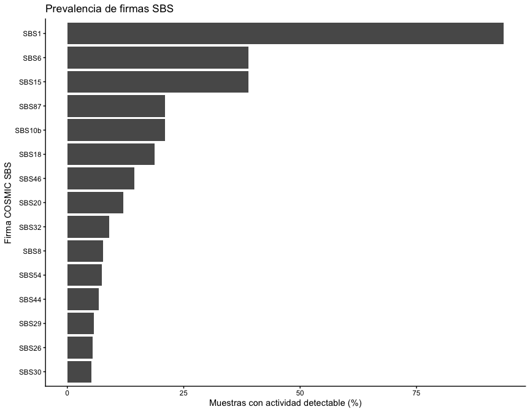
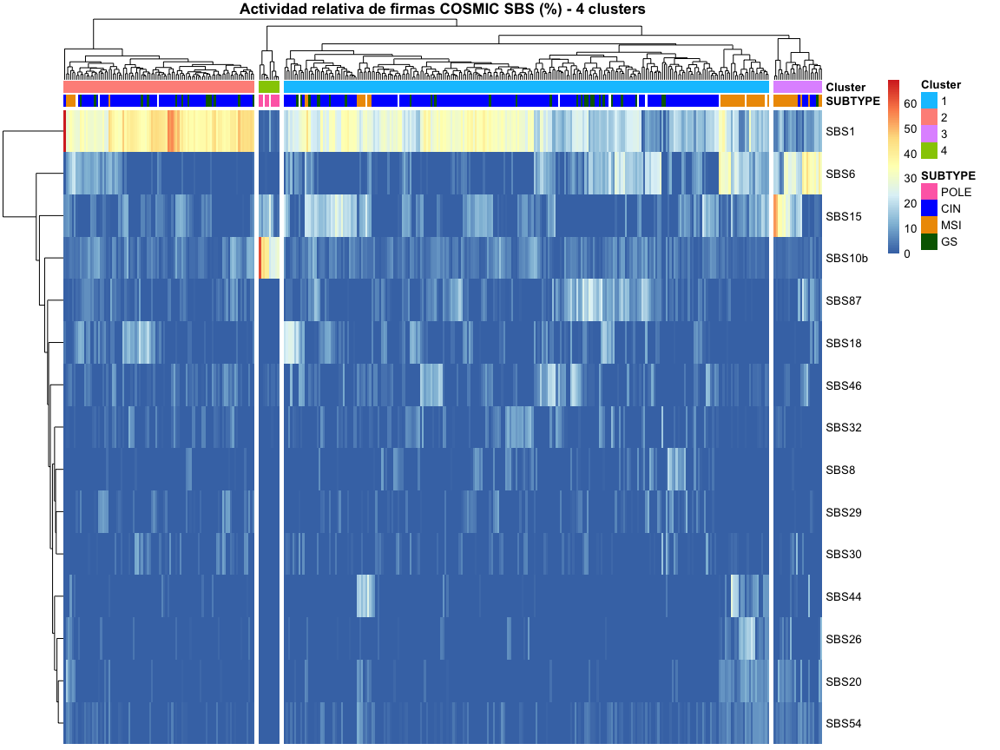
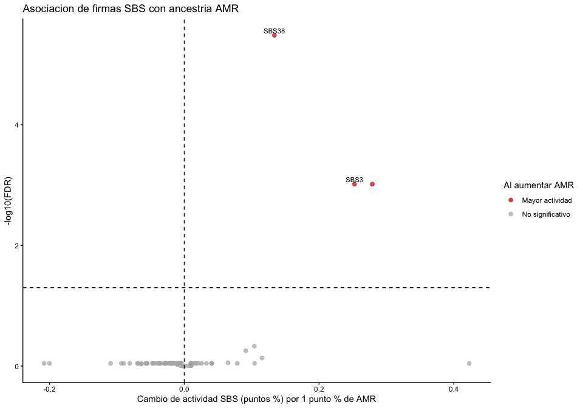

``` r
# install.packages(c("BiocManager", "tidyverse", "sigminer", "nnls", "pheatmap"))
# BiocManager::install(c("maftools", "BSgenome.Hsapiens.UCSC.hg19"))

library(BiocManager)
```

```
## Bioconductor version '3.20' is out-of-date; the current release version '3.23'
##   is available with R version '4.6'; see https://bioconductor.org/install
```

``` r
library(tidyverse)
```

```
## ── Attaching core tidyverse packages ──────────────────────── tidyverse 2.0.0 ──
## ✔ dplyr     1.1.4     ✔ readr     2.1.6
## ✔ forcats   1.0.1     ✔ stringr   1.6.0
## ✔ ggplot2   4.0.1     ✔ tibble    3.3.0
## ✔ lubridate 1.9.4     ✔ tidyr     1.3.1
## ✔ purrr     1.2.1
```

```
## ── Conflicts ────────────────────────────────────────── tidyverse_conflicts() ──
## ✖ dplyr::filter() masks stats::filter()
## ✖ dplyr::lag()    masks stats::lag()
## ℹ Use the conflicted package (<http://conflicted.r-lib.org/>) to force all conflicts to become errors
```

``` r
library(maftools)
library(sigminer)
```

```
## Registered S3 method overwritten by 'sigminer':
##   method      from
##   print.bytes Rcpp
## sigminer version 2.3.1
## - Star me at https://github.com/ShixiangWang/sigminer
## - Run hello() to see usage and citation.
## 
## Attaching package: 'sigminer'
## 
## The following object is masked from 'package:maftools':
## 
##     MAF
```

``` r
library(BSgenome.Hsapiens.UCSC.hg19)
```

```
## Loading required package: BSgenome
## Loading required package: S4Vectors
## Loading required package: stats4
## 
## Attaching package: 'S4Vectors'
## 
## The following objects are masked from 'package:lubridate':
## 
##     second, second<-
## 
## The following objects are masked from 'package:dplyr':
## 
##     first, rename
## 
## The following object is masked from 'package:tidyr':
## 
##     expand
## 
## The following object is masked from 'package:utils':
## 
##     findMatches
## 
## The following objects are masked from 'package:base':
## 
##     expand.grid, I, unname
## 
## Loading required package: IRanges
## 
## Attaching package: 'IRanges'
## 
## The following object is masked from 'package:lubridate':
## 
##     %within%
## 
## The following objects are masked from 'package:dplyr':
## 
##     collapse, desc, slice
## 
## The following object is masked from 'package:purrr':
## 
##     reduce
## 
## Loading required package: GenomeInfoDb
## Loading required package: GenomicRanges
## Loading required package: Biostrings
## Loading required package: XVector
## 
## Attaching package: 'XVector'
## 
## The following object is masked from 'package:purrr':
## 
##     compact
## 
## 
## Attaching package: 'Biostrings'
## 
## The following object is masked from 'package:base':
## 
##     strsplit
## 
## Loading required package: BiocIO
## Loading required package: rtracklayer
## 
## Attaching package: 'rtracklayer'
## 
## The following object is masked from 'package:BiocIO':
## 
##     FileForFormat
```

``` r
library(pheatmap)

packageVersion("BiocManager")
```

```
## [1] '1.30.27'
```

``` r
packageVersion("tidyverse")
```

```
## [1] '2.0.0'
```

``` r
packageVersion("maftools")
```

```
## [1] '2.22.0'
```

``` r
packageVersion("sigminer")
```

```
## [1] '2.3.1'
```

``` r
packageVersion("nnls")
```

```
## [1] '1.6'
```

``` r
packageVersion("BSgenome.Hsapiens.UCSC.hg19")
```

```
## [1] '1.4.3'
```

``` r
packageVersion("pheatmap")
```

```
## [1] '1.0.13'
```

# Datos y filtros


``` r
data_mutations <- read_tsv("../files/data_mutations.txt", show_col_types = FALSE)
data_clinical_sample <- read_tsv("../files/data_clinical_sample.txt",
                                 comment = "#", show_col_types = FALSE)
data_clinical_patient <- read_tsv("../files/data_clinical_patient.txt",
                                  comment = "#", show_col_types = FALSE)

head(data_mutations)
```

```
## # A tibble: 6 × 114
##   Hugo_Symbol Entrez_Gene_Id Center NCBI_Build Chromosome Start_Position
##   <chr>                <dbl> <chr>  <chr>      <chr>               <dbl>
## 1 DMBT1                 1755 .      GRCh37     10              124399948
## 2 C10orf90            118611 .      GRCh37     10              128193330
## 3 WDFY4                57705 .      GRCh37     10               49997997
## 4 PRKCQ                 5588 .      GRCh37     10                6533674
## 5 DYNC2H1              79659 .      GRCh37     11              103153768
## 6 SPON1                10418 .      GRCh37     11               13984681
## # ℹ 108 more variables: End_Position <dbl>, Strand <chr>, Consequence <chr>,
## #   Variant_Classification <chr>, Variant_Type <chr>, Reference_Allele <chr>,
## #   Tumor_Seq_Allele1 <chr>, Tumor_Seq_Allele2 <chr>, dbSNP_RS <chr>,
## #   dbSNP_Val_Status <chr>, Tumor_Sample_Barcode <chr>,
## #   Matched_Norm_Sample_Barcode <chr>, Match_Norm_Seq_Allele1 <chr>,
## #   Match_Norm_Seq_Allele2 <chr>, Tumor_Validation_Allele1 <chr>,
## #   Tumor_Validation_Allele2 <chr>, Match_Norm_Validation_Allele1 <chr>, …
```

``` r
head(data_clinical_sample)
```

```
## # A tibble: 6 × 19
##   PATIENT_ID SAMPLE_ID ONCOTREE_CODE CANCER_TYPE CANCER_TYPE_DETAILED TUMOR_TYPE
##   <chr>      <chr>     <chr>         <chr>       <chr>                <chr>     
## 1 TCGA-AF-2… TCGA-AF-… READ          Colorectal… Rectal Adenocarcino… Rectal Ad…
## 2 TCGA-AF-2… TCGA-AF-… READ          Colorectal… Rectal Adenocarcino… Rectal Ad…
## 3 TCGA-AF-2… TCGA-AF-… READ          Colorectal… Rectal Adenocarcino… Rectal Ad…
## 4 TCGA-AF-2… TCGA-AF-… READ          Colorectal… Rectal Adenocarcino… Rectal Ad…
## 5 TCGA-AF-2… TCGA-AF-… READ          Colorectal… Rectal Adenocarcino… Rectum Ad…
## 6 TCGA-AF-2… TCGA-AF-… READ          Colorectal… Rectal Adenocarcino… Rectum Ad…
## # ℹ 13 more variables: GRADE <lgl>,
## #   TISSUE_PROSPECTIVE_COLLECTION_INDICATOR <chr>,
## #   TISSUE_RETROSPECTIVE_COLLECTION_INDICATOR <chr>,
## #   TISSUE_SOURCE_SITE_CODE <chr>, TUMOR_TISSUE_SITE <chr>,
## #   ANEUPLOIDY_SCORE <dbl>, SAMPLE_TYPE <chr>, MSI_SCORE_MANTIS <dbl>,
## #   MSI_SENSOR_SCORE <dbl>, SOMATIC_STATUS <chr>, TMB_NONSYNONYMOUS <dbl>,
## #   TISSUE_SOURCE_SITE <chr>, TBL_SCORE <dbl>
```

``` r
head(data_clinical_patient)
```

```
## # A tibble: 6 × 38
##   PATIENT_ID   SUBTYPE  CANCER_TYPE_ACRONYM OTHER_PATIENT_ID           AGE SEX  
##   <chr>        <chr>    <chr>               <chr>                    <dbl> <chr>
## 1 TCGA-3L-AA1B COAD_CIN COAD                A94E1279-A975-480A-93E9…    61 Fema…
## 2 TCGA-4N-A93T COAD_CIN COAD                92554413-9EBC-4354-8E1B…    67 Male 
## 3 TCGA-4T-AA8H COAD_CIN COAD                A5E14ADD-1552-4606-9FFE…    42 Fema…
## 4 TCGA-5M-AAT4 COAD_CIN COAD                1136DD50-242A-4659-AAD4…    74 Male 
## 5 TCGA-5M-AAT6 COAD_MSI COAD                CE00896A-F7D2-4123-BB95…    40 Fema…
## 6 TCGA-5M-AATE COAD_CIN COAD                A54B322B-80D3-435C-8D14…    76 Male 
## # ℹ 32 more variables: AJCC_PATHOLOGIC_TUMOR_STAGE <chr>,
## #   AJCC_STAGING_EDITION <chr>, DAYS_LAST_FOLLOWUP <dbl>, DAYS_TO_BIRTH <dbl>,
## #   DAYS_TO_INITIAL_PATHOLOGIC_DIAGNOSIS <dbl>, ETHNICITY <chr>,
## #   FORM_COMPLETION_DATE <chr>, HISTORY_NEOADJUVANT_TRTYN <chr>, ICD_10 <chr>,
## #   ICD_O_3_HISTOLOGY <chr>, ICD_O_3_SITE <chr>,
## #   INFORMED_CONSENT_VERIFIED <chr>,
## #   NEW_TUMOR_EVENT_AFTER_INITIAL_TREATMENT <chr>, PATH_M_STAGE <chr>, …
```


``` r
muestras_evaluadas <- data_mutations %>%
  distinct(Tumor_Sample_Barcode)

metadata <- data_clinical_sample %>%
  mutate(Tumor_Sample_Barcode = SAMPLE_ID) %>%
  semi_join(muestras_evaluadas, by = "Tumor_Sample_Barcode") %>%
  left_join(data_clinical_patient, by = "PATIENT_ID")

head(metadata)
```

```
## # A tibble: 6 × 57
##   PATIENT_ID SAMPLE_ID ONCOTREE_CODE CANCER_TYPE CANCER_TYPE_DETAILED TUMOR_TYPE
##   <chr>      <chr>     <chr>         <chr>       <chr>                <chr>     
## 1 TCGA-AF-2… TCGA-AF-… READ          Colorectal… Rectal Adenocarcino… Rectal Ad…
## 2 TCGA-AF-2… TCGA-AF-… READ          Colorectal… Rectal Adenocarcino… Rectal Ad…
## 3 TCGA-AF-2… TCGA-AF-… READ          Colorectal… Rectal Adenocarcino… Rectal Ad…
## 4 TCGA-AF-2… TCGA-AF-… READ          Colorectal… Rectal Adenocarcino… Rectal Ad…
## 5 TCGA-AF-2… TCGA-AF-… READ          Colorectal… Rectal Adenocarcino… Rectum Ad…
## 6 TCGA-AF-2… TCGA-AF-… READ          Colorectal… Rectal Adenocarcino… Rectum Ad…
## # ℹ 51 more variables: GRADE <lgl>,
## #   TISSUE_PROSPECTIVE_COLLECTION_INDICATOR <chr>,
## #   TISSUE_RETROSPECTIVE_COLLECTION_INDICATOR <chr>,
## #   TISSUE_SOURCE_SITE_CODE <chr>, TUMOR_TISSUE_SITE <chr>,
## #   ANEUPLOIDY_SCORE <dbl>, SAMPLE_TYPE <chr>, MSI_SCORE_MANTIS <dbl>,
## #   MSI_SENSOR_SCORE <dbl>, SOMATIC_STATUS <chr>, TMB_NONSYNONYMOUS <dbl>,
## #   TISSUE_SOURCE_SITE <chr>, TBL_SCORE <dbl>, Tumor_Sample_Barcode <chr>, …
```


``` r
data_wgd <- read_tsv("../files/wgd_tcga.tsv", show_col_types = FALSE) %>%
  select(Tumor_Sample_Barcode = array, WGD = `Genome doublings`, purity) %>%
  mutate(WGD = WGD > 0)

metadata <- metadata %>%
  left_join(data_wgd, by = "Tumor_Sample_Barcode")

head(metadata)
```

```
## # A tibble: 6 × 59
##   PATIENT_ID SAMPLE_ID ONCOTREE_CODE CANCER_TYPE CANCER_TYPE_DETAILED TUMOR_TYPE
##   <chr>      <chr>     <chr>         <chr>       <chr>                <chr>     
## 1 TCGA-AF-2… TCGA-AF-… READ          Colorectal… Rectal Adenocarcino… Rectal Ad…
## 2 TCGA-AF-2… TCGA-AF-… READ          Colorectal… Rectal Adenocarcino… Rectal Ad…
## 3 TCGA-AF-2… TCGA-AF-… READ          Colorectal… Rectal Adenocarcino… Rectal Ad…
## 4 TCGA-AF-2… TCGA-AF-… READ          Colorectal… Rectal Adenocarcino… Rectal Ad…
## 5 TCGA-AF-2… TCGA-AF-… READ          Colorectal… Rectal Adenocarcino… Rectum Ad…
## 6 TCGA-AF-2… TCGA-AF-… READ          Colorectal… Rectal Adenocarcino… Rectum Ad…
## # ℹ 53 more variables: GRADE <lgl>,
## #   TISSUE_PROSPECTIVE_COLLECTION_INDICATOR <chr>,
## #   TISSUE_RETROSPECTIVE_COLLECTION_INDICATOR <chr>,
## #   TISSUE_SOURCE_SITE_CODE <chr>, TUMOR_TISSUE_SITE <chr>,
## #   ANEUPLOIDY_SCORE <dbl>, SAMPLE_TYPE <chr>, MSI_SCORE_MANTIS <dbl>,
## #   MSI_SENSOR_SCORE <dbl>, SOMATIC_STATUS <chr>, TMB_NONSYNONYMOUS <dbl>,
## #   TISSUE_SOURCE_SITE <chr>, TBL_SCORE <dbl>, Tumor_Sample_Barcode <chr>, …
```


``` r
table(data_mutations$FILTER, useNA = "ifany")
```

```
## 
##                            common_in_exac 
##                                      2640 
##                  common_in_exac,gapfiller 
##                                        14 
##   common_in_exac,gapfiller,native_wga_mix 
##                                         3 
## common_in_exac,gapfiller,nonpreferredpair 
##                                         3 
##             common_in_exac,native_wga_mix 
##                                        93 
##           common_in_exac,nonpreferredpair 
##                                       155 
##                        common_in_exac,wga 
##                                       632 
##                                 gapfiller 
##                                       902 
##                  gapfiller,native_wga_mix 
##                                        99 
##             gapfiller,native_wga_mix,oxog 
##                                         3 
##                gapfiller,nonpreferredpair 
##                                       370 
##           gapfiller,nonpreferredpair,oxog 
##                                         2 
##                            gapfiller,oxog 
##                                         9 
##                            native_wga_mix 
##                                      5549 
##           native_wga_mix,nonpreferredpair 
##                                        17 
##                          nonpreferredpair 
##                                     13536 
##                     nonpreferredpair,oxog 
##                                        11 
##                                      oxog 
##                                      1308 
##                                  oxog,wga 
##                                         1 
##                                      PASS 
##                                    247018 
##                            StrandBias,wga 
##                                        31 
##                                       wga 
##                                     60214
```

``` r
data_mutations <- data_mutations %>%
  filter(FILTER == "PASS")
```


``` r
data_mutations <- data_mutations %>%
  filter(Chromosome %in% as.character(1:22))
```


``` r
metadata <- metadata %>%
  mutate(SUBTYPE = str_remove(SUBTYPE, "^(COAD|READ)_"))
```


``` r
maf <- read.maf(maf = data_mutations, clinicalData = metadata)
```

```
## -Validating
## -Silent variants: 83654 
## -Summarizing
## --Possible FLAGS among top ten genes:
##   TTN
##   SYNE1
##   MUC16
##   OBSCN
## -Processing clinical data
## -Finished in 5.887s elapsed (6.939s cpu)
```

# SBS


``` r
# Matriz de 96 contextos usando el MAF ya generado.
tri <- trinucleotideMatrix(
  maf = maf,
  ref_genome = "BSgenome.Hsapiens.UCSC.hg19",
  prefix = "chr", add = TRUE, useSyn = TRUE
)
```

```
## -Extracting 5' and 3' adjacent bases
## -Extracting +/- 20bp around mutated bases for background C>T estimation
## -Estimating APOBEC enrichment scores
## --Performing one-way Fisher's test for APOBEC enrichment
## ---APOBEC related mutations are enriched in  0.272 % of samples (APOBEC enrichment score > 2 ;  1  of  367  samples)
## -Creating mutation matrix
## --matrix of dimension 367x96
```

``` r
sbs96 <- t(tri$nmf_matrix)

# Ajustar todas las firmas COSMIC SBS por NNLS.
fit <- sig_fit(
  catalogue_matrix = sbs96,
  sig_index = "ALL", sig_db = "SBS", db_type = "human-exome",
  method = "NNLS", type = "absolute",
  return_error = TRUE, show_index = FALSE
)
```

```
## ℹ [2026-10-14 10:36:12.837325]: Started.
```

```
## ✔ [2026-10-14 10:36:12.842109]: Signature index detected.
```

```
## ℹ [2026-10-14 10:36:12.843051]: Checking signature database in package.
```

```
## ℹ [2026-10-14 10:36:12.847641]: Checking signature index.
```

```
## ✔ [2026-10-14 10:36:12.848877]: Database and index checked.
```

```
## ✔ [2026-10-14 10:36:12.850064]: Signature normalized.
```

```
## ℹ [2026-10-14 10:36:12.850965]: Checking row number for catalog matrix and signature matrix.
```

```
## ✔ [2026-10-14 10:36:12.852025]: Checked.
```

```
## ℹ [2026-10-14 10:36:12.852941]: Checking rownames for catalog matrix and signature matrix.
```

```
## ℹ [2026-10-14 10:36:12.853819]: Matrix V and W don't have same orders. Try reordering...
```

```
## ✔ [2026-10-14 10:36:12.854943]: Checked.
```

```
## ✔ [2026-10-14 10:36:12.855987]: Method 'NNLS' detected.
```

```
## ✔ [2026-10-14 10:36:12.892475]: Corresponding function generated.
```

```
## ℹ [2026-10-14 10:36:12.893844]: Calling function.
```

```
## ℹ [2026-10-14 10:36:12.896205]: Fitting sample: TCGA-3L-AA1B-01
```

```
## ℹ [2026-10-14 10:36:12.898435]: Fitting sample: TCGA-4N-A93T-01
```

```
## ℹ [2026-10-14 10:36:12.89988]: Fitting sample: TCGA-4T-AA8H-01
```

```
## ℹ [2026-10-14 10:36:12.901286]: Fitting sample: TCGA-5M-AAT4-01
```

```
## ℹ [2026-10-14 10:36:12.902805]: Fitting sample: TCGA-5M-AAT5-01
```

```
## ℹ [2026-10-14 10:36:12.904204]: Fitting sample: TCGA-5M-AAT6-01
```

```
## ℹ [2026-10-14 10:36:12.905528]: Fitting sample: TCGA-5M-AATA-01
```

```
## ℹ [2026-10-14 10:36:12.906809]: Fitting sample: TCGA-5M-AATE-01
```

```
## ℹ [2026-10-14 10:36:12.908129]: Fitting sample: TCGA-A6-2671-01
```

```
## ℹ [2026-10-14 10:36:12.90947]: Fitting sample: TCGA-A6-2674-01
```

```
## ℹ [2026-10-14 10:36:12.911971]: Fitting sample: TCGA-A6-2675-01
```

```
## ℹ [2026-10-14 10:36:12.913271]: Fitting sample: TCGA-A6-2677-01
```

```
## ℹ [2026-10-14 10:36:12.914658]: Fitting sample: TCGA-A6-2681-01
```

```
## ℹ [2026-10-14 10:36:12.91603]: Fitting sample: TCGA-A6-2684-01
```

```
## ℹ [2026-10-14 10:36:12.917289]: Fitting sample: TCGA-A6-2685-01
```

```
## ℹ [2026-10-14 10:36:12.918708]: Fitting sample: TCGA-A6-2686-01
```

```
## ℹ [2026-10-14 10:36:12.920133]: Fitting sample: TCGA-A6-3809-01
```

```
## ℹ [2026-10-14 10:36:12.92154]: Fitting sample: TCGA-A6-3810-01
```

```
## ℹ [2026-10-14 10:36:12.922871]: Fitting sample: TCGA-A6-4105-01
```

```
## ℹ [2026-10-14 10:36:12.924168]: Fitting sample: TCGA-A6-4107-01
```

```
## ℹ [2026-10-14 10:36:12.925467]: Fitting sample: TCGA-A6-5656-01
```

```
## ℹ [2026-10-14 10:36:12.926764]: Fitting sample: TCGA-A6-5657-01
```

```
## ℹ [2026-10-14 10:36:12.928064]: Fitting sample: TCGA-A6-5659-01
```

```
## ℹ [2026-10-14 10:36:12.929347]: Fitting sample: TCGA-A6-5660-01
```

```
## ℹ [2026-10-14 10:36:12.930653]: Fitting sample: TCGA-A6-5661-01
```

```
## ℹ [2026-10-14 10:36:12.931954]: Fitting sample: TCGA-A6-5662-01
```

```
## ℹ [2026-10-14 10:36:12.933209]: Fitting sample: TCGA-A6-5664-01
```

```
## ℹ [2026-10-14 10:36:12.9345]: Fitting sample: TCGA-A6-5665-01
```

```
## ℹ [2026-10-14 10:36:12.935916]: Fitting sample: TCGA-A6-5666-01
```

```
## ℹ [2026-10-14 10:36:12.937174]: Fitting sample: TCGA-A6-5667-01
```

```
## ℹ [2026-10-14 10:36:12.938406]: Fitting sample: TCGA-A6-6137-01
```

```
## ℹ [2026-10-14 10:36:12.939694]: Fitting sample: TCGA-A6-6138-01
```

```
## ℹ [2026-10-14 10:36:12.940996]: Fitting sample: TCGA-A6-6142-01
```

```
## ℹ [2026-10-14 10:36:12.942268]: Fitting sample: TCGA-A6-6648-01
```

```
## ℹ [2026-10-14 10:36:12.943493]: Fitting sample: TCGA-A6-6649-01
```

```
## ℹ [2026-10-14 10:36:12.944745]: Fitting sample: TCGA-A6-6651-01
```

```
## ℹ [2026-10-14 10:36:12.946008]: Fitting sample: TCGA-A6-6652-01
```

```
## ℹ [2026-10-14 10:36:12.947284]: Fitting sample: TCGA-A6-6653-01
```

```
## ℹ [2026-10-14 10:36:12.948618]: Fitting sample: TCGA-A6-6654-01
```

```
## ℹ [2026-10-14 10:36:12.949849]: Fitting sample: TCGA-A6-6780-01
```

```
## ℹ [2026-10-14 10:36:12.951226]: Fitting sample: TCGA-A6-6781-01
```

```
## ℹ [2026-10-14 10:36:12.952743]: Fitting sample: TCGA-A6-6782-01
```

```
## ℹ [2026-10-14 10:36:12.95407]: Fitting sample: TCGA-A6-A565-01
```

```
## ℹ [2026-10-14 10:36:12.955429]: Fitting sample: TCGA-A6-A566-01
```

```
## ℹ [2026-10-14 10:36:12.956813]: Fitting sample: TCGA-A6-A567-01
```

```
## ℹ [2026-10-14 10:36:12.958139]: Fitting sample: TCGA-A6-A56B-01
```

```
## ℹ [2026-10-14 10:36:12.959454]: Fitting sample: TCGA-AA-3489-01
```

```
## ℹ [2026-10-14 10:36:12.9609]: Fitting sample: TCGA-AA-3492-01
```

```
## ℹ [2026-10-14 10:36:12.962329]: Fitting sample: TCGA-AA-3496-01
```

```
## ℹ [2026-10-14 10:36:12.963807]: Fitting sample: TCGA-AA-3502-01
```

```
## ℹ [2026-10-14 10:36:12.966609]: Fitting sample: TCGA-AA-3506-01
```

```
## ℹ [2026-10-14 10:36:12.967947]: Fitting sample: TCGA-AA-3510-01
```

```
## ℹ [2026-10-14 10:36:12.969337]: Fitting sample: TCGA-AA-3511-01
```

```
## ℹ [2026-10-14 10:36:12.97065]: Fitting sample: TCGA-AA-3522-01
```

```
## ℹ [2026-10-14 10:36:12.971822]: Fitting sample: TCGA-AA-3655-01
```

```
## ℹ [2026-10-14 10:36:12.973417]: Fitting sample: TCGA-AA-3660-01
```

```
## ℹ [2026-10-14 10:36:12.974774]: Fitting sample: TCGA-AA-3663-01
```

```
## ℹ [2026-10-14 10:36:12.976151]: Fitting sample: TCGA-AA-3712-01
```

```
## ℹ [2026-10-14 10:36:12.977415]: Fitting sample: TCGA-AA-3713-01
```

```
## ℹ [2026-10-14 10:36:12.978784]: Fitting sample: TCGA-AA-3947-01
```

```
## ℹ [2026-10-14 10:36:12.980127]: Fitting sample: TCGA-AA-3984-01
```

```
## ℹ [2026-10-14 10:36:12.981348]: Fitting sample: TCGA-AA-A00N-01
```

```
## ℹ [2026-10-14 10:36:12.98251]: Fitting sample: TCGA-AA-A010-01
```

```
## ℹ [2026-10-14 10:36:12.983753]: Fitting sample: TCGA-AA-A01P-01
```

```
## ℹ [2026-10-14 10:36:12.98511]: Fitting sample: TCGA-AA-A01R-01
```

```
## ℹ [2026-10-14 10:36:12.986534]: Fitting sample: TCGA-AA-A022-01
```

```
## ℹ [2026-10-14 10:36:12.987844]: Fitting sample: TCGA-AD-5900-01
```

```
## ℹ [2026-10-14 10:36:12.989121]: Fitting sample: TCGA-AD-6548-01
```

```
## ℹ [2026-10-14 10:36:12.990363]: Fitting sample: TCGA-AD-6888-01
```

```
## ℹ [2026-10-14 10:36:12.991643]: Fitting sample: TCGA-AD-6889-01
```

```
## ℹ [2026-10-14 10:36:12.992984]: Fitting sample: TCGA-AD-6890-01
```

```
## ℹ [2026-10-14 10:36:12.994276]: Fitting sample: TCGA-AD-6895-01
```

```
## ℹ [2026-10-14 10:36:12.995664]: Fitting sample: TCGA-AD-6899-01
```

```
## ℹ [2026-10-14 10:36:12.996962]: Fitting sample: TCGA-AD-6901-01
```

```
## ℹ [2026-10-14 10:36:12.998256]: Fitting sample: TCGA-AD-6963-01
```

```
## ℹ [2026-10-14 10:36:12.999463]: Fitting sample: TCGA-AD-6964-01
```

```
## ℹ [2026-10-14 10:36:13.000746]: Fitting sample: TCGA-AD-6965-01
```

```
## ℹ [2026-10-14 10:36:13.002437]: Fitting sample: TCGA-AD-A5EJ-01
```

```
## ℹ [2026-10-14 10:36:13.004241]: Fitting sample: TCGA-AD-A5EK-01
```

```
## ℹ [2026-10-14 10:36:13.005927]: Fitting sample: TCGA-AF-2687-01
```

```
## ℹ [2026-10-14 10:36:13.007631]: Fitting sample: TCGA-AF-2690-01
```

```
## ℹ [2026-10-14 10:36:13.010992]: Fitting sample: TCGA-AF-2693-01
```

```
## ℹ [2026-10-14 10:36:13.013209]: Fitting sample: TCGA-AF-3911-01
```

```
## ℹ [2026-10-14 10:36:13.015455]: Fitting sample: TCGA-AF-4110-01
```

```
## ℹ [2026-10-14 10:36:13.017639]: Fitting sample: TCGA-AF-5654-01
```

```
## ℹ [2026-10-14 10:36:13.020268]: Fitting sample: TCGA-AF-6136-01
```

```
## ℹ [2026-10-14 10:36:13.021817]: Fitting sample: TCGA-AF-6655-01
```

```
## ℹ [2026-10-14 10:36:13.023284]: Fitting sample: TCGA-AF-6672-01
```

```
## ℹ [2026-10-14 10:36:13.024873]: Fitting sample: TCGA-AF-A56K-01
```

```
## ℹ [2026-10-14 10:36:13.026295]: Fitting sample: TCGA-AF-A56L-01
```

```
## ℹ [2026-10-14 10:36:13.027577]: Fitting sample: TCGA-AF-A56N-01
```

```
## ℹ [2026-10-14 10:36:13.028994]: Fitting sample: TCGA-AG-3591-01
```

```
## ℹ [2026-10-14 10:36:13.030497]: Fitting sample: TCGA-AG-3592-01
```

```
## ℹ [2026-10-14 10:36:13.033669]: Fitting sample: TCGA-AG-3725-01
```

```
## ℹ [2026-10-14 10:36:13.035528]: Fitting sample: TCGA-AG-3731-01
```

```
## ℹ [2026-10-14 10:36:13.037287]: Fitting sample: TCGA-AG-3732-01
```

```
## ℹ [2026-10-14 10:36:13.038978]: Fitting sample: TCGA-AG-3742-01
```

```
## ℹ [2026-10-14 10:36:13.040633]: Fitting sample: TCGA-AG-4021-01
```

```
## ℹ [2026-10-14 10:36:13.042314]: Fitting sample: TCGA-AG-4022-01
```

```
## ℹ [2026-10-14 10:36:13.044098]: Fitting sample: TCGA-AH-6544-01
```

```
## ℹ [2026-10-14 10:36:13.049358]: Fitting sample: TCGA-AH-6547-01
```

```
## ℹ [2026-10-14 10:36:13.05102]: Fitting sample: TCGA-AH-6643-01
```

```
## ℹ [2026-10-14 10:36:13.052853]: Fitting sample: TCGA-AH-6644-01
```

```
## ℹ [2026-10-14 10:36:13.054782]: Fitting sample: TCGA-AH-6897-01
```

```
## ℹ [2026-10-14 10:36:13.056542]: Fitting sample: TCGA-AH-6903-01
```

```
## ℹ [2026-10-14 10:36:13.062599]: Fitting sample: TCGA-AM-5820-01
```

```
## ℹ [2026-10-14 10:36:13.064455]: Fitting sample: TCGA-AM-5821-01
```

```
## ℹ [2026-10-14 10:36:13.066426]: Fitting sample: TCGA-AU-3779-01
```

```
## ℹ [2026-10-14 10:36:13.068337]: Fitting sample: TCGA-AU-6004-01
```

```
## ℹ [2026-10-14 10:36:13.070347]: Fitting sample: TCGA-AY-5543-01
```

```
## ℹ [2026-10-14 10:36:13.072092]: Fitting sample: TCGA-AY-6196-01
```

```
## ℹ [2026-10-14 10:36:13.077148]: Fitting sample: TCGA-AY-6197-01
```

```
## ℹ [2026-10-14 10:36:13.081368]: Fitting sample: TCGA-AY-6386-01
```

```
## ℹ [2026-10-14 10:36:13.083079]: Fitting sample: TCGA-AY-A54L-01
```

```
## ℹ [2026-10-14 10:36:13.084968]: Fitting sample: TCGA-AY-A69D-01
```

```
## ℹ [2026-10-14 10:36:13.086771]: Fitting sample: TCGA-AY-A71X-01
```

```
## ℹ [2026-10-14 10:36:13.088502]: Fitting sample: TCGA-AY-A8YK-01
```

```
## ℹ [2026-10-14 10:36:13.090104]: Fitting sample: TCGA-AZ-4308-01
```

```
## ℹ [2026-10-14 10:36:13.095036]: Fitting sample: TCGA-AZ-4315-01
```

```
## ℹ [2026-10-14 10:36:13.096576]: Fitting sample: TCGA-AZ-4323-01
```

```
## ℹ [2026-10-14 10:36:13.098293]: Fitting sample: TCGA-AZ-4614-01
```

```
## ℹ [2026-10-14 10:36:13.100144]: Fitting sample: TCGA-AZ-4615-01
```

```
## ℹ [2026-10-14 10:36:13.101987]: Fitting sample: TCGA-AZ-4616-01
```

```
## ℹ [2026-10-14 10:36:13.103743]: Fitting sample: TCGA-AZ-4681-01
```

```
## ℹ [2026-10-14 10:36:13.107518]: Fitting sample: TCGA-AZ-4682-01
```

```
## ℹ [2026-10-14 10:36:13.111507]: Fitting sample: TCGA-AZ-5403-01
```

```
## ℹ [2026-10-14 10:36:13.113746]: Fitting sample: TCGA-AZ-5407-01
```

```
## ℹ [2026-10-14 10:36:13.115215]: Fitting sample: TCGA-AZ-6598-01
```

```
## ℹ [2026-10-14 10:36:13.116955]: Fitting sample: TCGA-AZ-6599-01
```

```
## ℹ [2026-10-14 10:36:13.118801]: Fitting sample: TCGA-AZ-6600-01
```

```
## ℹ [2026-10-14 10:36:13.120644]: Fitting sample: TCGA-AZ-6603-01
```

```
## ℹ [2026-10-14 10:36:13.123605]: Fitting sample: TCGA-AZ-6605-01
```

```
## ℹ [2026-10-14 10:36:13.125847]: Fitting sample: TCGA-AZ-6606-01
```

```
## ℹ [2026-10-14 10:36:13.127356]: Fitting sample: TCGA-AZ-6607-01
```

```
## ℹ [2026-10-14 10:36:13.128822]: Fitting sample: TCGA-CA-5254-01
```

```
## ℹ [2026-10-14 10:36:13.13058]: Fitting sample: TCGA-CA-5255-01
```

```
## ℹ [2026-10-14 10:36:13.132303]: Fitting sample: TCGA-CA-5256-01
```

```
## ℹ [2026-10-14 10:36:13.135562]: Fitting sample: TCGA-CA-5796-01
```

```
## ℹ [2026-10-14 10:36:13.138951]: Fitting sample: TCGA-CA-5797-01
```

```
## ℹ [2026-10-14 10:36:13.141353]: Fitting sample: TCGA-CA-6715-01
```

```
## ℹ [2026-10-14 10:36:13.143173]: Fitting sample: TCGA-CA-6716-01
```

```
## ℹ [2026-10-14 10:36:13.144723]: Fitting sample: TCGA-CA-6717-01
```

```
## ℹ [2026-10-14 10:36:13.146299]: Fitting sample: TCGA-CA-6718-01
```

```
## ℹ [2026-10-14 10:36:13.148003]: Fitting sample: TCGA-CA-6719-01
```

```
## ℹ [2026-10-14 10:36:13.149672]: Fitting sample: TCGA-CI-6619-01
```

```
## ℹ [2026-10-14 10:36:13.151245]: Fitting sample: TCGA-CI-6620-01
```

```
## ℹ [2026-10-14 10:36:13.152898]: Fitting sample: TCGA-CI-6621-01
```

```
## ℹ [2026-10-14 10:36:13.154556]: Fitting sample: TCGA-CI-6622-01
```

```
## ℹ [2026-10-14 10:36:13.156203]: Fitting sample: TCGA-CI-6623-01
```

```
## ℹ [2026-10-14 10:36:13.157823]: Fitting sample: TCGA-CI-6624-01
```

```
## ℹ [2026-10-14 10:36:13.159352]: Fitting sample: TCGA-CK-4947-01
```

```
## ℹ [2026-10-14 10:36:13.160875]: Fitting sample: TCGA-CK-4948-01
```

```
## ℹ [2026-10-14 10:36:13.163079]: Fitting sample: TCGA-CK-4950-01
```

```
## ℹ [2026-10-14 10:36:13.165134]: Fitting sample: TCGA-CK-4951-01
```

```
## ℹ [2026-10-14 10:36:13.166745]: Fitting sample: TCGA-CK-4952-01
```

```
## ℹ [2026-10-14 10:36:13.168371]: Fitting sample: TCGA-CK-5912-01
```

```
## ℹ [2026-10-14 10:36:13.16986]: Fitting sample: TCGA-CK-5913-01
```

```
## ℹ [2026-10-14 10:36:13.171398]: Fitting sample: TCGA-CK-5914-01
```

```
## ℹ [2026-10-14 10:36:13.173763]: Fitting sample: TCGA-CK-5915-01
```

```
## ℹ [2026-10-14 10:36:13.175275]: Fitting sample: TCGA-CK-5916-01
```

```
## ℹ [2026-10-14 10:36:13.176939]: Fitting sample: TCGA-CK-6746-01
```

```
## ℹ [2026-10-14 10:36:13.178557]: Fitting sample: TCGA-CK-6747-01
```

```
## ℹ [2026-10-14 10:36:13.180096]: Fitting sample: TCGA-CK-6748-01
```

```
## ℹ [2026-10-14 10:36:13.181617]: Fitting sample: TCGA-CK-6751-01
```

```
## ℹ [2026-10-14 10:36:13.183112]: Fitting sample: TCGA-CL-4957-01
```

```
## ℹ [2026-10-14 10:36:13.184633]: Fitting sample: TCGA-CL-5917-01
```

```
## ℹ [2026-10-14 10:36:13.186235]: Fitting sample: TCGA-CL-5918-01
```

```
## ℹ [2026-10-14 10:36:13.188362]: Fitting sample: TCGA-CM-4743-01
```

```
## ℹ [2026-10-14 10:36:13.190762]: Fitting sample: TCGA-CM-4744-01
```

```
## ℹ [2026-10-14 10:36:13.193475]: Fitting sample: TCGA-CM-4746-01
```

```
## ℹ [2026-10-14 10:36:13.194998]: Fitting sample: TCGA-CM-4747-01
```

```
## ℹ [2026-10-14 10:36:13.196436]: Fitting sample: TCGA-CM-4748-01
```

```
## ℹ [2026-10-14 10:36:13.19827]: Fitting sample: TCGA-CM-4750-01
```

```
## ℹ [2026-10-14 10:36:13.199966]: Fitting sample: TCGA-CM-4751-01
```

```
## ℹ [2026-10-14 10:36:13.201657]: Fitting sample: TCGA-CM-4752-01
```

```
## ℹ [2026-10-14 10:36:13.204881]: Fitting sample: TCGA-CM-5341-01
```

```
## ℹ [2026-10-14 10:36:13.208989]: Fitting sample: TCGA-CM-5344-01
```

```
## ℹ [2026-10-14 10:36:13.212425]: Fitting sample: TCGA-CM-5348-01
```

```
## ℹ [2026-10-14 10:36:13.216289]: Fitting sample: TCGA-CM-5349-01
```

```
## ℹ [2026-10-14 10:36:13.218546]: Fitting sample: TCGA-CM-5860-01
```

```
## ℹ [2026-10-14 10:36:13.220033]: Fitting sample: TCGA-CM-5861-01
```

```
## ℹ [2026-10-14 10:36:13.221654]: Fitting sample: TCGA-CM-5862-01
```

```
## ℹ [2026-10-14 10:36:13.223158]: Fitting sample: TCGA-CM-5863-01
```

```
## ℹ [2026-10-14 10:36:13.224544]: Fitting sample: TCGA-CM-5864-01
```

```
## ℹ [2026-10-14 10:36:13.226112]: Fitting sample: TCGA-CM-5868-01
```

```
## ℹ [2026-10-14 10:36:13.228155]: Fitting sample: TCGA-CM-6161-01
```

```
## ℹ [2026-10-14 10:36:13.231958]: Fitting sample: TCGA-CM-6163-01
```

```
## ℹ [2026-10-14 10:36:13.235011]: Fitting sample: TCGA-CM-6164-01
```

```
## ℹ [2026-10-14 10:36:13.23633]: Fitting sample: TCGA-CM-6165-01
```

```
## ℹ [2026-10-14 10:36:13.237621]: Fitting sample: TCGA-CM-6166-01
```

```
## ℹ [2026-10-14 10:36:13.238865]: Fitting sample: TCGA-CM-6167-01
```

```
## ℹ [2026-10-14 10:36:13.240179]: Fitting sample: TCGA-CM-6168-01
```

```
## ℹ [2026-10-14 10:36:13.241472]: Fitting sample: TCGA-CM-6169-01
```

```
## ℹ [2026-10-14 10:36:13.24271]: Fitting sample: TCGA-CM-6170-01
```

```
## ℹ [2026-10-14 10:36:13.243994]: Fitting sample: TCGA-CM-6171-01
```

```
## ℹ [2026-10-14 10:36:13.245402]: Fitting sample: TCGA-CM-6172-01
```

```
## ℹ [2026-10-14 10:36:13.246762]: Fitting sample: TCGA-CM-6674-01
```

```
## ℹ [2026-10-14 10:36:13.247998]: Fitting sample: TCGA-CM-6675-01
```

```
## ℹ [2026-10-14 10:36:13.24952]: Fitting sample: TCGA-CM-6676-01
```

```
## ℹ [2026-10-14 10:36:13.251349]: Fitting sample: TCGA-CM-6677-01
```

```
## ℹ [2026-10-14 10:36:13.25269]: Fitting sample: TCGA-CM-6678-01
```

```
## ℹ [2026-10-14 10:36:13.254046]: Fitting sample: TCGA-CM-6679-01
```

```
## ℹ [2026-10-14 10:36:13.255327]: Fitting sample: TCGA-CM-6680-01
```

```
## ℹ [2026-10-14 10:36:13.256543]: Fitting sample: TCGA-D5-5537-01
```

```
## ℹ [2026-10-14 10:36:13.257855]: Fitting sample: TCGA-D5-5538-01
```

```
## ℹ [2026-10-14 10:36:13.259175]: Fitting sample: TCGA-D5-5539-01
```

```
## ℹ [2026-10-14 10:36:13.260485]: Fitting sample: TCGA-D5-5540-01
```

```
## ℹ [2026-10-14 10:36:13.261899]: Fitting sample: TCGA-D5-5541-01
```

```
## ℹ [2026-10-14 10:36:13.263423]: Fitting sample: TCGA-D5-6529-01
```

```
## ℹ [2026-10-14 10:36:13.264931]: Fitting sample: TCGA-D5-6530-01
```

```
## ℹ [2026-10-14 10:36:13.2663]: Fitting sample: TCGA-D5-6531-01
```

```
## ℹ [2026-10-14 10:36:13.267697]: Fitting sample: TCGA-D5-6532-01
```

```
## ℹ [2026-10-14 10:36:13.269041]: Fitting sample: TCGA-D5-6533-01
```

```
## ℹ [2026-10-14 10:36:13.270374]: Fitting sample: TCGA-D5-6534-01
```

```
## ℹ [2026-10-14 10:36:13.271741]: Fitting sample: TCGA-D5-6535-01
```

```
## ℹ [2026-10-14 10:36:13.273247]: Fitting sample: TCGA-D5-6536-01
```

```
## ℹ [2026-10-14 10:36:13.27475]: Fitting sample: TCGA-D5-6537-01
```

```
## ℹ [2026-10-14 10:36:13.276072]: Fitting sample: TCGA-D5-6538-01
```

```
## ℹ [2026-10-14 10:36:13.27751]: Fitting sample: TCGA-D5-6539-01
```

```
## ℹ [2026-10-14 10:36:13.279395]: Fitting sample: TCGA-D5-6540-01
```

```
## ℹ [2026-10-14 10:36:13.280789]: Fitting sample: TCGA-D5-6541-01
```

```
## ℹ [2026-10-14 10:36:13.282124]: Fitting sample: TCGA-D5-6898-01
```

```
## ℹ [2026-10-14 10:36:13.283662]: Fitting sample: TCGA-D5-6920-01
```

```
## ℹ [2026-10-14 10:36:13.285115]: Fitting sample: TCGA-D5-6922-01
```

```
## ℹ [2026-10-14 10:36:13.28649]: Fitting sample: TCGA-D5-6924-01
```

```
## ℹ [2026-10-14 10:36:13.287904]: Fitting sample: TCGA-D5-6926-01
```

```
## ℹ [2026-10-14 10:36:13.289383]: Fitting sample: TCGA-D5-6927-01
```

```
## ℹ [2026-10-14 10:36:13.29153]: Fitting sample: TCGA-D5-6928-01
```

```
## ℹ [2026-10-14 10:36:13.294858]: Fitting sample: TCGA-D5-6929-01
```

```
## ℹ [2026-10-14 10:36:13.296294]: Fitting sample: TCGA-D5-6930-01
```

```
## ℹ [2026-10-14 10:36:13.297666]: Fitting sample: TCGA-D5-6931-01
```

```
## ℹ [2026-10-14 10:36:13.299088]: Fitting sample: TCGA-D5-6932-01
```

```
## ℹ [2026-10-14 10:36:13.30062]: Fitting sample: TCGA-D5-7000-01
```

```
## ℹ [2026-10-14 10:36:13.302022]: Fitting sample: TCGA-DC-4745-01
```

```
## ℹ [2026-10-14 10:36:13.30339]: Fitting sample: TCGA-DC-4749-01
```

```
## ℹ [2026-10-14 10:36:13.304758]: Fitting sample: TCGA-DC-5337-01
```

```
## ℹ [2026-10-14 10:36:13.306087]: Fitting sample: TCGA-DC-5869-01
```

```
## ℹ [2026-10-14 10:36:13.307412]: Fitting sample: TCGA-DC-6154-01
```

```
## ℹ [2026-10-14 10:36:13.308825]: Fitting sample: TCGA-DC-6155-01
```

```
## ℹ [2026-10-14 10:36:13.310158]: Fitting sample: TCGA-DC-6157-01
```

```
## ℹ [2026-10-14 10:36:13.312017]: Fitting sample: TCGA-DC-6158-01
```

```
## ℹ [2026-10-14 10:36:13.314705]: Fitting sample: TCGA-DC-6160-01
```

```
## ℹ [2026-10-14 10:36:13.316058]: Fitting sample: TCGA-DC-6681-01
```

```
## ℹ [2026-10-14 10:36:13.317441]: Fitting sample: TCGA-DC-6682-01
```

```
## ℹ [2026-10-14 10:36:13.318979]: Fitting sample: TCGA-DC-6683-01
```

```
## ℹ [2026-10-14 10:36:13.320287]: Fitting sample: TCGA-DM-A0X9-01
```

```
## ℹ [2026-10-14 10:36:13.321621]: Fitting sample: TCGA-DM-A0XD-01
```

```
## ℹ [2026-10-14 10:36:13.322934]: Fitting sample: TCGA-DM-A0XF-01
```

```
## ℹ [2026-10-14 10:36:13.32428]: Fitting sample: TCGA-DM-A1D0-01
```

```
## ℹ [2026-10-14 10:36:13.325584]: Fitting sample: TCGA-DM-A1D4-01
```

```
## ℹ [2026-10-14 10:36:13.326971]: Fitting sample: TCGA-DM-A1D6-01
```

```
## ℹ [2026-10-14 10:36:13.32851]: Fitting sample: TCGA-DM-A1D7-01
```

```
## ℹ [2026-10-14 10:36:13.330242]: Fitting sample: TCGA-DM-A1D8-01
```

```
## ℹ [2026-10-14 10:36:13.3351]: Fitting sample: TCGA-DM-A1D9-01
```

```
## ℹ [2026-10-14 10:36:13.336683]: Fitting sample: TCGA-DM-A1DA-01
```

```
## ℹ [2026-10-14 10:36:13.338283]: Fitting sample: TCGA-DM-A1DB-01
```

```
## ℹ [2026-10-14 10:36:13.339855]: Fitting sample: TCGA-DM-A1HA-01
```

```
## ℹ [2026-10-14 10:36:13.341275]: Fitting sample: TCGA-DM-A1HB-01
```

```
## ℹ [2026-10-14 10:36:13.342656]: Fitting sample: TCGA-DM-A280-01
```

```
## ℹ [2026-10-14 10:36:13.343945]: Fitting sample: TCGA-DM-A282-01
```

```
## ℹ [2026-10-14 10:36:13.345355]: Fitting sample: TCGA-DM-A285-01
```

```
## ℹ [2026-10-14 10:36:13.34741]: Fitting sample: TCGA-DM-A288-01
```

```
## ℹ [2026-10-14 10:36:13.348925]: Fitting sample: TCGA-DM-A28A-01
```

```
## ℹ [2026-10-14 10:36:13.350304]: Fitting sample: TCGA-DM-A28C-01
```

```
## ℹ [2026-10-14 10:36:13.351776]: Fitting sample: TCGA-DM-A28E-01
```

```
## ℹ [2026-10-14 10:36:13.353238]: Fitting sample: TCGA-DM-A28F-01
```

```
## ℹ [2026-10-14 10:36:13.354765]: Fitting sample: TCGA-DM-A28G-01
```

```
## ℹ [2026-10-14 10:36:13.356163]: Fitting sample: TCGA-DM-A28H-01
```

```
## ℹ [2026-10-14 10:36:13.357614]: Fitting sample: TCGA-DM-A28K-01
```

```
## ℹ [2026-10-14 10:36:13.358924]: Fitting sample: TCGA-DM-A28M-01
```

```
## ℹ [2026-10-14 10:36:13.360363]: Fitting sample: TCGA-DT-5265-01
```

```
## ℹ [2026-10-14 10:36:13.361761]: Fitting sample: TCGA-DY-A0XA-01
```

```
## ℹ [2026-10-14 10:36:13.363177]: Fitting sample: TCGA-DY-A1DC-01
```

```
## ℹ [2026-10-14 10:36:13.364583]: Fitting sample: TCGA-DY-A1DD-01
```

```
## ℹ [2026-10-14 10:36:13.367305]: Fitting sample: TCGA-DY-A1DF-01
```

```
## ℹ [2026-10-14 10:36:13.369556]: Fitting sample: TCGA-DY-A1DG-01
```

```
## ℹ [2026-10-14 10:36:13.370963]: Fitting sample: TCGA-DY-A1H8-01
```

```
## ℹ [2026-10-14 10:36:13.37228]: Fitting sample: TCGA-EF-5830-01
```

```
## ℹ [2026-10-14 10:36:13.373649]: Fitting sample: TCGA-EI-6506-01
```

```
## ℹ [2026-10-14 10:36:13.375041]: Fitting sample: TCGA-EI-6507-01
```

```
## ℹ [2026-10-14 10:36:13.376546]: Fitting sample: TCGA-EI-6508-01
```

```
## ℹ [2026-10-14 10:36:13.377975]: Fitting sample: TCGA-EI-6509-01
```

```
## ℹ [2026-10-14 10:36:13.380395]: Fitting sample: TCGA-EI-6510-01
```

```
## ℹ [2026-10-14 10:36:13.384312]: Fitting sample: TCGA-EI-6511-01
```

```
## ℹ [2026-10-14 10:36:13.385866]: Fitting sample: TCGA-EI-6512-01
```

```
## ℹ [2026-10-14 10:36:13.387463]: Fitting sample: TCGA-EI-6513-01
```

```
## ℹ [2026-10-14 10:36:13.390025]: Fitting sample: TCGA-EI-6514-01
```

```
## ℹ [2026-10-14 10:36:13.39253]: Fitting sample: TCGA-EI-6881-01
```

```
## ℹ [2026-10-14 10:36:13.400917]: Fitting sample: TCGA-EI-6882-01
```

```
## ℹ [2026-10-14 10:36:13.405279]: Fitting sample: TCGA-EI-6883-01
```

```
## ℹ [2026-10-14 10:36:13.40715]: Fitting sample: TCGA-EI-6884-01
```

```
## ℹ [2026-10-14 10:36:13.412258]: Fitting sample: TCGA-EI-6885-01
```

```
## ℹ [2026-10-14 10:36:13.422157]: Fitting sample: TCGA-EI-6917-01
```

```
## ℹ [2026-10-14 10:36:13.425999]: Fitting sample: TCGA-EI-7002-01
```

```
## ℹ [2026-10-14 10:36:13.428384]: Fitting sample: TCGA-EI-7004-01
```

```
## ℹ [2026-10-14 10:36:13.43033]: Fitting sample: TCGA-F4-6459-01
```

```
## ℹ [2026-10-14 10:36:13.432172]: Fitting sample: TCGA-F4-6460-01
```

```
## ℹ [2026-10-14 10:36:13.43419]: Fitting sample: TCGA-F4-6461-01
```

```
## ℹ [2026-10-14 10:36:13.436236]: Fitting sample: TCGA-F4-6463-01
```

```
## ℹ [2026-10-14 10:36:13.437879]: Fitting sample: TCGA-F4-6569-01
```

```
## ℹ [2026-10-14 10:36:13.439642]: Fitting sample: TCGA-F4-6570-01
```

```
## ℹ [2026-10-14 10:36:13.441545]: Fitting sample: TCGA-F4-6703-01
```

```
## ℹ [2026-10-14 10:36:13.443245]: Fitting sample: TCGA-F4-6704-01
```

```
## ℹ [2026-10-14 10:36:13.444998]: Fitting sample: TCGA-F4-6805-01
```

```
## ℹ [2026-10-14 10:36:13.446627]: Fitting sample: TCGA-F4-6806-01
```

```
## ℹ [2026-10-14 10:36:13.448498]: Fitting sample: TCGA-F4-6807-01
```

```
## ℹ [2026-10-14 10:36:13.450215]: Fitting sample: TCGA-F4-6808-01
```

```
## ℹ [2026-10-14 10:36:13.452065]: Fitting sample: TCGA-F4-6809-01
```

```
## ℹ [2026-10-14 10:36:13.453802]: Fitting sample: TCGA-F4-6854-01
```

```
## ℹ [2026-10-14 10:36:13.455362]: Fitting sample: TCGA-F4-6855-01
```

```
## ℹ [2026-10-14 10:36:13.456837]: Fitting sample: TCGA-F4-6856-01
```

```
## ℹ [2026-10-14 10:36:13.458317]: Fitting sample: TCGA-F5-6464-01
```

```
## ℹ [2026-10-14 10:36:13.459696]: Fitting sample: TCGA-F5-6465-01
```

```
## ℹ [2026-10-14 10:36:13.461113]: Fitting sample: TCGA-F5-6571-01
```

```
## ℹ [2026-10-14 10:36:13.462484]: Fitting sample: TCGA-F5-6702-01
```

```
## ℹ [2026-10-14 10:36:13.463974]: Fitting sample: TCGA-F5-6810-01
```

```
## ℹ [2026-10-14 10:36:13.465423]: Fitting sample: TCGA-F5-6811-01
```

```
## ℹ [2026-10-14 10:36:13.466735]: Fitting sample: TCGA-F5-6812-01
```

```
## ℹ [2026-10-14 10:36:13.468142]: Fitting sample: TCGA-F5-6813-01
```

```
## ℹ [2026-10-14 10:36:13.469513]: Fitting sample: TCGA-F5-6814-01
```

```
## ℹ [2026-10-14 10:36:13.470876]: Fitting sample: TCGA-F5-6861-01
```

```
## ℹ [2026-10-14 10:36:13.472245]: Fitting sample: TCGA-F5-6863-01
```

```
## ℹ [2026-10-14 10:36:13.473697]: Fitting sample: TCGA-F5-6864-01
```

```
## ℹ [2026-10-14 10:36:13.475495]: Fitting sample: TCGA-G4-6293-01
```

```
## ℹ [2026-10-14 10:36:13.476924]: Fitting sample: TCGA-G4-6294-01
```

```
## ℹ [2026-10-14 10:36:13.478297]: Fitting sample: TCGA-G4-6295-01
```

```
## ℹ [2026-10-14 10:36:13.479736]: Fitting sample: TCGA-G4-6297-01
```

```
## ℹ [2026-10-14 10:36:13.481068]: Fitting sample: TCGA-G4-6298-01
```

```
## ℹ [2026-10-14 10:36:13.482379]: Fitting sample: TCGA-G4-6299-01
```

```
## ℹ [2026-10-14 10:36:13.483792]: Fitting sample: TCGA-G4-6302-01
```

```
## ℹ [2026-10-14 10:36:13.485191]: Fitting sample: TCGA-G4-6303-01
```

```
## ℹ [2026-10-14 10:36:13.486619]: Fitting sample: TCGA-G4-6304-01
```

```
## ℹ [2026-10-14 10:36:13.48814]: Fitting sample: TCGA-G4-6306-01
```

```
## ℹ [2026-10-14 10:36:13.48948]: Fitting sample: TCGA-G4-6307-01
```

```
## ℹ [2026-10-14 10:36:13.49078]: Fitting sample: TCGA-G4-6309-01
```

```
## ℹ [2026-10-14 10:36:13.492136]: Fitting sample: TCGA-G4-6311-01
```

```
## ℹ [2026-10-14 10:36:13.493678]: Fitting sample: TCGA-G4-6315-01
```

```
## ℹ [2026-10-14 10:36:13.495188]: Fitting sample: TCGA-G4-6317-01
```

```
## ℹ [2026-10-14 10:36:13.496593]: Fitting sample: TCGA-G4-6320-01
```

```
## ℹ [2026-10-14 10:36:13.498158]: Fitting sample: TCGA-G4-6321-01
```

```
## ℹ [2026-10-14 10:36:13.499425]: Fitting sample: TCGA-G4-6322-01
```

```
## ℹ [2026-10-14 10:36:13.50077]: Fitting sample: TCGA-G4-6323-01
```

```
## ℹ [2026-10-14 10:36:13.502056]: Fitting sample: TCGA-G4-6586-01
```

```
## ℹ [2026-10-14 10:36:13.503457]: Fitting sample: TCGA-G4-6588-01
```

```
## ℹ [2026-10-14 10:36:13.504869]: Fitting sample: TCGA-G4-6626-01
```

```
## ℹ [2026-10-14 10:36:13.50646]: Fitting sample: TCGA-G4-6627-01
```

```
## ℹ [2026-10-14 10:36:13.507829]: Fitting sample: TCGA-G4-6628-01
```

```
## ℹ [2026-10-14 10:36:13.509281]: Fitting sample: TCGA-G5-6641-01
```

```
## ℹ [2026-10-14 10:36:13.510648]: Fitting sample: TCGA-NH-A50T-01
```

```
## ℹ [2026-10-14 10:36:13.512035]: Fitting sample: TCGA-NH-A50U-01
```

```
## ℹ [2026-10-14 10:36:13.513376]: Fitting sample: TCGA-NH-A50V-01
```

```
## ℹ [2026-10-14 10:36:13.514731]: Fitting sample: TCGA-NH-A5IV-01
```

```
## ℹ [2026-10-14 10:36:13.516164]: Fitting sample: TCGA-NH-A6GA-01
```

```
## ℹ [2026-10-14 10:36:13.517507]: Fitting sample: TCGA-NH-A6GB-01
```

```
## ℹ [2026-10-14 10:36:13.519068]: Fitting sample: TCGA-NH-A6GC-01
```

```
## ℹ [2026-10-14 10:36:13.520805]: Fitting sample: TCGA-NH-A8F7-01
```

```
## ℹ [2026-10-14 10:36:13.522366]: Fitting sample: TCGA-NH-A8F8-01
```

```
## ℹ [2026-10-14 10:36:13.523823]: Fitting sample: TCGA-QG-A5YV-01
```

```
## ℹ [2026-10-14 10:36:13.525226]: Fitting sample: TCGA-QG-A5YW-01
```

```
## ℹ [2026-10-14 10:36:13.526629]: Fitting sample: TCGA-QG-A5YX-01
```

```
## ℹ [2026-10-14 10:36:13.528071]: Fitting sample: TCGA-QG-A5Z1-01
```

```
## ℹ [2026-10-14 10:36:13.529479]: Fitting sample: TCGA-QG-A5Z2-01
```

```
## ℹ [2026-10-14 10:36:13.531058]: Fitting sample: TCGA-QL-A97D-01
```

```
## ℹ [2026-10-14 10:36:13.53255]: Fitting sample: TCGA-RU-A8FL-01
```

```
## ℹ [2026-10-14 10:36:13.534026]: Fitting sample: TCGA-SS-A7HO-01
```

```
## ℹ [2026-10-14 10:36:13.535567]: Fitting sample: TCGA-T9-A92H-01
```

```
## ℹ [2026-10-14 10:36:13.537019]: Fitting sample: TCGA-WS-AB45-01
```

```
## ✔ [2026-10-14 10:36:13.53841]: Done.
```

```
## ℹ [2026-10-14 10:36:13.539386]: Generating output signature exposures.
```

```
## ✔ [2026-10-14 10:36:13.5455]: Done.
```

```
## ℹ [2026-10-14 10:36:13.546633]: Calculating errors (Frobenius Norm).
```

```
## ✔ [2026-10-14 10:36:13.864277]: Done.
```

```
## ℹ [2026-10-14 10:36:13.866774]: 1.029 secs elapsed.
```

``` r
# Filas: muestras; columnas: firmas SBS.
sbs_absolute <- t(fit$expo)
totals <- rowSums(sbs_absolute)
sbs_relative <- sweep(sbs_absolute, 1, pmax(totals, 1), "/") * 100
sbs_relative[totals == 0, ] <- NA_real_

head(sbs_absolute)
```

```
##                      SBS1     SBS2 SBS3 SBS4     SBS5      SBS6    SBS7a
## TCGA-3L-AA1B-01  39.56896 2.578363    0    0 0.000000  25.59108 0.000000
## TCGA-4N-A93T-01  43.61733 0.372468    0    0 0.000000   0.00000 0.000000
## TCGA-4T-AA8H-01  52.57157 2.065974    0    0 0.000000  12.89860 0.000000
## TCGA-5M-AAT4-01  35.56904 1.754164    0    0 4.030543  31.62853 0.000000
## TCGA-5M-AAT5-01  23.27888 2.290705    0    0 0.000000  18.36547 0.174997
## TCGA-5M-AAT6-01 748.55347 0.000000    0    0 0.000000 250.36167 0.000000
##                    SBS7b SBS7c    SBS7d      SBS8 SBS9   SBS10a    SBS10b SBS11
## TCGA-3L-AA1B-01 5.940263     0 5.492095  0.000000    0 0.000000 14.457394     0
## TCGA-4N-A93T-01 0.000000     0 0.641149  9.762829    0 0.000000  9.605985     0
## TCGA-4T-AA8H-01 0.000000     0 0.000000  0.000000    0 0.121982  6.480997     0
## TCGA-5M-AAT4-01 4.849070     0 3.983173 11.238183    0 4.381756  4.484932     0
## TCGA-5M-AAT5-01 5.197791     0 0.000000  0.000000    0 0.000000  0.736601     0
## TCGA-5M-AAT6-01 0.000000     0 0.000000  0.000000    0 0.000000 84.360740     0
##                   SBS12     SBS13     SBS14      SBS15    SBS16   SBS17a
## TCGA-3L-AA1B-01 0.00000  6.642533  0.112961   0.848254 0.000000 0.000000
## TCGA-4N-A93T-01 0.00000  1.191621  1.162401   0.000000 0.000000 0.989343
## TCGA-4T-AA8H-01 0.00000  1.036992  0.000000  13.214950 3.299142 1.074749
## TCGA-5M-AAT4-01 0.00000 11.627595  0.000000  16.823376 0.000000 1.913929
## TCGA-5M-AAT5-01 1.62384  0.953309  0.000000  11.985150 1.236401 4.486915
## TCGA-5M-AAT6-01 0.00000  0.000000 20.303271 302.776970 0.000000 0.000000
##                    SBS17b     SBS18     SBS19    SBS20 SBS21    SBS22 SBS23
## TCGA-3L-AA1B-01  0.000000  7.531831  8.831654   0.0000     0 0.000000     0
## TCGA-4N-A93T-01  1.296104  0.000000 12.922707   0.0000     0 0.000000     0
## TCGA-4T-AA8H-01  0.000000  0.000000  9.741745   0.0000     0 0.000000     0
## TCGA-5M-AAT4-01 15.681688 11.946439  0.000000   0.0000     0 0.000000     0
## TCGA-5M-AAT5-01  0.000000  7.531311  0.000000   0.0000     0 1.020141     0
## TCGA-5M-AAT6-01 10.167576  0.000000  0.000000 115.1588     0 1.779709     0
##                    SBS24   SBS25    SBS26    SBS27    SBS28    SBS29 SBS30
## TCGA-3L-AA1B-01 0.000000 0.00000   0.0000 0.000000 0.000000 0.000000     0
## TCGA-4N-A93T-01 0.000000 0.00000   0.0000 0.000000 0.000000 8.386057     0
## TCGA-4T-AA8H-01 3.889628 0.00000   0.0000 0.000000 0.066831 4.622052     0
## TCGA-5M-AAT4-01 0.000000 1.55229   0.0000 1.080802 0.000000 5.975768     0
## TCGA-5M-AAT5-01 0.000000 0.00000   0.0000 0.000000 0.000000 1.435147     0
## TCGA-5M-AAT6-01 5.336211 0.00000 401.7247 0.578553 0.000000 0.000000     0
##                    SBS31    SBS32 SBS33    SBS34    SBS35    SBS36    SBS37
## TCGA-3L-AA1B-01  0.00000 0.000000     0 0.000000 0.000000 5.856010 0.000000
## TCGA-4N-A93T-01  0.00000 6.249693     0 0.000000 0.000000 0.000000 0.000000
## TCGA-4T-AA8H-01 24.57792 2.284306     0 0.820843 0.000000 0.000000 0.000000
## TCGA-5M-AAT4-01  0.00000 0.000000     0 0.000000 6.017008 0.000000 0.000000
## TCGA-5M-AAT5-01  0.00000 0.315088     0 0.947120 0.000000 0.328756 0.978662
## TCGA-5M-AAT6-01  0.00000 0.000000     0 0.000000 0.000000 0.000000 0.000000
##                    SBS38    SBS39 SBS40    SBS41 SBS42     SBS43    SBS44 SBS45
## TCGA-3L-AA1B-01 2.477567 0.000000     0  0.00000     0  0.000000  0.00000     0
## TCGA-4N-A93T-01 0.312248 0.000000     0  0.00000     0  0.000000  0.00000     0
## TCGA-4T-AA8H-01 0.000000 0.000000     0  0.00000     0  0.638099  0.00000     0
## TCGA-5M-AAT4-01 0.000000 8.596594     0 13.16497     0  0.000000  0.00000     0
## TCGA-5M-AAT5-01 0.000000 0.000000     0  0.00000     0  0.133900  0.00000     0
## TCGA-5M-AAT6-01 0.000000 0.000000     0  0.00000     0 12.084601 65.19653     0
##                     SBS46 SBS47    SBS48    SBS49    SBS50   SBS51    SBS52
## TCGA-3L-AA1B-01  3.521352     0 0.184995 1.017487 5.805717 0.00000 1.060587
## TCGA-4N-A93T-01  0.000000     0 0.485553 1.684695 8.180572 0.00000 0.743728
## TCGA-4T-AA8H-01  0.000000     0 0.000000 0.254922 2.780955 0.00000 0.000000
## TCGA-5M-AAT4-01  3.525119     0 0.000000 0.000000 0.000000 2.48641 0.000000
## TCGA-5M-AAT5-01  0.000000     0 0.000000 0.000000 2.112676 0.00000 0.000000
## TCGA-5M-AAT6-01 85.619338     0 1.286848 6.448606 0.000000 0.00000 0.000000
##                 SBS53      SBS54 SBS55    SBS56 SBS57    SBS58    SBS59   SBS60
## TCGA-3L-AA1B-01     0   2.487309     0 2.582175     0 2.662731 4.326351 0.00000
## TCGA-4N-A93T-01     0   7.031509     0 8.773929     0 0.000000 0.000000 0.00000
## TCGA-4T-AA8H-01     0   2.579840     0 4.414134     0 7.464567 0.000000 0.34952
## TCGA-5M-AAT4-01     0   2.822195     0 0.000000     0 0.000000 1.999472 0.00000
## TCGA-5M-AAT5-01     0   0.000000     0 9.728896     0 0.000000 0.322231 0.00000
## TCGA-5M-AAT6-01     0 172.229550     0 0.000000     0 0.000000 4.412075 0.00000
##                     SBS84 SBS85     SBS86     SBS87    SBS88 SBS89 SBS90
## TCGA-3L-AA1B-01  0.000000     0  0.000000 12.422324 0.000000     0     0
## TCGA-4N-A93T-01  6.127406     0  0.503611  4.527266 2.431798     0     0
## TCGA-4T-AA8H-01  0.000000     0  0.370268  3.379414 0.000000     0     0
## TCGA-5M-AAT4-01  0.000000     0 19.598707 15.217015 0.051232     0     0
## TCGA-5M-AAT5-01  0.000000     0  0.000000 17.816004 0.000000     0     0
## TCGA-5M-AAT6-01 99.620859     0  0.000000  0.000000 0.000000     0     0
```

``` r
head(sbs_relative)
```

```
##                     SBS1      SBS2 SBS3 SBS4     SBS5      SBS6     SBS7a
## TCGA-3L-AA1B-01 24.42529 1.5915821    0    0 0.000000 15.796964 0.0000000
## TCGA-4N-A93T-01 31.83747 0.2718745    0    0 0.000000  0.000000 0.0000000
## TCGA-4T-AA8H-01 32.65315 1.2832136    0    0 0.000000  8.011554 0.0000000
## TCGA-5M-AAT4-01 14.69795 0.7248612    0    0 1.665514 13.069641 0.0000000
## TCGA-5M-AAT5-01 20.60078 2.0271726    0    0 0.000000 16.252633 0.1548646
## TCGA-5M-AAT6-01 31.34646 0.0000000    0    0 0.000000 10.484157 0.0000000
##                    SBS7b SBS7c    SBS7d     SBS8 SBS9     SBS10a    SBS10b
## TCGA-3L-AA1B-01 3.666829     0 3.390182 0.000000    0 0.00000000 8.9243173
## TCGA-4N-A93T-01 0.000000     0 0.467992 7.126153    0 0.00000000 7.0116679
## TCGA-4T-AA8H-01 0.000000     0 0.000000 0.000000    0 0.07576522 4.0254639
## TCGA-5M-AAT4-01 2.003748     0 1.645939 4.643877    0 1.81064298 1.8532777
## TCGA-5M-AAT5-01 4.599815     0 0.000000 0.000000    0 0.00000000 0.6518593
## TCGA-5M-AAT6-01 0.000000     0 0.000000 0.000000    0 0.00000000 3.5326943
##                 SBS11    SBS12     SBS13      SBS14      SBS15    SBS16
## TCGA-3L-AA1B-01     0 0.000000 4.1003290 0.06972901  0.5236136 0.000000
## TCGA-4N-A93T-01     0 0.000000 0.8697964 0.84846789  0.0000000 0.000000
## TCGA-4T-AA8H-01     0 0.000000 0.6440944 0.00000000  8.2080434 2.049156
## TCGA-5M-AAT4-01     0 0.000000 4.8047913 0.00000000  6.9518083 0.000000
## TCGA-5M-AAT5-01     0 1.437027 0.8436363 0.00000000 10.6063274 1.094160
## TCGA-5M-AAT6-01     0 0.000000 0.0000000 0.85022073 12.6791026 0.000000
##                    SBS17a    SBS17b    SBS18    SBS19    SBS20 SBS21      SBS22
## TCGA-3L-AA1B-01 0.0000000 0.0000000 4.649278 5.451638 0.000000     0 0.00000000
## TCGA-4N-A93T-01 0.7221482 0.9460613 0.000000 9.432633 0.000000     0 0.00000000
## TCGA-4T-AA8H-01 0.6675460 0.0000000 0.000000 6.050773 0.000000     0 0.00000000
## TCGA-5M-AAT4-01 0.7908798 6.4800364 4.936545 0.000000 0.000000     0 0.00000000
## TCGA-5M-AAT5-01 3.9707212 0.0000000 6.664877 0.000000 0.000000     0 0.90277965
## TCGA-5M-AAT6-01 0.0000000 0.4257779 0.000000 0.000000 4.822393     0 0.07452718
##                 SBS23     SBS24     SBS25    SBS26      SBS27      SBS28
## TCGA-3L-AA1B-01     0 0.0000000 0.0000000  0.00000 0.00000000 0.00000000
## TCGA-4N-A93T-01     0 0.0000000 0.0000000  0.00000 0.00000000 0.00000000
## TCGA-4T-AA8H-01     0 2.4159180 0.0000000  0.00000 0.00000000 0.04150994
## TCGA-5M-AAT4-01     0 0.0000000 0.6414421  0.00000 0.44661240 0.00000000
## TCGA-5M-AAT5-01     0 0.0000000 0.0000000  0.00000 0.00000000 0.00000000
## TCGA-5M-AAT6-01     0 0.2234594 0.0000000 16.82264 0.02422751 0.00000000
##                    SBS29 SBS30    SBS31     SBS32 SBS33     SBS34    SBS35
## TCGA-3L-AA1B-01 0.000000     0  0.00000 0.0000000     0 0.0000000 0.000000
## TCGA-4N-A93T-01 6.121210     0  0.00000 4.5618197     0 0.0000000 0.000000
## TCGA-4T-AA8H-01 2.870840     0 15.26579 1.4188236     0 0.5098404 0.000000
## TCGA-5M-AAT4-01 2.469326     0  0.00000 0.0000000     0 0.0000000 2.486367
## TCGA-5M-AAT5-01 1.270042     0  0.00000 0.2788389     0 0.8381593 0.000000
## TCGA-5M-AAT6-01 0.000000     0  0.00000 0.0000000     0 0.0000000 0.000000
##                     SBS36     SBS37     SBS38    SBS39 SBS40    SBS41 SBS42
## TCGA-3L-AA1B-01 3.6148210 0.0000000 1.5293623 0.000000     0 0.000000     0
## TCGA-4N-A93T-01 0.0000000 0.0000000 0.2279182 0.000000     0 0.000000     0
## TCGA-4T-AA8H-01 0.0000000 0.0000000 0.0000000 0.000000     0 0.000000     0
## TCGA-5M-AAT4-01 0.0000000 0.0000000 0.0000000 3.552312     0 5.440071     0
## TCGA-5M-AAT5-01 0.2909345 0.8660726 0.0000000 0.000000     0 0.000000     0
## TCGA-5M-AAT6-01 0.0000000 0.0000000 0.0000000 0.000000     0 0.000000     0
##                     SBS43    SBS44 SBS45    SBS46 SBS47      SBS48     SBS49
## TCGA-3L-AA1B-01 0.0000000 0.000000     0 2.173674     0 0.11419444 0.6280784
## TCGA-4N-A93T-01 0.0000000 0.000000     0 0.000000     0 0.35441825 1.2297044
## TCGA-4T-AA8H-01 0.3963348 0.000000     0 0.000000     0 0.00000000 0.1583366
## TCGA-5M-AAT4-01 0.0000000 0.000000     0 1.456661     0 0.00000000 0.0000000
## TCGA-5M-AAT5-01 0.1184956 0.000000     0 0.000000     0 0.00000000 0.0000000
## TCGA-5M-AAT6-01 0.5060553 2.730173     0 3.585399     0 0.05388811 0.2700421
##                    SBS50    SBS51     SBS52 SBS53    SBS54 SBS55    SBS56 SBS57
## TCGA-3L-AA1B-01 3.583776 0.000000 0.6546833     0 1.535376     0 1.593935     0
## TCGA-4N-A93T-01 5.971220 0.000000 0.5428672     0 5.132488     0 6.404328     0
## TCGA-4T-AA8H-01 1.727301 0.000000 0.0000000     0 1.602385     0 2.741698     0
## TCGA-5M-AAT4-01 0.000000 1.027442 0.0000000     0 1.166196     0 0.000000     0
## TCGA-5M-AAT5-01 1.869625 0.000000 0.0000000     0 0.000000     0 8.609642     0
## TCGA-5M-AAT6-01 0.000000 0.000000 0.0000000     0 7.212293     0 0.000000     0
##                    SBS58     SBS59     SBS60    SBS84 SBS85     SBS86     SBS87
## TCGA-3L-AA1B-01 1.643661 2.6705870 0.0000000 0.000000     0 0.0000000  7.668101
## TCGA-4N-A93T-01 0.000000 0.0000000 0.0000000 4.472559     0 0.3675993  3.304574
## TCGA-4T-AA8H-01 4.636377 0.0000000 0.2170932 0.000000     0 0.2299801  2.099015
## TCGA-5M-AAT4-01 0.000000 0.8262281 0.0000000 0.000000     0 8.0986393  6.288023
## TCGA-5M-AAT5-01 0.000000 0.2851602 0.0000000 0.000000     0 0.0000000 15.766375
## TCGA-5M-AAT6-01 0.000000 0.1847603 0.0000000 4.171728     0 0.0000000  0.000000
##                      SBS88 SBS89 SBS90
## TCGA-3L-AA1B-01 0.00000000     0     0
## TCGA-4N-A93T-01 1.77503505     0     0
## TCGA-4T-AA8H-01 0.00000000     0     0
## TCGA-5M-AAT4-01 0.02117025     0     0
## TCGA-5M-AAT5-01 0.00000000     0     0
## TCGA-5M-AAT6-01 0.00000000     0     0
```

``` r
valid <- totals > 0
sbs_qc <- data.frame(
  Tumor_Sample_Barcode = rownames(sbs_absolute),
  total_activity = totals,
  cosine = fit$cosine,
  error = fit$errors,
  dominant_SBS = colnames(sbs_absolute)[max.col(sbs_absolute, ties.method = "first")]
)
sbs_qc$dominant_SBS[!valid] <- NA
head(sbs_qc)
```

```
##                 Tumor_Sample_Barcode total_activity   cosine  error
## TCGA-3L-AA1B-01      TCGA-3L-AA1B-01            162 0.983972  7.806
## TCGA-4N-A93T-01      TCGA-4N-A93T-01            137 0.971015  7.803
## TCGA-4T-AA8H-01      TCGA-4T-AA8H-01            161 0.982613  8.604
## TCGA-5M-AAT4-01      TCGA-5M-AAT4-01            242 0.969071 12.566
## TCGA-5M-AAT5-01      TCGA-5M-AAT5-01            113 0.979336  6.571
## TCGA-5M-AAT6-01      TCGA-5M-AAT6-01           2388 0.996315 60.960
##                 dominant_SBS
## TCGA-3L-AA1B-01         SBS1
## TCGA-4N-A93T-01         SBS1
## TCGA-4T-AA8H-01         SBS1
## TCGA-5M-AAT4-01         SBS1
## TCGA-5M-AAT5-01         SBS1
## TCGA-5M-AAT6-01         SBS1
```


``` r
# Actividad detectable: al menos 5% y 10 mutaciones estimadas.
present <- sbs_relative >= 5 & sbs_absolute >= 10
present[is.na(present)] <- FALSE

sbs_summary <- data.frame(
  SBS = colnames(sbs_absolute),
  n_samples = colSums(present[valid, , drop = FALSE]),
  prevalence_pct = 100 * colMeans(present[valid, , drop = FALSE]),
  total_activity = colSums(sbs_absolute),
  dominant_n = sapply(colnames(sbs_absolute),
                     function(x) sum(sbs_qc$dominant_SBS == x, na.rm = TRUE))
)
sbs_summary$cohort_activity_pct <- 100 * sbs_summary$total_activity /
  sum(sbs_summary$total_activity)
sbs_summary <- sbs_summary[order(-sbs_summary$prevalence_pct), ]
sbs_summary
```

```
##           SBS n_samples prevalence_pct total_activity dominant_n
## SBS1     SBS1       344     93.7329700    30811.12767        268
## SBS6     SBS6       143     38.9645777    21246.68081         43
## SBS15   SBS15       143     38.9645777    22040.32223         18
## SBS10b SBS10b        77     20.9809264    31434.18161          5
## SBS87   SBS87        77     20.9809264     2503.14525          9
## SBS18   SBS18        69     18.8010899     1849.51977          4
## SBS46   SBS46        53     14.4414169     4501.30704          2
## SBS20   SBS20        44     11.9891008     6531.00538          0
## SBS32   SBS32        33      8.9918256     1721.26123          0
## SBS8     SBS8        28      7.6294278      805.11500          3
## SBS54   SBS54        27      7.3569482     5090.01785          0
## SBS44   SBS44        25      6.8119891     5652.35933          1
## SBS29   SBS29        21      5.7220708      778.34750          0
## SBS26   SBS26        20      5.4495913     4009.57780          1
## SBS30   SBS30        19      5.1771117     1895.83987          1
## SBS12   SBS12        18      4.9046322     3549.86686          0
## SBS19   SBS19        18      4.9046322     1286.33725          0
## SBS39   SBS39        18      4.9046322      774.00535          1
## SBS13   SBS13        17      4.6321526     1070.16874          1
## SBS37   SBS37        16      4.3596730     2698.82994          0
## SBS21   SBS21        15      4.0871935     6154.11904          0
## SBS36   SBS36        15      4.0871935      387.55498          0
## SBS42   SBS42        14      3.8147139     1508.94199          0
## SBS3     SBS3        13      3.5422343      294.23496          1
## SBS14   SBS14        13      3.5422343     4418.53087          0
## SBS50   SBS50        13      3.5422343      790.32972          0
## SBS16   SBS16        12      3.2697548     1059.13612          0
## SBS58   SBS58        11      2.9972752      480.82033          0
## SBS41   SBS41        10      2.7247956      248.82886          0
## SBS84   SBS84        10      2.7247956     2529.13472          0
## SBS86   SBS86        10      2.7247956     1041.25304          0
## SBS7c   SBS7c         9      2.4523161      451.97382          0
## SBS10a SBS10a         9      2.4523161    21188.59039          4
## SBS17b SBS17b         9      2.4523161     2347.19676          1
## SBS31   SBS31         9      2.4523161      544.49862          0
## SBS7a   SBS7a         8      2.1798365     1288.90899          1
## SBS25   SBS25         8      2.1798365      244.20166          1
## SBS24   SBS24         7      1.9073569      683.85864          0
## SBS28   SBS28         7      1.9073569     6702.27383          0
## SBS51   SBS51         7      1.9073569      410.72183          0
## SBS17a SBS17a         6      1.6348774      913.30820          1
## SBS40   SBS40         6      1.6348774      162.48678          0
## SBS4     SBS4         5      1.3623978      173.95082          1
## SBS7d   SBS7d         5      1.3623978     1066.32051          0
## SBS35   SBS35         5      1.3623978      278.06147          0
## SBS2     SBS2         4      1.0899183     1193.89033          0
## SBS23   SBS23         4      1.0899183      293.42949          0
## SBS57   SBS57         4      1.0899183      727.42362          0
## SBS89   SBS89         4      1.0899183      163.58659          0
## SBS7b   SBS7b         3      0.8174387      386.46880          0
## SBS5     SBS5         2      0.5449591       66.77828          0
## SBS9     SBS9         2      0.5449591      269.02057          0
## SBS11   SBS11         2      0.5449591      605.50616          0
## SBS56   SBS56         2      0.5449591      314.19151          0
## SBS52   SBS52         1      0.2724796      774.56322          0
## SBS53   SBS53         1      0.2724796      366.48004          0
## SBS59   SBS59         1      0.2724796      775.54922          0
## SBS88   SBS88         1      0.2724796      873.87072          0
## SBS22   SBS22         0      0.0000000      925.86593          0
## SBS27   SBS27         0      0.0000000      105.58862          0
## SBS33   SBS33         0      0.0000000      378.38844          0
## SBS34   SBS34         0      0.0000000      405.74272          0
## SBS38   SBS38         0      0.0000000      300.45618          0
## SBS43   SBS43         0      0.0000000      603.25181          0
## SBS45   SBS45         0      0.0000000      203.01506          0
## SBS47   SBS47         0      0.0000000       91.36622          0
## SBS48   SBS48         0      0.0000000      271.58637          0
## SBS49   SBS49         0      0.0000000      470.64580          0
## SBS55   SBS55         0      0.0000000      108.43101          0
## SBS60   SBS60         0      0.0000000       30.11897          0
## SBS85   SBS85         0      0.0000000      402.19153          0
## SBS90   SBS90         0      0.0000000      133.33936          0
##        cohort_activity_pct
## SBS1           14.20790821
## SBS6            9.79746324
## SBS15          10.16343441
## SBS10b         14.49521653
## SBS87           1.15427317
## SBS18           0.85286743
## SBS46           2.07568376
## SBS20           3.01163677
## SBS32           0.79372368
## SBS8            0.37126197
## SBS54           2.34715546
## SBS44           2.60646749
## SBS29           0.35891870
## SBS26           1.84893309
## SBS30           0.87422697
## SBS12           1.63694699
## SBS19           0.59316756
## SBS39           0.35691641
## SBS13           0.49348597
## SBS37           1.24450908
## SBS21           2.83784350
## SBS36           0.17871289
## SBS42           0.69581709
## SBS3            0.13568031
## SBS14           2.03751325
## SBS50           0.36444405
## SBS16           0.48839851
## SBS58           0.22172026
## SBS41           0.11474224
## SBS84           1.16625767
## SBS86           0.48015210
## SBS7c           0.20841829
## SBS10a          9.77067606
## SBS17b          1.08236078
## SBS31           0.25108417
## SBS7a           0.59435347
## SBS25           0.11260850
## SBS24           0.31534713
## SBS28           3.09061364
## SBS51           0.18939580
## SBS17a          0.42115301
## SBS40           0.07492739
## SBS4            0.08021379
## SBS7d           0.49171144
## SBS35           0.12822224
## SBS2            0.55053760
## SBS23           0.13530888
## SBS57           0.33543621
## SBS89           0.07543454
## SBS7b           0.17821202
## SBS5            0.03079341
## SBS9            0.12405322
## SBS11           0.27921652
## SBS56           0.14488285
## SBS52           0.35717365
## SBS53           0.16899462
## SBS59           0.35762833
## SBS88           0.40296724
## SBS22           0.42694374
## SBS27           0.04868999
## SBS33           0.17448593
## SBS34           0.18709978
## SBS38           0.13854909
## SBS43           0.27817698
## SBS45           0.09361616
## SBS47           0.04213163
## SBS48           0.12523638
## SBS49           0.21702848
## SBS55           0.05000070
## SBS60           0.01388874
## SBS85           0.18546223
## SBS90           0.06148666
```

``` r
top <- head(sbs_summary, 15)
ggplot(top, aes(x = reorder(SBS, prevalence_pct), y = prevalence_pct)) +
  geom_col() +
  coord_flip() +
  labs(x = "Firma COSMIC SBS", y = "Muestras con actividad detectable (%)",
       title = "Prevalencia de firmas SBS") +
  theme_classic()
```

<!-- -->


``` r
top_sbs <- head(sbs_summary$SBS, 15)
# Clustering de muestras por la actividad relativa de estas 15 firmas.
clustering_sbs <- hclust(dist(sbs_relative[valid, top_sbs, drop = FALSE]))
grupos_sbs <- cutree(clustering_sbs, k = 4)

anotacion_sbs <- data.frame(
  SUBTYPE = metadata$SUBTYPE[match(names(grupos_sbs), metadata$Tumor_Sample_Barcode)],
  Cluster = factor(grupos_sbs),
  row.names = names(grupos_sbs)
)

pheatmap(
  t(sbs_relative[valid, top_sbs, drop = FALSE]),
  cluster_rows = TRUE, cluster_cols = clustering_sbs,
  cutree_cols = 4,
  annotation_col = anotacion_sbs,
  annotation_colors = list(
    SUBTYPE = c(POLE = "hotpink1", CIN = "blue", MSI = "orange2", GS = "darkgreen")
  ),
  show_colnames = FALSE,
  main = "Actividad relativa de firmas COSMIC SBS (%) - 4 clusters"
)
```

<!-- -->

``` r
table(anotacion_sbs$Cluster, anotacion_sbs$SUBTYPE, useNA = "ifany")
```

```
##    
##     CIN  GS MSI POLE <NA>
##   1 173  26  30    0   10
##   2  72  13   6    0    3
##   3   7   1  16    0    0
##   4   0   0   0    8    2
```

## Asociación de SBS con ancestría AMR


``` r
ancestria_amr <- read_tsv("../files/data_genetic_ancestry.txt",
                        show_col_types = FALSE) %>%
  filter(ENTITY_STABLE_ID == "AMR") %>%
  select(-ENTITY_STABLE_ID, -NAME) %>%
  pivot_longer(everything(), names_to = "Tumor_Sample_Barcode", values_to = "AMR") %>%
  mutate(AMR = AMR * 100)

metadata_sbs_amr <- metadata %>%
  select(Tumor_Sample_Barcode, purity, SEX, AGE) %>%
  filter(Tumor_Sample_Barcode %in% rownames(sbs_relative)[valid]) %>%
  left_join(ancestria_amr, by = "Tumor_Sample_Barcode") %>%
  mutate(SEX = factor(SEX)) %>%
  drop_na(AMR, purity, SEX, AGE)

nrow(metadata_sbs_amr)
```

```
## [1] 346
```

``` r
summary(metadata_sbs_amr$AMR)
```

```
##    Min. 1st Qu.  Median    Mean 3rd Qu.    Max. 
##  0.0010  0.0010  0.0955  0.5552  0.5120 18.3102
```


``` r
# Respuesta: actividad relativa (%) de cada firma SBS.
resultados_sbs_amr <- data.frame(SBS = colnames(sbs_relative),
                                 beta = NA_real_, p_value = NA_real_)

for (i in seq_len(nrow(resultados_sbs_amr))) {
  datos <- metadata_sbs_amr
  datos$actividad <- sbs_relative[datos$Tumor_Sample_Barcode, resultados_sbs_amr$SBS[i]]

  modelo <- lm(actividad ~ AMR + purity + SEX + AGE, data = datos)
  coeficiente <- summary(modelo)$coefficients["AMR", ]
  resultados_sbs_amr$beta[i] <- coeficiente["Estimate"]
  resultados_sbs_amr$p_value[i] <- coeficiente["Pr(>|t|)"]
}

resultados_sbs_amr$FDR <- p.adjust(resultados_sbs_amr$p_value, method = "BH")
resultados_sbs_amr <- resultados_sbs_amr %>% arrange(FDR)
resultados_sbs_amr
```

```
##       SBS          beta      p_value          FDR
## 1   SBS38  0.1337141345 4.549625e-08 3.275730e-06
## 2    SBS3  0.2525554637 4.008596e-05 9.620631e-04
## 3  SBS17b  0.2790386269 3.489520e-05 9.620631e-04
## 4   SBS41  0.1039438733 2.604774e-02 4.688593e-01
## 5   SBS89  0.0911815855 3.865197e-02 5.565883e-01
## 6   SBS31  0.1153875899 6.108936e-02 7.330724e-01
## 7   SBS52  0.0648426916 8.563481e-02 8.808152e-01
## 8    SBS1  0.4228827049 2.419283e-01 9.025030e-01
## 9    SBS2 -0.0352106198 5.445503e-01 9.025030e-01
## 10   SBS4  0.0148975373 7.383652e-01 9.025030e-01
## 11   SBS5 -0.0083231227 7.028102e-01 9.025030e-01
## 12   SBS6 -0.2000199037 5.009569e-01 9.025030e-01
## 13  SBS7a -0.0566679168 4.573715e-01 9.025030e-01
## 14  SBS7b -0.0285289910 5.720909e-01 9.025030e-01
## 15  SBS7c -0.0470066021 3.560360e-01 9.025030e-01
## 16  SBS7d  0.0786798583 1.790432e-01 9.025030e-01
## 17   SBS9 -0.0229219256 4.802280e-01 9.025030e-01
## 18 SBS10a  0.0406380963 7.348954e-01 9.025030e-01
## 19 SBS10b -0.0808531001 6.608595e-01 9.025030e-01
## 20  SBS11 -0.0167947183 4.528046e-01 9.025030e-01
## 21  SBS13 -0.0379949666 6.083271e-01 9.025030e-01
## 22  SBS14 -0.0571511117 3.109603e-01 9.025030e-01
## 23  SBS16  0.0208445373 7.622447e-01 9.025030e-01
## 24  SBS18 -0.2080002785 1.793045e-01 9.025030e-01
## 25  SBS20 -0.0897907032 3.071575e-01 9.025030e-01
## 26  SBS21 -0.0635958426 3.677108e-01 9.025030e-01
## 27  SBS22 -0.0364660832 3.273814e-01 9.025030e-01
## 28  SBS23  0.0406753995 2.464637e-01 9.025030e-01
## 29  SBS24 -0.0213851161 7.025170e-01 9.025030e-01
## 30  SBS25 -0.0471643164 4.450440e-01 9.025030e-01
## 31  SBS26 -0.0691879454 4.431991e-01 9.025030e-01
## 32  SBS27  0.0116406628 4.131826e-01 9.025030e-01
## 33  SBS29 -0.0547503730 4.796150e-01 9.025030e-01
## 34  SBS30 -0.0690209848 3.709429e-01 9.025030e-01
## 35  SBS33 -0.0267157797 4.150943e-01 9.025030e-01
## 36  SBS34 -0.0182638890 4.894330e-01 9.025030e-01
## 37  SBS35 -0.0153036331 6.766649e-01 9.025030e-01
## 38  SBS39  0.0328784930 6.604657e-01 9.025030e-01
## 39  SBS42 -0.0293761011 6.012129e-01 9.025030e-01
## 40  SBS43 -0.0205166519 2.293061e-01 9.025030e-01
## 41  SBS44 -0.0555885594 6.197414e-01 9.025030e-01
## 42  SBS45 -0.0056069244 6.388782e-01 9.025030e-01
## 43  SBS46 -0.1093380533 4.335020e-01 9.025030e-01
## 44  SBS47 -0.0039312209 7.175437e-01 9.025030e-01
## 45  SBS48  0.0098489573 4.868451e-01 9.025030e-01
## 46  SBS49 -0.0133108737 3.702901e-01 9.025030e-01
## 47  SBS50  0.1042595163 1.107466e-01 9.025030e-01
## 48  SBS51 -0.0196291502 7.122602e-01 9.025030e-01
## 49  SBS53 -0.0297933596 3.236960e-01 9.025030e-01
## 50  SBS54 -0.0934832675 2.013395e-01 9.025030e-01
## 51  SBS55 -0.0095326602 3.668048e-01 9.025030e-01
## 52  SBS56 -0.0406071354 2.855983e-01 9.025030e-01
## 53  SBS57 -0.0270550061 5.792338e-01 9.025030e-01
## 54  SBS58  0.0256849715 6.570617e-01 9.025030e-01
## 55  SBS59  0.0405164180 2.618480e-01 9.025030e-01
## 56  SBS60  0.0096257912 1.741492e-01 9.025030e-01
## 57  SBS84 -0.0445261874 5.035918e-01 9.025030e-01
## 58  SBS85 -0.0171780206 4.026048e-01 9.025030e-01
## 59  SBS86 -0.0180242482 7.646206e-01 9.025030e-01
## 60  SBS88  0.0176567896 7.586523e-01 9.025030e-01
## 61  SBS90 -0.0065499876 6.999764e-01 9.025030e-01
## 62  SBS15 -0.0643708624 7.978651e-01 9.265530e-01
## 63  SBS28 -0.0101069060 8.267632e-01 9.413015e-01
## 64  SBS40 -0.0101128040 8.367124e-01 9.413015e-01
## 65  SBS36  0.0096595562 8.809907e-01 9.758666e-01
## 66  SBS19  0.0099163456 8.963864e-01 9.778761e-01
## 67  SBS12  0.0063503169 9.239902e-01 9.888311e-01
## 68  SBS37 -0.0053602578 9.406689e-01 9.888311e-01
## 69  SBS87  0.0102214181 9.476298e-01 9.888311e-01
## 70   SBS8 -0.0014385743 9.867289e-01 9.961758e-01
## 71 SBS17a  0.0005737044 9.961758e-01 9.961758e-01
## 72  SBS32 -0.0015603048 9.873049e-01 9.961758e-01
```

``` r
firmas_asociadas_amr <- resultados_sbs_amr %>% filter(FDR < 0.05)
print(paste("Firmas asociadas a AMR (FDR < 0.05):", nrow(firmas_asociadas_amr)))
```

```
## [1] "Firmas asociadas a AMR (FDR < 0.05): 3"
```

``` r
firmas_asociadas_amr
```

```
##      SBS      beta      p_value          FDR
## 1  SBS38 0.1337141 4.549625e-08 3.275730e-06
## 2   SBS3 0.2525555 4.008596e-05 9.620631e-04
## 3 SBS17b 0.2790386 3.489520e-05 9.620631e-04
```


``` r
datos_volcano_sbs_amr <- resultados_sbs_amr %>%
  filter(!is.na(FDR)) %>%
  mutate(asociacion = case_when(
    FDR < 0.05 & beta > 0 ~ "Mayor actividad",
    FDR < 0.05 & beta < 0 ~ "Menor actividad",
    TRUE ~ "No significativo"))

ggplot(datos_volcano_sbs_amr, aes(x = beta, y = -log10(FDR), color = asociacion)) +
  geom_point(size = 2, alpha = 0.7) +
  geom_vline(xintercept = 0, linetype = "dashed") +
  geom_hline(yintercept = -log10(0.05), linetype = "dashed") +
  geom_text(data = firmas_asociadas_amr, aes(label = SBS),
            color = "black", vjust = -0.5, size = 3, check_overlap = TRUE) +
  scale_color_manual(values = c("Mayor actividad" = "red3", "Menor actividad" = "steelblue",
                                "No significativo" = "grey70")) +
  labs(x = "Cambio de actividad SBS (puntos %) por 1 punto % de AMR",
       y = "-log10(FDR)", color = "Al aumentar AMR",
       title = "Asociacion de firmas SBS con ancestria AMR") +
  theme_classic()
```

<!-- -->
