# Parte 1 maftools


``` r
# install.packages("BiocManager")
# install.packages("tidyverse")
# BiocManager::install("maftools")

library(BiocManager)
```

```
## Bioconductor version '3.20' is out-of-date; the current release version '3.23'
##   is available with R version '4.6'; see https://bioconductor.org/install
```

``` r
library(tidyverse)
```

```
## ── Attaching core tidyverse packages ──────────────────────── tidyverse 2.0.0 ──
## ✔ dplyr     1.1.4     ✔ readr     2.1.6
## ✔ forcats   1.0.1     ✔ stringr   1.6.0
## ✔ ggplot2   4.0.1     ✔ tibble    3.3.0
## ✔ lubridate 1.9.4     ✔ tidyr     1.3.1
## ✔ purrr     1.2.1
```

```
## ── Conflicts ────────────────────────────────────────── tidyverse_conflicts() ──
## ✖ dplyr::filter() masks stats::filter()
## ✖ dplyr::lag()    masks stats::lag()
## ℹ Use the conflicted package (<http://conflicted.r-lib.org/>) to force all conflicts to become errors
```

``` r
library(maftools)

packageVersion("BiocManager")
```

```
## [1] '1.30.27'
```

``` r
packageVersion("tidyverse")
```

```
## [1] '2.0.0'
```

``` r
packageVersion("maftools")
```

```
## [1] '2.22.0'
```


``` r
data_mutations <- read_tsv("../files/data_mutations.txt", show_col_types = FALSE)
data_clinical_sample <- read_tsv("../files/data_clinical_sample.txt",
                                 comment = "#", show_col_types = FALSE)
data_clinical_patient <- read_tsv("../files/data_clinical_patient.txt",
                                  comment = "#", show_col_types = FALSE)

head(data_mutations)
```

```
## # A tibble: 6 × 114
##   Hugo_Symbol Entrez_Gene_Id Center NCBI_Build Chromosome Start_Position
##   <chr>                <dbl> <chr>  <chr>      <chr>               <dbl>
## 1 DMBT1                 1755 .      GRCh37     10              124399948
## 2 C10orf90            118611 .      GRCh37     10              128193330
## 3 WDFY4                57705 .      GRCh37     10               49997997
## 4 PRKCQ                 5588 .      GRCh37     10                6533674
## 5 DYNC2H1              79659 .      GRCh37     11              103153768
## 6 SPON1                10418 .      GRCh37     11               13984681
## # ℹ 108 more variables: End_Position <dbl>, Strand <chr>, Consequence <chr>,
## #   Variant_Classification <chr>, Variant_Type <chr>, Reference_Allele <chr>,
## #   Tumor_Seq_Allele1 <chr>, Tumor_Seq_Allele2 <chr>, dbSNP_RS <chr>,
## #   dbSNP_Val_Status <chr>, Tumor_Sample_Barcode <chr>,
## #   Matched_Norm_Sample_Barcode <chr>, Match_Norm_Seq_Allele1 <chr>,
## #   Match_Norm_Seq_Allele2 <chr>, Tumor_Validation_Allele1 <chr>,
## #   Tumor_Validation_Allele2 <chr>, Match_Norm_Validation_Allele1 <chr>, …
```

``` r
head(data_clinical_sample)
```

```
## # A tibble: 6 × 19
##   PATIENT_ID SAMPLE_ID ONCOTREE_CODE CANCER_TYPE CANCER_TYPE_DETAILED TUMOR_TYPE
##   <chr>      <chr>     <chr>         <chr>       <chr>                <chr>     
## 1 TCGA-AF-2… TCGA-AF-… READ          Colorectal… Rectal Adenocarcino… Rectal Ad…
## 2 TCGA-AF-2… TCGA-AF-… READ          Colorectal… Rectal Adenocarcino… Rectal Ad…
## 3 TCGA-AF-2… TCGA-AF-… READ          Colorectal… Rectal Adenocarcino… Rectal Ad…
## 4 TCGA-AF-2… TCGA-AF-… READ          Colorectal… Rectal Adenocarcino… Rectal Ad…
## 5 TCGA-AF-2… TCGA-AF-… READ          Colorectal… Rectal Adenocarcino… Rectum Ad…
## 6 TCGA-AF-2… TCGA-AF-… READ          Colorectal… Rectal Adenocarcino… Rectum Ad…
## # ℹ 13 more variables: GRADE <lgl>,
## #   TISSUE_PROSPECTIVE_COLLECTION_INDICATOR <chr>,
## #   TISSUE_RETROSPECTIVE_COLLECTION_INDICATOR <chr>,
## #   TISSUE_SOURCE_SITE_CODE <chr>, TUMOR_TISSUE_SITE <chr>,
## #   ANEUPLOIDY_SCORE <dbl>, SAMPLE_TYPE <chr>, MSI_SCORE_MANTIS <dbl>,
## #   MSI_SENSOR_SCORE <dbl>, SOMATIC_STATUS <chr>, TMB_NONSYNONYMOUS <dbl>,
## #   TISSUE_SOURCE_SITE <chr>, TBL_SCORE <dbl>
```

``` r
head(data_clinical_patient)
```

```
## # A tibble: 6 × 38
##   PATIENT_ID   SUBTYPE  CANCER_TYPE_ACRONYM OTHER_PATIENT_ID           AGE SEX  
##   <chr>        <chr>    <chr>               <chr>                    <dbl> <chr>
## 1 TCGA-3L-AA1B COAD_CIN COAD                A94E1279-A975-480A-93E9…    61 Fema…
## 2 TCGA-4N-A93T COAD_CIN COAD                92554413-9EBC-4354-8E1B…    67 Male 
## 3 TCGA-4T-AA8H COAD_CIN COAD                A5E14ADD-1552-4606-9FFE…    42 Fema…
## 4 TCGA-5M-AAT4 COAD_CIN COAD                1136DD50-242A-4659-AAD4…    74 Male 
## 5 TCGA-5M-AAT6 COAD_MSI COAD                CE00896A-F7D2-4123-BB95…    40 Fema…
## 6 TCGA-5M-AATE COAD_CIN COAD                A54B322B-80D3-435C-8D14…    76 Male 
## # ℹ 32 more variables: AJCC_PATHOLOGIC_TUMOR_STAGE <chr>,
## #   AJCC_STAGING_EDITION <chr>, DAYS_LAST_FOLLOWUP <dbl>, DAYS_TO_BIRTH <dbl>,
## #   DAYS_TO_INITIAL_PATHOLOGIC_DIAGNOSIS <dbl>, ETHNICITY <chr>,
## #   FORM_COMPLETION_DATE <chr>, HISTORY_NEOADJUVANT_TRTYN <chr>, ICD_10 <chr>,
## #   ICD_O_3_HISTOLOGY <chr>, ICD_O_3_SITE <chr>,
## #   INFORMED_CONSENT_VERIFIED <chr>,
## #   NEW_TUMOR_EVENT_AFTER_INITIAL_TREATMENT <chr>, PATH_M_STAGE <chr>, …
```


``` r
muestras_evaluadas <- data_mutations %>%
  distinct(Tumor_Sample_Barcode)

metadata <- data_clinical_sample %>%
  mutate(Tumor_Sample_Barcode = SAMPLE_ID) %>%
  semi_join(muestras_evaluadas, by = "Tumor_Sample_Barcode") %>%
  left_join(data_clinical_patient, by = "PATIENT_ID")

head(metadata)
```

```
## # A tibble: 6 × 57
##   PATIENT_ID SAMPLE_ID ONCOTREE_CODE CANCER_TYPE CANCER_TYPE_DETAILED TUMOR_TYPE
##   <chr>      <chr>     <chr>         <chr>       <chr>                <chr>     
## 1 TCGA-AF-2… TCGA-AF-… READ          Colorectal… Rectal Adenocarcino… Rectal Ad…
## 2 TCGA-AF-2… TCGA-AF-… READ          Colorectal… Rectal Adenocarcino… Rectal Ad…
## 3 TCGA-AF-2… TCGA-AF-… READ          Colorectal… Rectal Adenocarcino… Rectal Ad…
## 4 TCGA-AF-2… TCGA-AF-… READ          Colorectal… Rectal Adenocarcino… Rectal Ad…
## 5 TCGA-AF-2… TCGA-AF-… READ          Colorectal… Rectal Adenocarcino… Rectum Ad…
## 6 TCGA-AF-2… TCGA-AF-… READ          Colorectal… Rectal Adenocarcino… Rectum Ad…
## # ℹ 51 more variables: GRADE <lgl>,
## #   TISSUE_PROSPECTIVE_COLLECTION_INDICATOR <chr>,
## #   TISSUE_RETROSPECTIVE_COLLECTION_INDICATOR <chr>,
## #   TISSUE_SOURCE_SITE_CODE <chr>, TUMOR_TISSUE_SITE <chr>,
## #   ANEUPLOIDY_SCORE <dbl>, SAMPLE_TYPE <chr>, MSI_SCORE_MANTIS <dbl>,
## #   MSI_SENSOR_SCORE <dbl>, SOMATIC_STATUS <chr>, TMB_NONSYNONYMOUS <dbl>,
## #   TISSUE_SOURCE_SITE <chr>, TBL_SCORE <dbl>, Tumor_Sample_Barcode <chr>, …
```


``` r
data_wgd <- read_tsv("../files/wgd_tcga.tsv", show_col_types = FALSE) %>%
  select(Tumor_Sample_Barcode = array, WGD = `Genome doublings`, purity) %>%
  mutate(WGD = WGD > 0)

metadata <- metadata %>%
  left_join(data_wgd, by = "Tumor_Sample_Barcode")

head(metadata)
```

```
## # A tibble: 6 × 59
##   PATIENT_ID SAMPLE_ID ONCOTREE_CODE CANCER_TYPE CANCER_TYPE_DETAILED TUMOR_TYPE
##   <chr>      <chr>     <chr>         <chr>       <chr>                <chr>     
## 1 TCGA-AF-2… TCGA-AF-… READ          Colorectal… Rectal Adenocarcino… Rectal Ad…
## 2 TCGA-AF-2… TCGA-AF-… READ          Colorectal… Rectal Adenocarcino… Rectal Ad…
## 3 TCGA-AF-2… TCGA-AF-… READ          Colorectal… Rectal Adenocarcino… Rectal Ad…
## 4 TCGA-AF-2… TCGA-AF-… READ          Colorectal… Rectal Adenocarcino… Rectal Ad…
## 5 TCGA-AF-2… TCGA-AF-… READ          Colorectal… Rectal Adenocarcino… Rectum Ad…
## 6 TCGA-AF-2… TCGA-AF-… READ          Colorectal… Rectal Adenocarcino… Rectum Ad…
## # ℹ 53 more variables: GRADE <lgl>,
## #   TISSUE_PROSPECTIVE_COLLECTION_INDICATOR <chr>,
## #   TISSUE_RETROSPECTIVE_COLLECTION_INDICATOR <chr>,
## #   TISSUE_SOURCE_SITE_CODE <chr>, TUMOR_TISSUE_SITE <chr>,
## #   ANEUPLOIDY_SCORE <dbl>, SAMPLE_TYPE <chr>, MSI_SCORE_MANTIS <dbl>,
## #   MSI_SENSOR_SCORE <dbl>, SOMATIC_STATUS <chr>, TMB_NONSYNONYMOUS <dbl>,
## #   TISSUE_SOURCE_SITE <chr>, TBL_SCORE <dbl>, Tumor_Sample_Barcode <chr>, …
```


``` r
table(data_mutations$FILTER, useNA = "ifany")
```

```
## 
##                            common_in_exac 
##                                      2640 
##                  common_in_exac,gapfiller 
##                                        14 
##   common_in_exac,gapfiller,native_wga_mix 
##                                         3 
## common_in_exac,gapfiller,nonpreferredpair 
##                                         3 
##             common_in_exac,native_wga_mix 
##                                        93 
##           common_in_exac,nonpreferredpair 
##                                       155 
##                        common_in_exac,wga 
##                                       632 
##                                 gapfiller 
##                                       902 
##                  gapfiller,native_wga_mix 
##                                        99 
##             gapfiller,native_wga_mix,oxog 
##                                         3 
##                gapfiller,nonpreferredpair 
##                                       370 
##           gapfiller,nonpreferredpair,oxog 
##                                         2 
##                            gapfiller,oxog 
##                                         9 
##                            native_wga_mix 
##                                      5549 
##           native_wga_mix,nonpreferredpair 
##                                        17 
##                          nonpreferredpair 
##                                     13536 
##                     nonpreferredpair,oxog 
##                                        11 
##                                      oxog 
##                                      1308 
##                                  oxog,wga 
##                                         1 
##                                      PASS 
##                                    247018 
##                            StrandBias,wga 
##                                        31 
##                                       wga 
##                                     60214
```

``` r
data_mutations <- data_mutations %>%
  filter(FILTER == "PASS")
```


``` r
data_mutations <- data_mutations %>%
  filter(Chromosome %in% as.character(1:22))
```


``` r
metadata <- metadata %>%
  mutate(SUBTYPE = str_remove(SUBTYPE, "^(COAD|READ)_"))
```


``` r
maf <- read.maf(maf = data_mutations, clinicalData = metadata)
```

```
## -Validating
## -Silent variants: 83654 
## -Summarizing
## --Possible FLAGS among top ten genes:
##   TTN
##   SYNE1
##   MUC16
##   OBSCN
## -Processing clinical data
## -Finished in 3.697s elapsed (5.987s cpu)
```


``` r
getGeneSummary(maf)
```

```
##        Hugo_Symbol Frame_Shift_Del Frame_Shift_Ins In_Frame_Del In_Frame_Ins
##             <char>           <int>           <int>        <int>        <int>
##     1:         APC              91              45            0            0
##     2:        TP53              12               8            4            1
##     3:         TTN              28               9            0            0
##     4:        KRAS               0               0            0            1
##     5:       SYNE1               9               6            0            1
##    ---                                                                      
## 17237:      ZNF726               0               0            0            0
## 17238:      ZNF747               0               0            0            0
## 17239:      ZNF784               0               0            0            0
## 17240:      ZNHIT2               0               0            0            0
## 17241:      ZSWIM7               0               0            0            0
##        Missense_Mutation Nonsense_Mutation Nonstop_Mutation Splice_Site
##                    <int>             <int>            <int>       <int>
##     1:                51               269                0           9
##     2:               186                32                0          13
##     3:               508                61                0          13
##     4:               163                 0                0           0
##     5:               215                24                0           4
##    ---                                                                 
## 17237:                 1                 0                0           0
## 17238:                 1                 0                0           0
## 17239:                 1                 0                0           0
## 17240:                 1                 0                0           0
## 17241:                 0                 0                0           1
##        Translation_Start_Site total MutatedSamples AlteredSamples
##                         <int> <num>          <int>          <int>
##     1:                      0   465            281            281
##     2:                      0   256            240            240
##     3:                      0   619            189            189
##     4:                      0   164            161            161
##     5:                      0   259            112            112
##    ---                                                           
## 17237:                      0     1              1              1
## 17238:                      0     1              1              1
## 17239:                      0     1              1              1
## 17240:                      0     1              1              1
## 17241:                      0     1              1              1
```


``` r
getSampleSummary(maf)
```

```
##      Tumor_Sample_Barcode Frame_Shift_Del Frame_Shift_Ins In_Frame_Del
##                    <fctr>           <int>           <int>        <int>
##   1:      TCGA-CA-6717-01              11              26            0
##   2:      TCGA-F5-6814-01               4              11            0
##   3:      TCGA-AA-A010-01              19              20            2
##   4:      TCGA-AZ-4315-01              10              22            0
##   5:      TCGA-EI-6917-01               4               8            0
##  ---                                                                  
## 363:      TCGA-DC-6155-01               1               1            0
## 364:      TCGA-AZ-4323-01               0               0            0
## 365:      TCGA-A6-2685-01               0               0            0
## 366:      TCGA-AH-6547-01               0               0            0
## 367:      TCGA-AA-3522-01               0               0            0
##      In_Frame_Ins Missense_Mutation Nonsense_Mutation Nonstop_Mutation
##             <int>             <int>             <int>            <int>
##   1:            0              7686               867               12
##   2:            0              7483              1015               14
##   3:            0              6341               677                5
##   4:            0              5359               562                3
##   5:            0              4159               514                4
##  ---                                                                  
## 363:            0                40                 2                0
## 364:            0                41                 2                0
## 365:            0                37                 2                0
## 366:            0                12                 0                0
## 367:            0                 8                 1                0
##      Splice_Site Translation_Start_Site total
##            <int>                  <int> <num>
##   1:         171                      7  8780
##   2:         137                      2  8666
##   3:         128                      3  7195
##   4:          83                      2  6041
##   5:          51                      1  4741
##  ---                                         
## 363:           2                      0    46
## 364:           0                      0    43
## 365:           0                      0    39
## 366:           0                      0    12
## 367:           0                      0     9
```


``` r
plotmafSummary(maf = maf, addStat = "median")
```

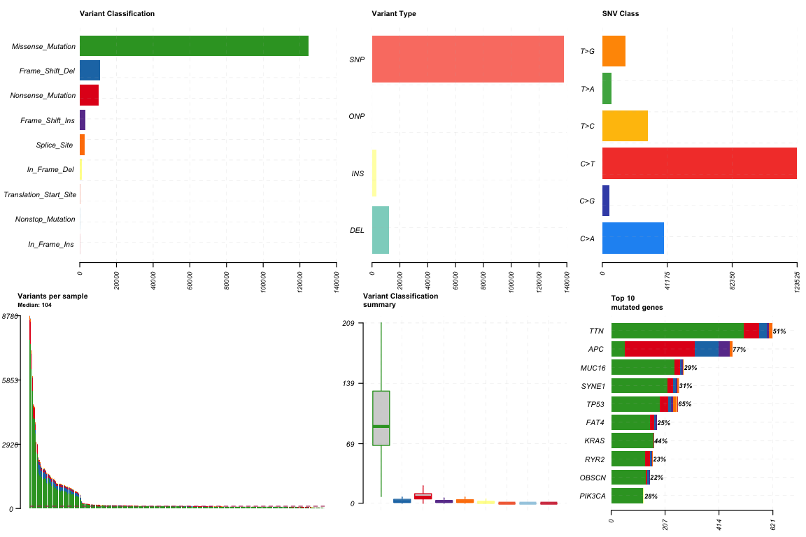<!-- -->


``` r
muestras_por_tmb <- metadata %>%
  filter(Tumor_Sample_Barcode %in% getSampleSummary(maf)$Tumor_Sample_Barcode) %>%
  arrange(desc(TMB_NONSYNONYMOUS)) %>%
  pull(Tumor_Sample_Barcode)

oncoplot(maf = maf, top = 10, sampleOrder = muestras_por_tmb)
```

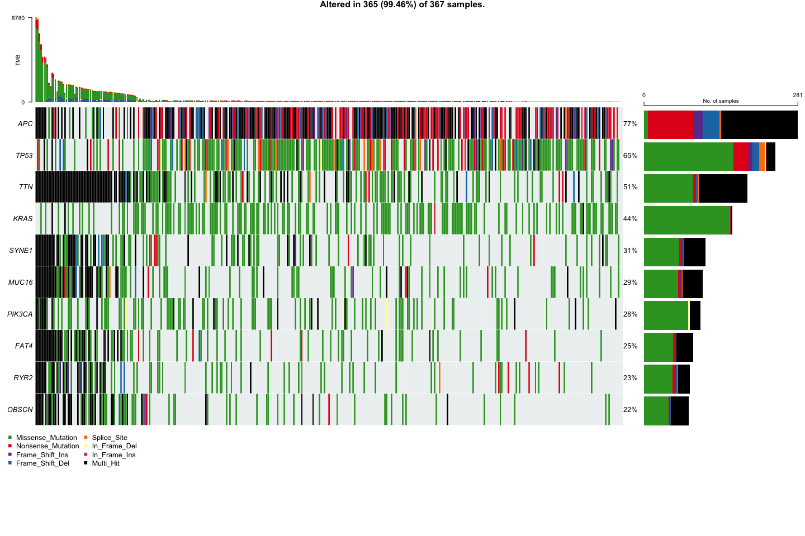<!-- -->


``` r
oncoplot(maf = maf, top = 10, sampleOrder = muestras_por_tmb,
         clinicalFeatures = c("ONCOTREE_CODE", "SUBTYPE", "WGD", "SEX"),
         annotationColor = list(
           ONCOTREE_CODE = c(COAD = "brown2", READ = "steelblue", MACR = "lightgreen"),
           SUBTYPE = c(POLE = "hotpink1", CIN = "blue", MSI = "orange2", GS = "darkgreen"),
           WGD = c("FALSE" = "gray", "TRUE" = "gold2"),
           SEX = c(Female = "lightcoral", Male = "skyblue")
         ),
         annotationFontSize = 0.8, legendFontSize = 1)
```

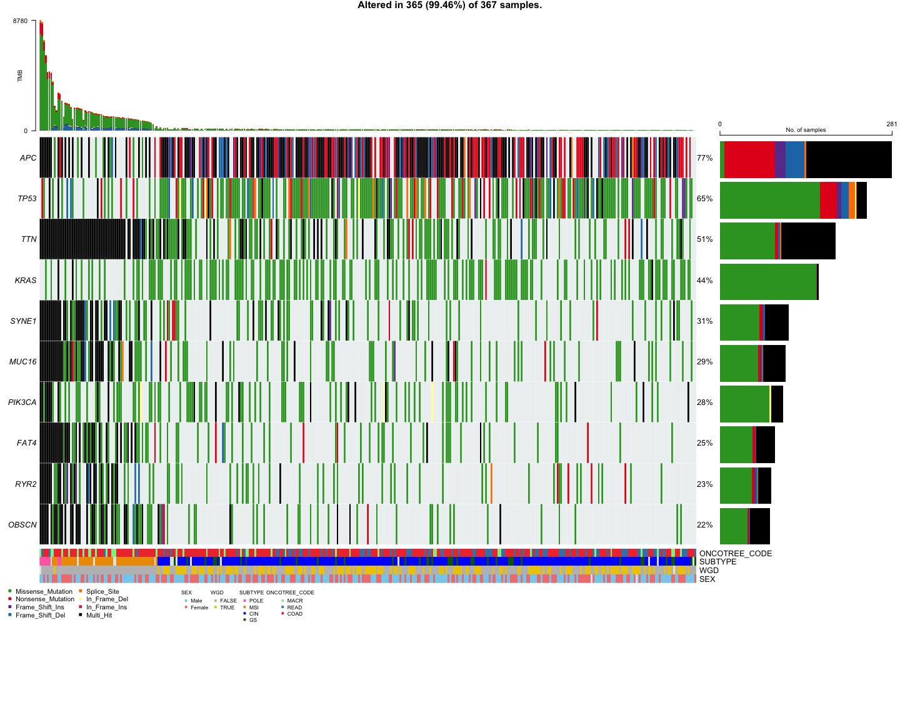<!-- -->


``` r
maf_titv <- titv(maf = maf, plot = FALSE, useSyn = TRUE)
plotTiTv(res = maf_titv)
```

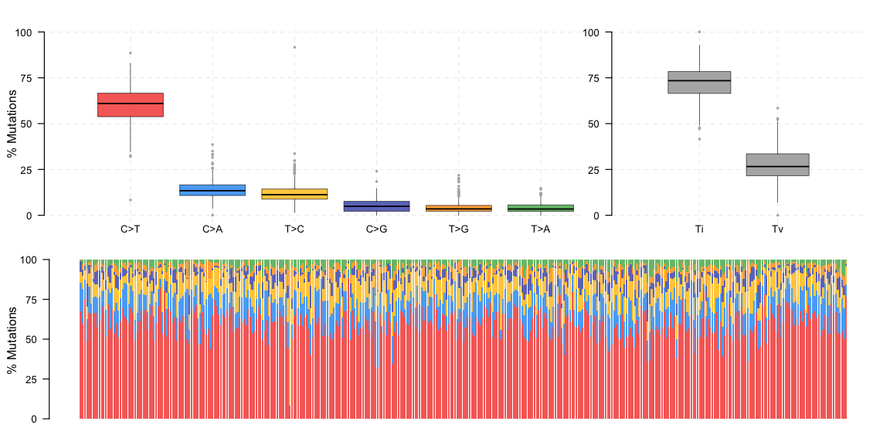<!-- -->


``` r
lollipopPlot(maf = maf, gene = "APC", AACol = "HGVSp_Short")
```

```
## 3 transcripts available. Use arguments refSeqID or proteinID to manually specify tx name.
```

```
##      HGNC    refseq.ID   protein.ID aa.length
##    <char>       <char>       <char>     <num>
## 1:    APC    NM_000038    NP_000029      2843
## 2:    APC NM_001127510 NP_001120982      2843
## 3:    APC NM_001127511 NP_001120983      2825
```

```
## Using longer transcript NM_000038 for now.
```

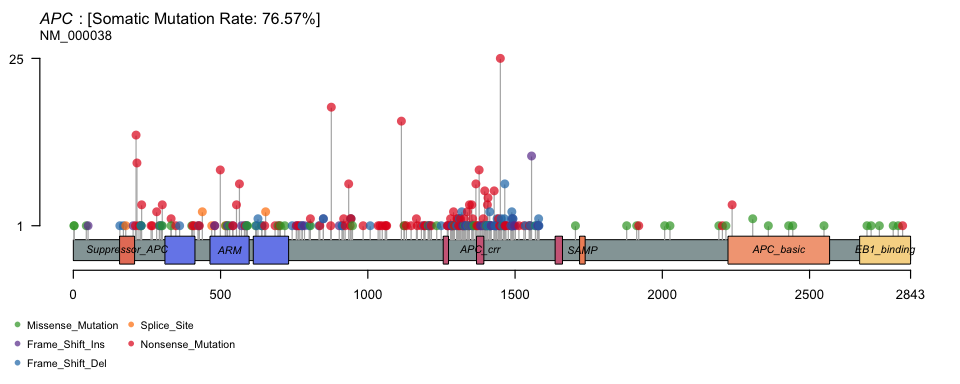<!-- -->

``` r
lollipopPlot(maf = maf, gene = "KRAS", AACol = "HGVSp_Short")
```

```
## 2 transcripts available. Use arguments refSeqID or proteinID to manually specify tx name.
```

```
##      HGNC refseq.ID protein.ID aa.length
##    <char>    <char>     <char>     <num>
## 1:   KRAS NM_004985  NP_004976       188
## 2:   KRAS NM_033360  NP_203524       189
```

```
## Using longer transcript NM_033360 for now.
```

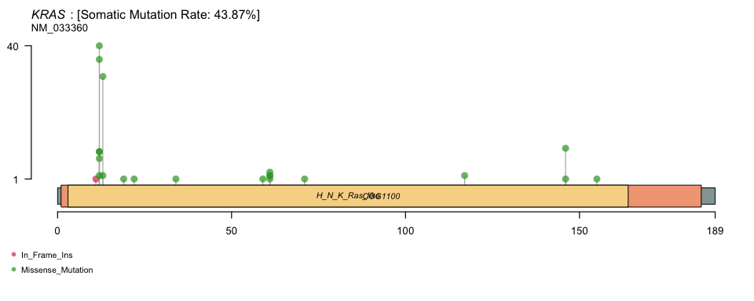<!-- -->


``` r
lollipopPlot(maf = maf, gene = "TP53", AACol = "HGVSp_Short")
```

```
## 8 transcripts available. Use arguments refSeqID or proteinID to manually specify tx name.
```

```
##      HGNC    refseq.ID   protein.ID aa.length
##    <char>       <char>       <char>     <num>
## 1:   TP53    NM_000546    NP_000537       393
## 2:   TP53 NM_001126112 NP_001119584       393
## 3:   TP53 NM_001126113 NP_001119585       346
## 4:   TP53 NM_001126114 NP_001119586       341
## 5:   TP53 NM_001126115 NP_001119587       261
## 6:   TP53 NM_001126116 NP_001119588       209
## 7:   TP53 NM_001126117 NP_001119589       214
## 8:   TP53 NM_001126118 NP_001119590       354
```

```
## Using longer transcript NM_000546 for now.
```

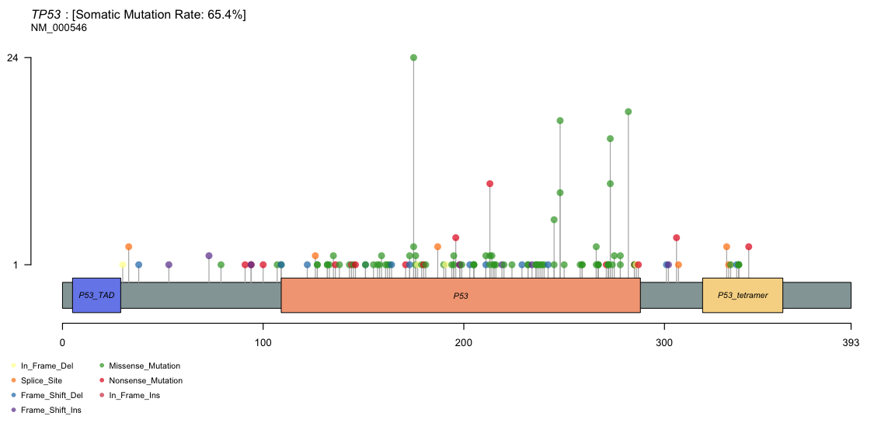<!-- -->


``` r
lollipopPlot(maf = maf, gene = "BRAF", AACol = "HGVSp_Short")
```

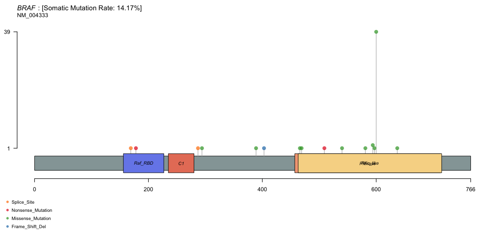<!-- -->


``` r
lollipopPlot(maf = maf, gene = "TTN", AACol = "HGVSp_Short")
```

```
## 7 transcripts available. Use arguments refSeqID or proteinID to manually specify tx name.
```

```
##      HGNC    refseq.ID   protein.ID aa.length
##    <char>       <char>       <char>     <num>
## 1:    TTN NM_001256850 NP_001243779     34350
## 2:    TTN NM_001267550 NP_001254479     35991
## 3:    TTN    NM_003319    NP_003310     26926
## 4:    TTN    NM_133378    NP_596869     33423
## 5:    TTN    NM_133379    NP_596870      5604
## 6:    TTN    NM_133432    NP_597676     27051
## 7:    TTN    NM_133437    NP_597681     27118
```

```
## Using longer transcript NM_001267550 for now.
```

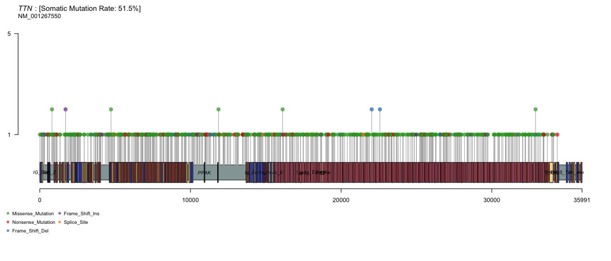<!-- -->


``` r
# Tamano de captura asumido: 50 Mb.
maf_mutload <- tcgaCompare(maf = maf, cohortName = "CRC",
                          logscale = TRUE, capture_size = 50)
```

```
## Warning in FUN(X[[i]], ...): Removed 0 samples with zero mutations.
```

```
## Capture size [TCGA]:  35.8
```

```
## Capture size [Input]: 50
```

```
## Performing pairwise t-test for differences in mutation burden (per MB)..
```

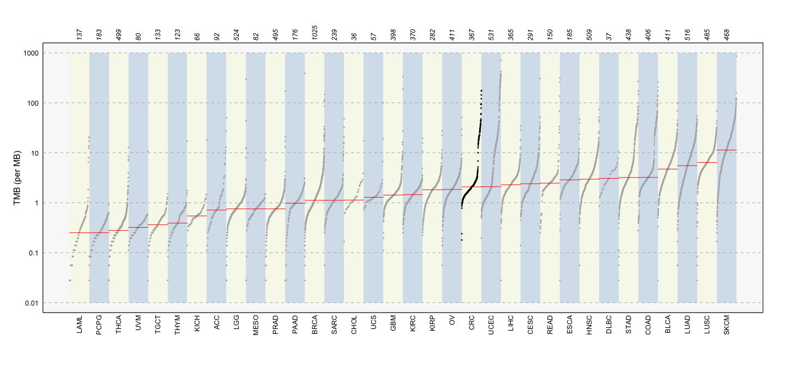<!-- -->

# Parte 2


``` r
resumen_genes <- getGeneSummary(maf)
resumen_muestras <- getSampleSummary(maf)

head(resumen_genes)
```

```
##    Hugo_Symbol Frame_Shift_Del Frame_Shift_Ins In_Frame_Del In_Frame_Ins
##         <char>           <int>           <int>        <int>        <int>
## 1:         APC              91              45            0            0
## 2:        TP53              12               8            4            1
## 3:         TTN              28               9            0            0
## 4:        KRAS               0               0            0            1
## 5:       SYNE1               9               6            0            1
## 6:       MUC16               5               4            1            0
##    Missense_Mutation Nonsense_Mutation Nonstop_Mutation Splice_Site
##                <int>             <int>            <int>       <int>
## 1:                51               269                0           9
## 2:               186                32                0          13
## 3:               508                61                0          13
## 4:               163                 0                0           0
## 5:               215                24                0           4
## 6:               243                22                0           3
##    Translation_Start_Site total MutatedSamples AlteredSamples
##                     <int> <num>          <int>          <int>
## 1:                      0   465            281            281
## 2:                      0   256            240            240
## 3:                      0   619            189            189
## 4:                      0   164            161            161
## 5:                      0   259            112            112
## 6:                      0   278            107            107
```

``` r
head(resumen_muestras)
```

```
##    Tumor_Sample_Barcode Frame_Shift_Del Frame_Shift_Ins In_Frame_Del
##                  <fctr>           <int>           <int>        <int>
## 1:      TCGA-CA-6717-01              11              26            0
## 2:      TCGA-F5-6814-01               4              11            0
## 3:      TCGA-AA-A010-01              19              20            2
## 4:      TCGA-AZ-4315-01              10              22            0
## 5:      TCGA-EI-6917-01               4               8            0
## 6:      TCGA-AA-3984-01               2              10            1
##    In_Frame_Ins Missense_Mutation Nonsense_Mutation Nonstop_Mutation
##           <int>             <int>             <int>            <int>
## 1:            0              7686               867               12
## 2:            0              7483              1015               14
## 3:            0              6341               677                5
## 4:            0              5359               562                3
## 5:            0              4159               514                4
## 6:            1              4093               501                5
##    Splice_Site Translation_Start_Site total
##          <int>                  <int> <num>
## 1:         171                      7  8780
## 2:         137                      2  8666
## 3:         128                      3  7195
## 4:          83                      2  6041
## 5:          51                      1  4741
## 6:          66                      1  4680
```

## multi-hit y TMB


``` r
matriz_gen_muestra <- as_tibble(maf@data) %>%
  count(Hugo_Symbol, Tumor_Sample_Barcode, name = "n_mutaciones") %>%
  pivot_wider(names_from = Tumor_Sample_Barcode,
              values_from = n_mutaciones, values_fill = 0) %>%
  column_to_rownames("Hugo_Symbol") %>%
  as.matrix()

dim(matriz_gen_muestra)
```

```
## [1] 17241   367
```


``` r
tabla_multihit <- tibble(
  Tumor_Sample_Barcode = colnames(matriz_gen_muestra),
  n_genes_multihit = colSums(matriz_gen_muestra >= 2)
) %>%
  left_join(metadata %>% select(Tumor_Sample_Barcode, TMB_NONSYNONYMOUS, SUBTYPE),
            by = "Tumor_Sample_Barcode") %>%
  mutate(SUBTYPE = factor(SUBTYPE, levels = c("CIN", "MSI", "POLE", "GS")))

head(tabla_multihit)
```

```
## # A tibble: 6 × 4
##   Tumor_Sample_Barcode n_genes_multihit TMB_NONSYNONYMOUS SUBTYPE
##   <chr>                           <dbl>             <dbl> <fct>  
## 1 TCGA-A6-2686-01                   190             136.  MSI    
## 2 TCGA-AA-3663-01                   143              64.9 MSI    
## 3 TCGA-AM-5821-01                    63              40.5 MSI    
## 4 TCGA-AZ-4315-01                  1076             211.  POLE   
## 5 TCGA-CA-6717-01                  1787             321.  POLE   
## 6 TCGA-D5-6531-01                     4               5.7 CIN
```

``` r
table(tabla_multihit$SUBTYPE, useNA = "ifany")
```

```
## 
##  CIN  MSI POLE   GS <NA> 
##  252   52    8   40   15
```


``` r
modelo_multihit_tmb <- lm(n_genes_multihit ~ TMB_NONSYNONYMOUS,
                          data = tabla_multihit)
resumen_modelo <- summary(modelo_multihit_tmb)
resumen_modelo
```

```
## 
## Call:
## lm(formula = n_genes_multihit ~ TMB_NONSYNONYMOUS, data = tabla_multihit)
## 
## Residuals:
##     Min      1Q  Median      3Q     Max 
## -401.46    8.02   15.77   19.20  370.75 
## 
## Coefficients:
##                    Estimate Std. Error t value Pr(>|t|)    
## (Intercept)       -30.96368    3.41169  -9.076   <2e-16 ***
## TMB_NONSYNONYMOUS   4.58450    0.08442  54.305   <2e-16 ***
## ---
## Signif. codes:  0 '***' 0.001 '**' 0.01 '*' 0.05 '.' 0.1 ' ' 1
## 
## Residual standard error: 60.19 on 365 degrees of freedom
## Multiple R-squared:  0.8899,	Adjusted R-squared:  0.8896 
## F-statistic:  2949 on 1 and 365 DF,  p-value: < 2.2e-16
```

``` r
# El p-value prueba la asociacion de la pendiente; no demuestra linealidad.
p_multihit_tmb <- resumen_modelo$coefficients["TMB_NONSYNONYMOUS", "Pr(>|t|)"]
```


``` r
r2 <- round(resumen_modelo$r.squared, 3)
p_valor <- signif(p_multihit_tmb, 3)
texto_regresion <- paste("Regresion lineal: R2 =", r2, "; p =", p_valor)

ggplot(tabla_multihit, aes(x = TMB_NONSYNONYMOUS, y = n_genes_multihit)) +
  geom_point(aes(color = SUBTYPE), alpha = 0.7) +
  geom_smooth(method = "lm", formula = y ~ x, color = "black") +
  labs(x = "TMB (mutaciones/Mb)", y = "Numero de genes con multi-hit",
       color = "Subtipo", subtitle = texto_regresion) + theme_classic()
```

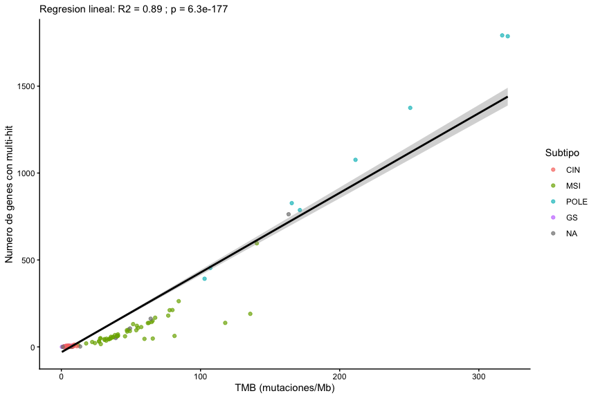<!-- -->


``` r
resumen_multihit_subtipos <- tabla_multihit %>%
  filter(!is.na(SUBTYPE)) %>% group_by(SUBTYPE) %>%
  summarise(n_muestras = n(),
            mediana_multihit = median(n_genes_multihit),
            .groups = "drop")

resumen_multihit_subtipos
```

```
## # A tibble: 4 × 3
##   SUBTYPE n_muestras mediana_multihit
##   <fct>        <int>            <dbl>
## 1 CIN            252               2 
## 2 MSI             52              63 
## 3 POLE             8             952.
## 4 GS              40               2
```

``` r
kruskal.test(n_genes_multihit ~ SUBTYPE, data = tabla_multihit)
```

```
## 
## 	Kruskal-Wallis rank sum test
## 
## data:  n_genes_multihit by SUBTYPE
## Kruskal-Wallis chi-squared = 154.25, df = 3, p-value < 2.2e-16
```

``` r
ggplot(tabla_multihit %>% filter(!is.na(SUBTYPE)),
       aes(x = SUBTYPE, y = n_genes_multihit, fill = SUBTYPE)) +
  geom_boxplot(outlier.shape = NA) +
  geom_jitter(width = 0.15, alpha = 0.5, size = 1) +
  scale_fill_manual(values = c(CIN = "blue", MSI = "orange2",
                               POLE = "hotpink1", GS = "darkgreen")) +
  labs(x = "Subtipo de cancer colorrectal", y = "Numero de genes con multi-hit") +
  theme_classic()
```

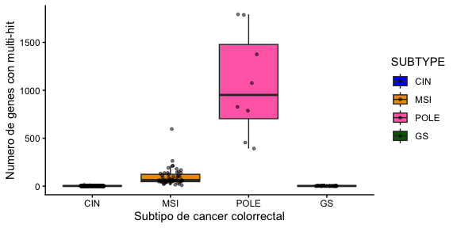<!-- -->

## MSI

MSI es TRUE si SUBTYPE es MSI y FALSE en los demas casos.


``` r
matriz_binaria <- ifelse(matriz_gen_muestra > 0, TRUE, FALSE)
dim(matriz_binaria)
```

```
## [1] 17241   367
```


``` r
# Contar muestras mutadas en toda la matriz, sin distinguir por MSI.
genes_modelo <- rownames(matriz_binaria)[rowSums(matriz_binaria) >= 5]
length(genes_modelo)
```

```
## [1] 10595
```


``` r
metadata_msi <- metadata %>%
  select(Tumor_Sample_Barcode, SUBTYPE, purity, SEX, AGE) %>%
  filter(Tumor_Sample_Barcode %in% colnames(matriz_binaria)) %>%
  mutate(MSI = SUBTYPE == "MSI", SEX = factor(SEX))

# Muestras con subtipo, pureza, sexo y edad para los modelos.
metadata_msi <- metadata_msi %>% drop_na(MSI, purity, SEX, AGE)
table(metadata_msi$MSI)
```

```
## 
## FALSE  TRUE 
##   296    52
```


``` r
datos_msh2 <- metadata_msi
datos_msh2$MSH2 <- matriz_binaria["MSH2", datos_msh2$Tumor_Sample_Barcode]

modelo_msh2 <- glm(MSH2 ~ MSI + AGE + SEX + purity,
                   data = datos_msh2, family = binomial())

tabla_msh2 <- as.data.frame(summary(modelo_msh2)$coefficients)
tabla_msh2$OR <- exp(tabla_msh2$Estimate)

tabla_msh2
```

```
##                Estimate Std. Error     z value     Pr(>|z|)         OR
## (Intercept) -3.09738240 1.58813941 -1.95032147 0.0511378147 0.04516728
## MSITRUE      2.22888868 0.57468682  3.87844061 0.0001051282 9.28953672
## AGE         -0.01686490 0.02021915 -0.83410556 0.4042214999 0.98327651
## SEXMale      0.56199433 0.58752124  0.95655152 0.3387936674 1.75416741
## purity      -0.08710902 1.59078687 -0.05475845 0.9563309066 0.91657717
```


``` r
# Cada gen es la respuesta binaria; se extrae el coeficiente de MSI.
resultados_msi <- data.frame(gen = genes_modelo,
                             beta = NA_real_, p_value = NA_real_)

for (i in seq_len(nrow(resultados_msi))) {
  datos <- metadata_msi
  datos$mutacion <- matriz_binaria[resultados_msi$gen[i], datos$Tumor_Sample_Barcode]

  modelo <- glm(mutacion ~ MSI + AGE + SEX + purity,
                data = datos, family = binomial())

  if (modelo$converged && !anyNA(coef(modelo))) {
    coeficiente <- summary(modelo)$coefficients["MSITRUE", ]
    OR_gen <- exp(coeficiente["Estimate"])

    if (is.finite(OR_gen) && OR_gen > 0) {
      resultados_msi$beta[i] <- coeficiente["Estimate"]
      resultados_msi$p_value[i] <- coeficiente["Pr(>|z|)"]
    }
  }
}
```

```
## Warning: glm.fit: fitted probabilities numerically 0 or 1 occurred
## Warning: glm.fit: fitted probabilities numerically 0 or 1 occurred
## Warning: glm.fit: fitted probabilities numerically 0 or 1 occurred
## Warning: glm.fit: fitted probabilities numerically 0 or 1 occurred
## Warning: glm.fit: fitted probabilities numerically 0 or 1 occurred
## Warning: glm.fit: fitted probabilities numerically 0 or 1 occurred
## Warning: glm.fit: fitted probabilities numerically 0 or 1 occurred
## Warning: glm.fit: fitted probabilities numerically 0 or 1 occurred
## Warning: glm.fit: fitted probabilities numerically 0 or 1 occurred
## Warning: glm.fit: fitted probabilities numerically 0 or 1 occurred
## Warning: glm.fit: fitted probabilities numerically 0 or 1 occurred
## Warning: glm.fit: fitted probabilities numerically 0 or 1 occurred
## Warning: glm.fit: fitted probabilities numerically 0 or 1 occurred
## Warning: glm.fit: fitted probabilities numerically 0 or 1 occurred
## Warning: glm.fit: fitted probabilities numerically 0 or 1 occurred
## Warning: glm.fit: fitted probabilities numerically 0 or 1 occurred
## Warning: glm.fit: fitted probabilities numerically 0 or 1 occurred
## Warning: glm.fit: fitted probabilities numerically 0 or 1 occurred
## Warning: glm.fit: fitted probabilities numerically 0 or 1 occurred
## Warning: glm.fit: fitted probabilities numerically 0 or 1 occurred
## Warning: glm.fit: fitted probabilities numerically 0 or 1 occurred
## Warning: glm.fit: fitted probabilities numerically 0 or 1 occurred
## Warning: glm.fit: fitted probabilities numerically 0 or 1 occurred
## Warning: glm.fit: fitted probabilities numerically 0 or 1 occurred
## Warning: glm.fit: fitted probabilities numerically 0 or 1 occurred
## Warning: glm.fit: fitted probabilities numerically 0 or 1 occurred
## Warning: glm.fit: fitted probabilities numerically 0 or 1 occurred
## Warning: glm.fit: fitted probabilities numerically 0 or 1 occurred
## Warning: glm.fit: fitted probabilities numerically 0 or 1 occurred
## Warning: glm.fit: fitted probabilities numerically 0 or 1 occurred
## Warning: glm.fit: fitted probabilities numerically 0 or 1 occurred
## Warning: glm.fit: fitted probabilities numerically 0 or 1 occurred
## Warning: glm.fit: fitted probabilities numerically 0 or 1 occurred
## Warning: glm.fit: fitted probabilities numerically 0 or 1 occurred
## Warning: glm.fit: fitted probabilities numerically 0 or 1 occurred
## Warning: glm.fit: fitted probabilities numerically 0 or 1 occurred
## Warning: glm.fit: fitted probabilities numerically 0 or 1 occurred
## Warning: glm.fit: fitted probabilities numerically 0 or 1 occurred
## Warning: glm.fit: fitted probabilities numerically 0 or 1 occurred
## Warning: glm.fit: fitted probabilities numerically 0 or 1 occurred
## Warning: glm.fit: fitted probabilities numerically 0 or 1 occurred
## Warning: glm.fit: fitted probabilities numerically 0 or 1 occurred
## Warning: glm.fit: fitted probabilities numerically 0 or 1 occurred
## Warning: glm.fit: fitted probabilities numerically 0 or 1 occurred
## Warning: glm.fit: fitted probabilities numerically 0 or 1 occurred
## Warning: glm.fit: fitted probabilities numerically 0 or 1 occurred
## Warning: glm.fit: fitted probabilities numerically 0 or 1 occurred
## Warning: glm.fit: fitted probabilities numerically 0 or 1 occurred
## Warning: glm.fit: fitted probabilities numerically 0 or 1 occurred
## Warning: glm.fit: fitted probabilities numerically 0 or 1 occurred
## Warning: glm.fit: fitted probabilities numerically 0 or 1 occurred
## Warning: glm.fit: fitted probabilities numerically 0 or 1 occurred
## Warning: glm.fit: fitted probabilities numerically 0 or 1 occurred
## Warning: glm.fit: fitted probabilities numerically 0 or 1 occurred
## Warning: glm.fit: fitted probabilities numerically 0 or 1 occurred
## Warning: glm.fit: fitted probabilities numerically 0 or 1 occurred
## Warning: glm.fit: fitted probabilities numerically 0 or 1 occurred
## Warning: glm.fit: fitted probabilities numerically 0 or 1 occurred
## Warning: glm.fit: fitted probabilities numerically 0 or 1 occurred
## Warning: glm.fit: fitted probabilities numerically 0 or 1 occurred
## Warning: glm.fit: fitted probabilities numerically 0 or 1 occurred
## Warning: glm.fit: fitted probabilities numerically 0 or 1 occurred
```

``` r
resultados_msi$OR <- exp(resultados_msi$beta)
resultados_msi$FDR <- p.adjust(resultados_msi$p_value, method = "BH")
head(resultados_msi)
```

```
##      gen     beta      p_value        OR          FDR
## 1   A1BG 2.279395 1.516109e-02  9.770769 0.0281316464
## 2   A1CF 2.575301 3.961933e-02 13.135265 0.0609063874
## 3    A2M 1.744336 3.410910e-04  5.722102 0.0017349302
## 4  A2ML1 2.049713 1.410236e-06  7.765674 0.0000315887
## 5 A4GALT 2.488194 7.220843e-03 12.039517 0.0157904707
## 6  A4GNT 1.846484 2.885430e-02  6.337499 0.0467662933
```


``` r
genes_significativos_msi <- resultados_msi %>%
  filter(FDR < 0.05) %>% arrange(FDR, gen)

# Beta > 0: mayor probabilidad de mutacion en MSI TRUE; beta < 0: mayor en MSI FALSE.
genes_msi_true <- genes_significativos_msi %>% filter(beta > 0)

print(paste("Total de genes asociados a MSI TRUE:", nrow(genes_msi_true)))
```

```
## [1] "Total de genes asociados a MSI TRUE: 6649"
```

``` r
top10_msi_true <- genes_msi_true %>%
  slice_head(n = 10) %>% select(gen, beta, OR, p_value, FDR)
top10_msi_true
```

```
##       gen     beta       OR      p_value          FDR
## 1   KMT2B 3.248353 25.74790 9.583235e-17 5.076719e-13
## 2   KMT2D 3.233730 25.37413 6.801202e-17 5.076719e-13
## 3    BRAF 3.180726 24.06422 4.924746e-16 1.739256e-12
## 4  MYCBP2 3.634512 37.88337 8.417144e-16 2.097974e-12
## 5   RNF43 3.697727 40.35547 9.900774e-16 2.097974e-12
## 6    ANK3 3.194123 24.38877 1.373244e-15 2.424920e-12
## 7   ZFHX3 3.351558 28.54717 5.505444e-15 8.332882e-12
## 8   MUC5B 2.749980 15.64232 6.986547e-15 9.252809e-12
## 9   DNAH2 3.162664 23.63346 1.077935e-14 1.268969e-11
## 10  MACF1 3.050302 21.12172 1.450065e-14 1.536344e-11
```


``` r
datos_volcano_msi <- resultados_msi %>%
  filter(!is.na(FDR)) %>%
  mutate(asociacion = case_when(
    FDR < 0.05 & beta > 0 ~ "MSI TRUE",
    FDR < 0.05 & beta < 0 ~ "MSI FALSE",
    TRUE ~ "No significativo"))

ggplot(datos_volcano_msi, aes(x = beta, y = -log10(FDR), color = asociacion)) +
  geom_point(alpha = 0.5, size = 2) +
  geom_vline(xintercept = 0, linetype = "dashed") +
  geom_hline(yintercept = -log10(0.05), linetype = "dashed") +
  geom_text(data = top10_msi_true, aes(x = beta, y = -log10(FDR), label = gen),
            inherit.aes = FALSE, color = "black",
            vjust = -0.5, size = 3, check_overlap = TRUE) +
  scale_color_manual(values = c("MSI TRUE" = "red3", "MSI FALSE" = "steelblue",
                                "No significativo" = "grey70")) +
  labs(x = "Coeficiente de MSI (log OR ajustado)",
       y = "-log10(FDR)", color = "Asociacion") +
  theme_classic()
```

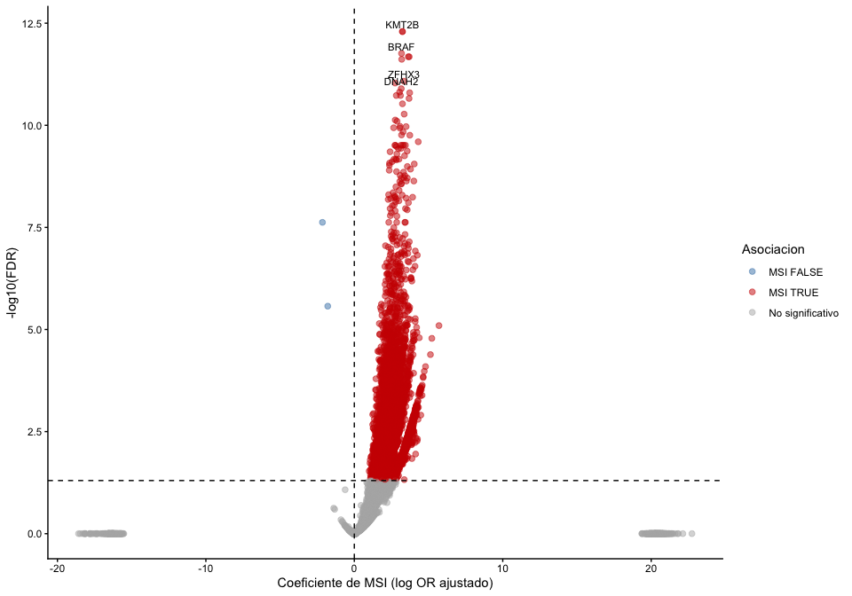<!-- -->


``` r
# Porcentajes observados en las mismas muestras usadas para el modelo.
datos_estado <- metadata_msi %>%
  select(Tumor_Sample_Barcode, MSI) %>%
  mutate(APC = matriz_binaria["APC", Tumor_Sample_Barcode],
         PLXNB1 = matriz_binaria["PLXNB1", Tumor_Sample_Barcode]) %>%
  pivot_longer(c(APC, PLXNB1), names_to = "gen", values_to = "mutado")

ggplot(datos_estado, aes(x = factor(MSI), fill = factor(mutado))) +
  geom_bar(position = "fill") +
  facet_wrap(~ gen) +
  scale_fill_manual(values = c("FALSE" = "grey80", "TRUE" = "red3"),
                    labels = c("FALSE" = "No mutado", "TRUE" = "Mutado")) +
  scale_y_continuous(labels = scales::percent) +
  labs(x = "MSI", y = "Porcentaje de muestras", fill = "Estado mutacional") +
  theme_classic()
```

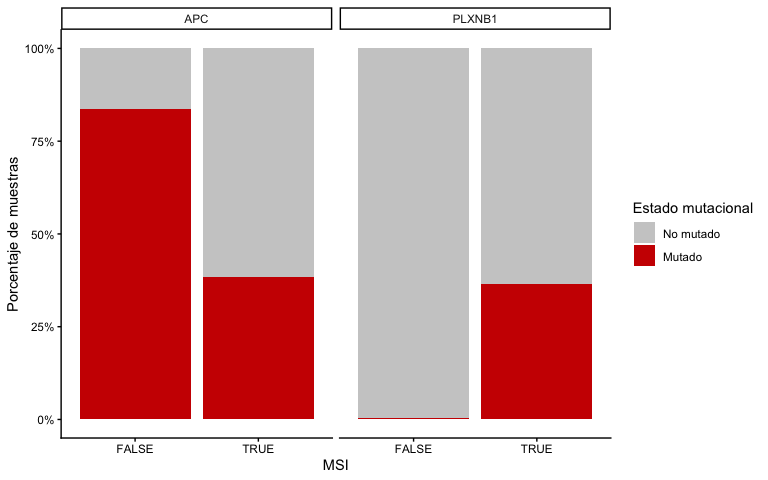<!-- -->

## Ancestría


``` r
ancestria_europea <- read_tsv("../files/data_genetic_ancestry.txt",
                             show_col_types = FALSE) %>%
  filter(ENTITY_STABLE_ID == "EUR") %>%
  select(-ENTITY_STABLE_ID, -NAME) %>%
  pivot_longer(everything(), names_to = "Tumor_Sample_Barcode", values_to = "EUR") %>%
  mutate(EUR = EUR * 100)

metadata_ancestria <- metadata_msi %>%
  left_join(ancestria_europea, by = "Tumor_Sample_Barcode") %>%
  drop_na(EUR)

nrow(metadata_ancestria)
```

```
## [1] 333
```

``` r
summary(metadata_ancestria$EUR)
```

```
##    Min. 1st Qu.  Median    Mean 3rd Qu.    Max. 
##   0.001  86.089  95.074  79.259  98.655  99.996
```


``` r
# Cada gen es la respuesta; EUR es el porcentaje de ancestria europea.
resultados_ancestria <- data.frame(gen = genes_modelo,
                                  beta = NA_real_, p_value = NA_real_)

for (i in seq_len(nrow(resultados_ancestria))) {
  datos <- metadata_ancestria
  datos$mutacion <- matriz_binaria[resultados_ancestria$gen[i], datos$Tumor_Sample_Barcode]

  modelo <- glm(mutacion ~ MSI + AGE + SEX + purity + EUR,
                data = datos, family = binomial())

  if (modelo$converged && !anyNA(coef(modelo))) {
    coeficiente <- summary(modelo)$coefficients["EUR", ]
    OR_gen <- exp(coeficiente["Estimate"])

    if (is.finite(OR_gen) && OR_gen > 0) {
      resultados_ancestria$beta[i] <- coeficiente["Estimate"]
      resultados_ancestria$p_value[i] <- coeficiente["Pr(>|z|)"]
    }
  }
}
```

```
## Warning: glm.fit: fitted probabilities numerically 0 or 1 occurred
## Warning: glm.fit: fitted probabilities numerically 0 or 1 occurred
## Warning: glm.fit: fitted probabilities numerically 0 or 1 occurred
## Warning: glm.fit: fitted probabilities numerically 0 or 1 occurred
## Warning: glm.fit: fitted probabilities numerically 0 or 1 occurred
## Warning: glm.fit: fitted probabilities numerically 0 or 1 occurred
## Warning: glm.fit: fitted probabilities numerically 0 or 1 occurred
## Warning: glm.fit: fitted probabilities numerically 0 or 1 occurred
## Warning: glm.fit: fitted probabilities numerically 0 or 1 occurred
## Warning: glm.fit: fitted probabilities numerically 0 or 1 occurred
## Warning: glm.fit: fitted probabilities numerically 0 or 1 occurred
## Warning: glm.fit: fitted probabilities numerically 0 or 1 occurred
## Warning: glm.fit: fitted probabilities numerically 0 or 1 occurred
## Warning: glm.fit: fitted probabilities numerically 0 or 1 occurred
## Warning: glm.fit: fitted probabilities numerically 0 or 1 occurred
## Warning: glm.fit: fitted probabilities numerically 0 or 1 occurred
## Warning: glm.fit: fitted probabilities numerically 0 or 1 occurred
## Warning: glm.fit: fitted probabilities numerically 0 or 1 occurred
## Warning: glm.fit: fitted probabilities numerically 0 or 1 occurred
## Warning: glm.fit: fitted probabilities numerically 0 or 1 occurred
## Warning: glm.fit: fitted probabilities numerically 0 or 1 occurred
## Warning: glm.fit: fitted probabilities numerically 0 or 1 occurred
```

```
## Warning: glm.fit: algorithm did not converge
```

```
## Warning: glm.fit: fitted probabilities numerically 0 or 1 occurred
## Warning: glm.fit: fitted probabilities numerically 0 or 1 occurred
## Warning: glm.fit: fitted probabilities numerically 0 or 1 occurred
## Warning: glm.fit: fitted probabilities numerically 0 or 1 occurred
## Warning: glm.fit: fitted probabilities numerically 0 or 1 occurred
## Warning: glm.fit: fitted probabilities numerically 0 or 1 occurred
```

```
## Warning: glm.fit: algorithm did not converge
```

```
## Warning: glm.fit: fitted probabilities numerically 0 or 1 occurred
## Warning: glm.fit: fitted probabilities numerically 0 or 1 occurred
## Warning: glm.fit: fitted probabilities numerically 0 or 1 occurred
## Warning: glm.fit: fitted probabilities numerically 0 or 1 occurred
## Warning: glm.fit: fitted probabilities numerically 0 or 1 occurred
## Warning: glm.fit: fitted probabilities numerically 0 or 1 occurred
## Warning: glm.fit: fitted probabilities numerically 0 or 1 occurred
## Warning: glm.fit: fitted probabilities numerically 0 or 1 occurred
## Warning: glm.fit: fitted probabilities numerically 0 or 1 occurred
## Warning: glm.fit: fitted probabilities numerically 0 or 1 occurred
## Warning: glm.fit: fitted probabilities numerically 0 or 1 occurred
## Warning: glm.fit: fitted probabilities numerically 0 or 1 occurred
## Warning: glm.fit: fitted probabilities numerically 0 or 1 occurred
## Warning: glm.fit: fitted probabilities numerically 0 or 1 occurred
## Warning: glm.fit: fitted probabilities numerically 0 or 1 occurred
## Warning: glm.fit: fitted probabilities numerically 0 or 1 occurred
## Warning: glm.fit: fitted probabilities numerically 0 or 1 occurred
## Warning: glm.fit: fitted probabilities numerically 0 or 1 occurred
## Warning: glm.fit: fitted probabilities numerically 0 or 1 occurred
## Warning: glm.fit: fitted probabilities numerically 0 or 1 occurred
## Warning: glm.fit: fitted probabilities numerically 0 or 1 occurred
## Warning: glm.fit: fitted probabilities numerically 0 or 1 occurred
## Warning: glm.fit: fitted probabilities numerically 0 or 1 occurred
## Warning: glm.fit: fitted probabilities numerically 0 or 1 occurred
## Warning: glm.fit: fitted probabilities numerically 0 or 1 occurred
## Warning: glm.fit: fitted probabilities numerically 0 or 1 occurred
## Warning: glm.fit: fitted probabilities numerically 0 or 1 occurred
## Warning: glm.fit: fitted probabilities numerically 0 or 1 occurred
## Warning: glm.fit: fitted probabilities numerically 0 or 1 occurred
## Warning: glm.fit: fitted probabilities numerically 0 or 1 occurred
## Warning: glm.fit: fitted probabilities numerically 0 or 1 occurred
## Warning: glm.fit: fitted probabilities numerically 0 or 1 occurred
## Warning: glm.fit: fitted probabilities numerically 0 or 1 occurred
## Warning: glm.fit: fitted probabilities numerically 0 or 1 occurred
## Warning: glm.fit: fitted probabilities numerically 0 or 1 occurred
## Warning: glm.fit: fitted probabilities numerically 0 or 1 occurred
## Warning: glm.fit: fitted probabilities numerically 0 or 1 occurred
## Warning: glm.fit: fitted probabilities numerically 0 or 1 occurred
## Warning: glm.fit: fitted probabilities numerically 0 or 1 occurred
## Warning: glm.fit: fitted probabilities numerically 0 or 1 occurred
## Warning: glm.fit: fitted probabilities numerically 0 or 1 occurred
## Warning: glm.fit: fitted probabilities numerically 0 or 1 occurred
## Warning: glm.fit: fitted probabilities numerically 0 or 1 occurred
## Warning: glm.fit: fitted probabilities numerically 0 or 1 occurred
## Warning: glm.fit: fitted probabilities numerically 0 or 1 occurred
## Warning: glm.fit: fitted probabilities numerically 0 or 1 occurred
## Warning: glm.fit: fitted probabilities numerically 0 or 1 occurred
## Warning: glm.fit: fitted probabilities numerically 0 or 1 occurred
## Warning: glm.fit: fitted probabilities numerically 0 or 1 occurred
## Warning: glm.fit: fitted probabilities numerically 0 or 1 occurred
## Warning: glm.fit: fitted probabilities numerically 0 or 1 occurred
## Warning: glm.fit: fitted probabilities numerically 0 or 1 occurred
## Warning: glm.fit: fitted probabilities numerically 0 or 1 occurred
## Warning: glm.fit: fitted probabilities numerically 0 or 1 occurred
## Warning: glm.fit: fitted probabilities numerically 0 or 1 occurred
## Warning: glm.fit: fitted probabilities numerically 0 or 1 occurred
## Warning: glm.fit: fitted probabilities numerically 0 or 1 occurred
## Warning: glm.fit: fitted probabilities numerically 0 or 1 occurred
## Warning: glm.fit: fitted probabilities numerically 0 or 1 occurred
## Warning: glm.fit: fitted probabilities numerically 0 or 1 occurred
## Warning: glm.fit: fitted probabilities numerically 0 or 1 occurred
## Warning: glm.fit: fitted probabilities numerically 0 or 1 occurred
## Warning: glm.fit: fitted probabilities numerically 0 or 1 occurred
## Warning: glm.fit: fitted probabilities numerically 0 or 1 occurred
## Warning: glm.fit: fitted probabilities numerically 0 or 1 occurred
## Warning: glm.fit: fitted probabilities numerically 0 or 1 occurred
## Warning: glm.fit: fitted probabilities numerically 0 or 1 occurred
## Warning: glm.fit: fitted probabilities numerically 0 or 1 occurred
## Warning: glm.fit: fitted probabilities numerically 0 or 1 occurred
## Warning: glm.fit: fitted probabilities numerically 0 or 1 occurred
## Warning: glm.fit: fitted probabilities numerically 0 or 1 occurred
## Warning: glm.fit: fitted probabilities numerically 0 or 1 occurred
## Warning: glm.fit: fitted probabilities numerically 0 or 1 occurred
## Warning: glm.fit: fitted probabilities numerically 0 or 1 occurred
## Warning: glm.fit: fitted probabilities numerically 0 or 1 occurred
## Warning: glm.fit: fitted probabilities numerically 0 or 1 occurred
## Warning: glm.fit: fitted probabilities numerically 0 or 1 occurred
## Warning: glm.fit: fitted probabilities numerically 0 or 1 occurred
## Warning: glm.fit: fitted probabilities numerically 0 or 1 occurred
## Warning: glm.fit: fitted probabilities numerically 0 or 1 occurred
## Warning: glm.fit: fitted probabilities numerically 0 or 1 occurred
## Warning: glm.fit: fitted probabilities numerically 0 or 1 occurred
## Warning: glm.fit: fitted probabilities numerically 0 or 1 occurred
## Warning: glm.fit: fitted probabilities numerically 0 or 1 occurred
## Warning: glm.fit: fitted probabilities numerically 0 or 1 occurred
## Warning: glm.fit: fitted probabilities numerically 0 or 1 occurred
## Warning: glm.fit: fitted probabilities numerically 0 or 1 occurred
## Warning: glm.fit: fitted probabilities numerically 0 or 1 occurred
## Warning: glm.fit: fitted probabilities numerically 0 or 1 occurred
## Warning: glm.fit: fitted probabilities numerically 0 or 1 occurred
## Warning: glm.fit: fitted probabilities numerically 0 or 1 occurred
## Warning: glm.fit: fitted probabilities numerically 0 or 1 occurred
## Warning: glm.fit: fitted probabilities numerically 0 or 1 occurred
## Warning: glm.fit: fitted probabilities numerically 0 or 1 occurred
## Warning: glm.fit: fitted probabilities numerically 0 or 1 occurred
## Warning: glm.fit: fitted probabilities numerically 0 or 1 occurred
## Warning: glm.fit: fitted probabilities numerically 0 or 1 occurred
## Warning: glm.fit: fitted probabilities numerically 0 or 1 occurred
## Warning: glm.fit: fitted probabilities numerically 0 or 1 occurred
## Warning: glm.fit: fitted probabilities numerically 0 or 1 occurred
## Warning: glm.fit: fitted probabilities numerically 0 or 1 occurred
## Warning: glm.fit: fitted probabilities numerically 0 or 1 occurred
## Warning: glm.fit: fitted probabilities numerically 0 or 1 occurred
## Warning: glm.fit: fitted probabilities numerically 0 or 1 occurred
## Warning: glm.fit: fitted probabilities numerically 0 or 1 occurred
## Warning: glm.fit: fitted probabilities numerically 0 or 1 occurred
## Warning: glm.fit: fitted probabilities numerically 0 or 1 occurred
## Warning: glm.fit: fitted probabilities numerically 0 or 1 occurred
## Warning: glm.fit: fitted probabilities numerically 0 or 1 occurred
## Warning: glm.fit: fitted probabilities numerically 0 or 1 occurred
## Warning: glm.fit: fitted probabilities numerically 0 or 1 occurred
## Warning: glm.fit: fitted probabilities numerically 0 or 1 occurred
## Warning: glm.fit: fitted probabilities numerically 0 or 1 occurred
## Warning: glm.fit: fitted probabilities numerically 0 or 1 occurred
## Warning: glm.fit: fitted probabilities numerically 0 or 1 occurred
## Warning: glm.fit: fitted probabilities numerically 0 or 1 occurred
## Warning: glm.fit: fitted probabilities numerically 0 or 1 occurred
## Warning: glm.fit: fitted probabilities numerically 0 or 1 occurred
## Warning: glm.fit: fitted probabilities numerically 0 or 1 occurred
```

```
## Warning: glm.fit: algorithm did not converge
```

```
## Warning: glm.fit: fitted probabilities numerically 0 or 1 occurred
## Warning: glm.fit: fitted probabilities numerically 0 or 1 occurred
## Warning: glm.fit: fitted probabilities numerically 0 or 1 occurred
## Warning: glm.fit: fitted probabilities numerically 0 or 1 occurred
## Warning: glm.fit: fitted probabilities numerically 0 or 1 occurred
## Warning: glm.fit: fitted probabilities numerically 0 or 1 occurred
## Warning: glm.fit: fitted probabilities numerically 0 or 1 occurred
## Warning: glm.fit: fitted probabilities numerically 0 or 1 occurred
## Warning: glm.fit: fitted probabilities numerically 0 or 1 occurred
## Warning: glm.fit: fitted probabilities numerically 0 or 1 occurred
## Warning: glm.fit: fitted probabilities numerically 0 or 1 occurred
## Warning: glm.fit: fitted probabilities numerically 0 or 1 occurred
## Warning: glm.fit: fitted probabilities numerically 0 or 1 occurred
## Warning: glm.fit: fitted probabilities numerically 0 or 1 occurred
## Warning: glm.fit: fitted probabilities numerically 0 or 1 occurred
## Warning: glm.fit: fitted probabilities numerically 0 or 1 occurred
## Warning: glm.fit: fitted probabilities numerically 0 or 1 occurred
## Warning: glm.fit: fitted probabilities numerically 0 or 1 occurred
## Warning: glm.fit: fitted probabilities numerically 0 or 1 occurred
## Warning: glm.fit: fitted probabilities numerically 0 or 1 occurred
## Warning: glm.fit: fitted probabilities numerically 0 or 1 occurred
## Warning: glm.fit: fitted probabilities numerically 0 or 1 occurred
## Warning: glm.fit: fitted probabilities numerically 0 or 1 occurred
## Warning: glm.fit: fitted probabilities numerically 0 or 1 occurred
## Warning: glm.fit: fitted probabilities numerically 0 or 1 occurred
## Warning: glm.fit: fitted probabilities numerically 0 or 1 occurred
## Warning: glm.fit: fitted probabilities numerically 0 or 1 occurred
## Warning: glm.fit: fitted probabilities numerically 0 or 1 occurred
## Warning: glm.fit: fitted probabilities numerically 0 or 1 occurred
## Warning: glm.fit: fitted probabilities numerically 0 or 1 occurred
## Warning: glm.fit: fitted probabilities numerically 0 or 1 occurred
## Warning: glm.fit: fitted probabilities numerically 0 or 1 occurred
## Warning: glm.fit: fitted probabilities numerically 0 or 1 occurred
## Warning: glm.fit: fitted probabilities numerically 0 or 1 occurred
## Warning: glm.fit: fitted probabilities numerically 0 or 1 occurred
## Warning: glm.fit: fitted probabilities numerically 0 or 1 occurred
## Warning: glm.fit: fitted probabilities numerically 0 or 1 occurred
## Warning: glm.fit: fitted probabilities numerically 0 or 1 occurred
## Warning: glm.fit: fitted probabilities numerically 0 or 1 occurred
## Warning: glm.fit: fitted probabilities numerically 0 or 1 occurred
## Warning: glm.fit: fitted probabilities numerically 0 or 1 occurred
## Warning: glm.fit: fitted probabilities numerically 0 or 1 occurred
## Warning: glm.fit: fitted probabilities numerically 0 or 1 occurred
## Warning: glm.fit: fitted probabilities numerically 0 or 1 occurred
## Warning: glm.fit: fitted probabilities numerically 0 or 1 occurred
## Warning: glm.fit: fitted probabilities numerically 0 or 1 occurred
## Warning: glm.fit: fitted probabilities numerically 0 or 1 occurred
## Warning: glm.fit: fitted probabilities numerically 0 or 1 occurred
## Warning: glm.fit: fitted probabilities numerically 0 or 1 occurred
## Warning: glm.fit: fitted probabilities numerically 0 or 1 occurred
## Warning: glm.fit: fitted probabilities numerically 0 or 1 occurred
## Warning: glm.fit: fitted probabilities numerically 0 or 1 occurred
## Warning: glm.fit: fitted probabilities numerically 0 or 1 occurred
## Warning: glm.fit: fitted probabilities numerically 0 or 1 occurred
## Warning: glm.fit: fitted probabilities numerically 0 or 1 occurred
## Warning: glm.fit: fitted probabilities numerically 0 or 1 occurred
## Warning: glm.fit: fitted probabilities numerically 0 or 1 occurred
## Warning: glm.fit: fitted probabilities numerically 0 or 1 occurred
## Warning: glm.fit: fitted probabilities numerically 0 or 1 occurred
## Warning: glm.fit: fitted probabilities numerically 0 or 1 occurred
## Warning: glm.fit: fitted probabilities numerically 0 or 1 occurred
## Warning: glm.fit: fitted probabilities numerically 0 or 1 occurred
## Warning: glm.fit: fitted probabilities numerically 0 or 1 occurred
## Warning: glm.fit: fitted probabilities numerically 0 or 1 occurred
## Warning: glm.fit: fitted probabilities numerically 0 or 1 occurred
## Warning: glm.fit: fitted probabilities numerically 0 or 1 occurred
## Warning: glm.fit: fitted probabilities numerically 0 or 1 occurred
## Warning: glm.fit: fitted probabilities numerically 0 or 1 occurred
## Warning: glm.fit: fitted probabilities numerically 0 or 1 occurred
## Warning: glm.fit: fitted probabilities numerically 0 or 1 occurred
## Warning: glm.fit: fitted probabilities numerically 0 or 1 occurred
## Warning: glm.fit: fitted probabilities numerically 0 or 1 occurred
## Warning: glm.fit: fitted probabilities numerically 0 or 1 occurred
## Warning: glm.fit: fitted probabilities numerically 0 or 1 occurred
## Warning: glm.fit: fitted probabilities numerically 0 or 1 occurred
## Warning: glm.fit: fitted probabilities numerically 0 or 1 occurred
## Warning: glm.fit: fitted probabilities numerically 0 or 1 occurred
## Warning: glm.fit: fitted probabilities numerically 0 or 1 occurred
## Warning: glm.fit: fitted probabilities numerically 0 or 1 occurred
## Warning: glm.fit: fitted probabilities numerically 0 or 1 occurred
## Warning: glm.fit: fitted probabilities numerically 0 or 1 occurred
## Warning: glm.fit: fitted probabilities numerically 0 or 1 occurred
## Warning: glm.fit: fitted probabilities numerically 0 or 1 occurred
## Warning: glm.fit: fitted probabilities numerically 0 or 1 occurred
## Warning: glm.fit: fitted probabilities numerically 0 or 1 occurred
## Warning: glm.fit: fitted probabilities numerically 0 or 1 occurred
## Warning: glm.fit: fitted probabilities numerically 0 or 1 occurred
## Warning: glm.fit: fitted probabilities numerically 0 or 1 occurred
## Warning: glm.fit: fitted probabilities numerically 0 or 1 occurred
## Warning: glm.fit: fitted probabilities numerically 0 or 1 occurred
## Warning: glm.fit: fitted probabilities numerically 0 or 1 occurred
## Warning: glm.fit: fitted probabilities numerically 0 or 1 occurred
## Warning: glm.fit: fitted probabilities numerically 0 or 1 occurred
## Warning: glm.fit: fitted probabilities numerically 0 or 1 occurred
## Warning: glm.fit: fitted probabilities numerically 0 or 1 occurred
## Warning: glm.fit: fitted probabilities numerically 0 or 1 occurred
## Warning: glm.fit: fitted probabilities numerically 0 or 1 occurred
## Warning: glm.fit: fitted probabilities numerically 0 or 1 occurred
## Warning: glm.fit: fitted probabilities numerically 0 or 1 occurred
## Warning: glm.fit: fitted probabilities numerically 0 or 1 occurred
## Warning: glm.fit: fitted probabilities numerically 0 or 1 occurred
## Warning: glm.fit: fitted probabilities numerically 0 or 1 occurred
## Warning: glm.fit: fitted probabilities numerically 0 or 1 occurred
## Warning: glm.fit: fitted probabilities numerically 0 or 1 occurred
## Warning: glm.fit: fitted probabilities numerically 0 or 1 occurred
## Warning: glm.fit: fitted probabilities numerically 0 or 1 occurred
## Warning: glm.fit: fitted probabilities numerically 0 or 1 occurred
## Warning: glm.fit: fitted probabilities numerically 0 or 1 occurred
## Warning: glm.fit: fitted probabilities numerically 0 or 1 occurred
## Warning: glm.fit: fitted probabilities numerically 0 or 1 occurred
## Warning: glm.fit: fitted probabilities numerically 0 or 1 occurred
## Warning: glm.fit: fitted probabilities numerically 0 or 1 occurred
## Warning: glm.fit: fitted probabilities numerically 0 or 1 occurred
## Warning: glm.fit: fitted probabilities numerically 0 or 1 occurred
## Warning: glm.fit: fitted probabilities numerically 0 or 1 occurred
## Warning: glm.fit: fitted probabilities numerically 0 or 1 occurred
## Warning: glm.fit: fitted probabilities numerically 0 or 1 occurred
## Warning: glm.fit: fitted probabilities numerically 0 or 1 occurred
## Warning: glm.fit: fitted probabilities numerically 0 or 1 occurred
## Warning: glm.fit: fitted probabilities numerically 0 or 1 occurred
## Warning: glm.fit: fitted probabilities numerically 0 or 1 occurred
## Warning: glm.fit: fitted probabilities numerically 0 or 1 occurred
## Warning: glm.fit: fitted probabilities numerically 0 or 1 occurred
## Warning: glm.fit: fitted probabilities numerically 0 or 1 occurred
## Warning: glm.fit: fitted probabilities numerically 0 or 1 occurred
## Warning: glm.fit: fitted probabilities numerically 0 or 1 occurred
## Warning: glm.fit: fitted probabilities numerically 0 or 1 occurred
## Warning: glm.fit: fitted probabilities numerically 0 or 1 occurred
## Warning: glm.fit: fitted probabilities numerically 0 or 1 occurred
## Warning: glm.fit: fitted probabilities numerically 0 or 1 occurred
## Warning: glm.fit: fitted probabilities numerically 0 or 1 occurred
## Warning: glm.fit: fitted probabilities numerically 0 or 1 occurred
## Warning: glm.fit: fitted probabilities numerically 0 or 1 occurred
## Warning: glm.fit: fitted probabilities numerically 0 or 1 occurred
## Warning: glm.fit: fitted probabilities numerically 0 or 1 occurred
## Warning: glm.fit: fitted probabilities numerically 0 or 1 occurred
## Warning: glm.fit: fitted probabilities numerically 0 or 1 occurred
## Warning: glm.fit: fitted probabilities numerically 0 or 1 occurred
## Warning: glm.fit: fitted probabilities numerically 0 or 1 occurred
## Warning: glm.fit: fitted probabilities numerically 0 or 1 occurred
## Warning: glm.fit: fitted probabilities numerically 0 or 1 occurred
## Warning: glm.fit: fitted probabilities numerically 0 or 1 occurred
## Warning: glm.fit: fitted probabilities numerically 0 or 1 occurred
## Warning: glm.fit: fitted probabilities numerically 0 or 1 occurred
## Warning: glm.fit: fitted probabilities numerically 0 or 1 occurred
## Warning: glm.fit: fitted probabilities numerically 0 or 1 occurred
## Warning: glm.fit: fitted probabilities numerically 0 or 1 occurred
## Warning: glm.fit: fitted probabilities numerically 0 or 1 occurred
## Warning: glm.fit: fitted probabilities numerically 0 or 1 occurred
## Warning: glm.fit: fitted probabilities numerically 0 or 1 occurred
## Warning: glm.fit: fitted probabilities numerically 0 or 1 occurred
## Warning: glm.fit: fitted probabilities numerically 0 or 1 occurred
## Warning: glm.fit: fitted probabilities numerically 0 or 1 occurred
## Warning: glm.fit: fitted probabilities numerically 0 or 1 occurred
## Warning: glm.fit: fitted probabilities numerically 0 or 1 occurred
## Warning: glm.fit: fitted probabilities numerically 0 or 1 occurred
## Warning: glm.fit: fitted probabilities numerically 0 or 1 occurred
## Warning: glm.fit: fitted probabilities numerically 0 or 1 occurred
## Warning: glm.fit: fitted probabilities numerically 0 or 1 occurred
## Warning: glm.fit: fitted probabilities numerically 0 or 1 occurred
## Warning: glm.fit: fitted probabilities numerically 0 or 1 occurred
## Warning: glm.fit: fitted probabilities numerically 0 or 1 occurred
## Warning: glm.fit: fitted probabilities numerically 0 or 1 occurred
## Warning: glm.fit: fitted probabilities numerically 0 or 1 occurred
## Warning: glm.fit: fitted probabilities numerically 0 or 1 occurred
## Warning: glm.fit: fitted probabilities numerically 0 or 1 occurred
## Warning: glm.fit: fitted probabilities numerically 0 or 1 occurred
## Warning: glm.fit: fitted probabilities numerically 0 or 1 occurred
## Warning: glm.fit: fitted probabilities numerically 0 or 1 occurred
## Warning: glm.fit: fitted probabilities numerically 0 or 1 occurred
## Warning: glm.fit: fitted probabilities numerically 0 or 1 occurred
## Warning: glm.fit: fitted probabilities numerically 0 or 1 occurred
## Warning: glm.fit: fitted probabilities numerically 0 or 1 occurred
## Warning: glm.fit: fitted probabilities numerically 0 or 1 occurred
## Warning: glm.fit: fitted probabilities numerically 0 or 1 occurred
## Warning: glm.fit: fitted probabilities numerically 0 or 1 occurred
## Warning: glm.fit: fitted probabilities numerically 0 or 1 occurred
## Warning: glm.fit: fitted probabilities numerically 0 or 1 occurred
## Warning: glm.fit: fitted probabilities numerically 0 or 1 occurred
## Warning: glm.fit: fitted probabilities numerically 0 or 1 occurred
## Warning: glm.fit: fitted probabilities numerically 0 or 1 occurred
## Warning: glm.fit: fitted probabilities numerically 0 or 1 occurred
## Warning: glm.fit: fitted probabilities numerically 0 or 1 occurred
## Warning: glm.fit: fitted probabilities numerically 0 or 1 occurred
## Warning: glm.fit: fitted probabilities numerically 0 or 1 occurred
## Warning: glm.fit: fitted probabilities numerically 0 or 1 occurred
## Warning: glm.fit: fitted probabilities numerically 0 or 1 occurred
## Warning: glm.fit: fitted probabilities numerically 0 or 1 occurred
## Warning: glm.fit: fitted probabilities numerically 0 or 1 occurred
## Warning: glm.fit: fitted probabilities numerically 0 or 1 occurred
## Warning: glm.fit: fitted probabilities numerically 0 or 1 occurred
## Warning: glm.fit: fitted probabilities numerically 0 or 1 occurred
## Warning: glm.fit: fitted probabilities numerically 0 or 1 occurred
## Warning: glm.fit: fitted probabilities numerically 0 or 1 occurred
## Warning: glm.fit: fitted probabilities numerically 0 or 1 occurred
## Warning: glm.fit: fitted probabilities numerically 0 or 1 occurred
## Warning: glm.fit: fitted probabilities numerically 0 or 1 occurred
## Warning: glm.fit: fitted probabilities numerically 0 or 1 occurred
## Warning: glm.fit: fitted probabilities numerically 0 or 1 occurred
## Warning: glm.fit: fitted probabilities numerically 0 or 1 occurred
## Warning: glm.fit: fitted probabilities numerically 0 or 1 occurred
## Warning: glm.fit: fitted probabilities numerically 0 or 1 occurred
## Warning: glm.fit: fitted probabilities numerically 0 or 1 occurred
## Warning: glm.fit: fitted probabilities numerically 0 or 1 occurred
## Warning: glm.fit: fitted probabilities numerically 0 or 1 occurred
## Warning: glm.fit: fitted probabilities numerically 0 or 1 occurred
## Warning: glm.fit: fitted probabilities numerically 0 or 1 occurred
## Warning: glm.fit: fitted probabilities numerically 0 or 1 occurred
## Warning: glm.fit: fitted probabilities numerically 0 or 1 occurred
## Warning: glm.fit: fitted probabilities numerically 0 or 1 occurred
## Warning: glm.fit: fitted probabilities numerically 0 or 1 occurred
## Warning: glm.fit: fitted probabilities numerically 0 or 1 occurred
## Warning: glm.fit: fitted probabilities numerically 0 or 1 occurred
## Warning: glm.fit: fitted probabilities numerically 0 or 1 occurred
## Warning: glm.fit: fitted probabilities numerically 0 or 1 occurred
## Warning: glm.fit: fitted probabilities numerically 0 or 1 occurred
## Warning: glm.fit: fitted probabilities numerically 0 or 1 occurred
## Warning: glm.fit: fitted probabilities numerically 0 or 1 occurred
## Warning: glm.fit: fitted probabilities numerically 0 or 1 occurred
## Warning: glm.fit: fitted probabilities numerically 0 or 1 occurred
## Warning: glm.fit: fitted probabilities numerically 0 or 1 occurred
## Warning: glm.fit: fitted probabilities numerically 0 or 1 occurred
## Warning: glm.fit: fitted probabilities numerically 0 or 1 occurred
## Warning: glm.fit: fitted probabilities numerically 0 or 1 occurred
## Warning: glm.fit: fitted probabilities numerically 0 or 1 occurred
## Warning: glm.fit: fitted probabilities numerically 0 or 1 occurred
## Warning: glm.fit: fitted probabilities numerically 0 or 1 occurred
## Warning: glm.fit: fitted probabilities numerically 0 or 1 occurred
## Warning: glm.fit: fitted probabilities numerically 0 or 1 occurred
## Warning: glm.fit: fitted probabilities numerically 0 or 1 occurred
## Warning: glm.fit: fitted probabilities numerically 0 or 1 occurred
## Warning: glm.fit: fitted probabilities numerically 0 or 1 occurred
## Warning: glm.fit: fitted probabilities numerically 0 or 1 occurred
## Warning: glm.fit: fitted probabilities numerically 0 or 1 occurred
## Warning: glm.fit: fitted probabilities numerically 0 or 1 occurred
## Warning: glm.fit: fitted probabilities numerically 0 or 1 occurred
## Warning: glm.fit: fitted probabilities numerically 0 or 1 occurred
## Warning: glm.fit: fitted probabilities numerically 0 or 1 occurred
## Warning: glm.fit: fitted probabilities numerically 0 or 1 occurred
## Warning: glm.fit: fitted probabilities numerically 0 or 1 occurred
## Warning: glm.fit: fitted probabilities numerically 0 or 1 occurred
## Warning: glm.fit: fitted probabilities numerically 0 or 1 occurred
## Warning: glm.fit: fitted probabilities numerically 0 or 1 occurred
## Warning: glm.fit: fitted probabilities numerically 0 or 1 occurred
## Warning: glm.fit: fitted probabilities numerically 0 or 1 occurred
## Warning: glm.fit: fitted probabilities numerically 0 or 1 occurred
## Warning: glm.fit: fitted probabilities numerically 0 or 1 occurred
## Warning: glm.fit: fitted probabilities numerically 0 or 1 occurred
## Warning: glm.fit: fitted probabilities numerically 0 or 1 occurred
## Warning: glm.fit: fitted probabilities numerically 0 or 1 occurred
## Warning: glm.fit: fitted probabilities numerically 0 or 1 occurred
## Warning: glm.fit: fitted probabilities numerically 0 or 1 occurred
## Warning: glm.fit: fitted probabilities numerically 0 or 1 occurred
## Warning: glm.fit: fitted probabilities numerically 0 or 1 occurred
## Warning: glm.fit: fitted probabilities numerically 0 or 1 occurred
## Warning: glm.fit: fitted probabilities numerically 0 or 1 occurred
## Warning: glm.fit: fitted probabilities numerically 0 or 1 occurred
## Warning: glm.fit: fitted probabilities numerically 0 or 1 occurred
## Warning: glm.fit: fitted probabilities numerically 0 or 1 occurred
## Warning: glm.fit: fitted probabilities numerically 0 or 1 occurred
## Warning: glm.fit: fitted probabilities numerically 0 or 1 occurred
## Warning: glm.fit: fitted probabilities numerically 0 or 1 occurred
## Warning: glm.fit: fitted probabilities numerically 0 or 1 occurred
## Warning: glm.fit: fitted probabilities numerically 0 or 1 occurred
## Warning: glm.fit: fitted probabilities numerically 0 or 1 occurred
## Warning: glm.fit: fitted probabilities numerically 0 or 1 occurred
## Warning: glm.fit: fitted probabilities numerically 0 or 1 occurred
## Warning: glm.fit: fitted probabilities numerically 0 or 1 occurred
## Warning: glm.fit: fitted probabilities numerically 0 or 1 occurred
## Warning: glm.fit: fitted probabilities numerically 0 or 1 occurred
## Warning: glm.fit: fitted probabilities numerically 0 or 1 occurred
## Warning: glm.fit: fitted probabilities numerically 0 or 1 occurred
## Warning: glm.fit: fitted probabilities numerically 0 or 1 occurred
## Warning: glm.fit: fitted probabilities numerically 0 or 1 occurred
## Warning: glm.fit: fitted probabilities numerically 0 or 1 occurred
## Warning: glm.fit: fitted probabilities numerically 0 or 1 occurred
## Warning: glm.fit: fitted probabilities numerically 0 or 1 occurred
## Warning: glm.fit: fitted probabilities numerically 0 or 1 occurred
## Warning: glm.fit: fitted probabilities numerically 0 or 1 occurred
## Warning: glm.fit: fitted probabilities numerically 0 or 1 occurred
## Warning: glm.fit: fitted probabilities numerically 0 or 1 occurred
## Warning: glm.fit: fitted probabilities numerically 0 or 1 occurred
## Warning: glm.fit: fitted probabilities numerically 0 or 1 occurred
## Warning: glm.fit: fitted probabilities numerically 0 or 1 occurred
## Warning: glm.fit: fitted probabilities numerically 0 or 1 occurred
## Warning: glm.fit: fitted probabilities numerically 0 or 1 occurred
## Warning: glm.fit: fitted probabilities numerically 0 or 1 occurred
## Warning: glm.fit: fitted probabilities numerically 0 or 1 occurred
## Warning: glm.fit: fitted probabilities numerically 0 or 1 occurred
## Warning: glm.fit: fitted probabilities numerically 0 or 1 occurred
## Warning: glm.fit: fitted probabilities numerically 0 or 1 occurred
## Warning: glm.fit: fitted probabilities numerically 0 or 1 occurred
## Warning: glm.fit: fitted probabilities numerically 0 or 1 occurred
## Warning: glm.fit: fitted probabilities numerically 0 or 1 occurred
## Warning: glm.fit: fitted probabilities numerically 0 or 1 occurred
## Warning: glm.fit: fitted probabilities numerically 0 or 1 occurred
## Warning: glm.fit: fitted probabilities numerically 0 or 1 occurred
## Warning: glm.fit: fitted probabilities numerically 0 or 1 occurred
```

``` r
resultados_ancestria$OR <- exp(resultados_ancestria$beta)
resultados_ancestria$FDR <- p.adjust(resultados_ancestria$p_value, method = "BH")
head(resultados_ancestria)
```

```
##      gen          beta   p_value        OR       FDR
## 1   A1BG  0.0225593368 0.4204675 1.0228157 0.9579938
## 2   A1CF  0.0131888119 0.5568211 1.0132762 0.9579938
## 3    A2M  0.0016403001 0.8285863 1.0016416 0.9929413
## 4  A2ML1 -0.0008169623 0.9009265 0.9991834 0.9958938
## 5 A4GALT -0.0100173496 0.3953213 0.9900327 0.9579938
## 6  A4GNT  0.0342916934 0.3897339 1.0348864 0.9579938
```


``` r
# Beta > 0: mayor probabilidad de mutacion al aumentar EUR; beta < 0: menor.
genes_fdr_ancestria <- resultados_ancestria %>%
  filter(FDR < 0.05) %>%
  arrange(FDR, gen)

print(paste("Genes con FDR < 0.05, mayor EUR:", sum(genes_fdr_ancestria$beta > 0)))
```

```
## [1] "Genes con FDR < 0.05, mayor EUR: 0"
```

``` r
print(paste("Genes con FDR < 0.05, menor EUR:", sum(genes_fdr_ancestria$beta < 0)))
```

```
## [1] "Genes con FDR < 0.05, menor EUR: 0"
```

``` r
genes_fdr_ancestria
```

```
## [1] gen     beta    p_value OR      FDR    
## <0 rows> (or 0-length row.names)
```

``` r
# Exploracion con p-value sin corregir; este es el criterio del volcano actual.
genes_p_ancestria <- resultados_ancestria %>%
  filter(p_value < 0.05) %>%
  arrange(p_value, gen)

genes_mas_eur <- genes_p_ancestria %>% filter(beta > 0)
genes_menos_eur <- genes_p_ancestria %>% filter(beta < 0)

print(paste("Genes asociados a mayor ancestria europea:", nrow(genes_mas_eur)))
```

```
## [1] "Genes asociados a mayor ancestria europea: 8"
```

``` r
print(paste("Genes asociados a menor ancestria europea:", nrow(genes_menos_eur)))
```

```
## [1] "Genes asociados a menor ancestria europea: 243"
```

``` r
genes_p_ancestria
```

```
##           gen        beta      p_value         OR       FDR
## 1      SLC5A3 -0.03140997 0.0004406083  0.9690782 0.9579938
## 2        KAZN -0.02771966 0.0011111356  0.9726610 0.9579938
## 3        AZI1 -0.03287625 0.0024979134  0.9676583 0.9579938
## 4         MYC -0.02864033 0.0027062302  0.9717659 0.9579938
## 5        GPR3 -0.03469302 0.0027807321  0.9659019 0.9579938
## 6       SBNO2 -0.02352474 0.0028109623  0.9767498 0.9579938
## 7    FAM160B2 -0.02870053 0.0028434679  0.9717074 0.9579938
## 8      MAP2K2 -0.03135078 0.0030321057  0.9691356 0.9579938
## 9       AXIN1 -0.02381423 0.0037629420  0.9764671 0.9579938
## 10    ALDH8A1 -0.03349499 0.0037677371  0.9670598 0.9579938
## 11    TMEM63C -0.02622766 0.0039160460  0.9741133 0.9579938
## 12     PLXNA2 -0.01914815 0.0039760193  0.9810340 0.9579938
## 13      DSTYK -0.03140087 0.0042201392  0.9690870 0.9579938
## 14     ANKLE2 -0.03748947 0.0042220823  0.9632046 0.9579938
## 15     PRDM14 -0.02705628 0.0044779810  0.9733065 0.9579938
## 16       KIF7 -0.02273640 0.0049480688  0.9775201 0.9579938
## 17      ZFP42 -0.02391165 0.0053907205  0.9763720 0.9579938
## 18      PIAS4 -0.02677078 0.0054589163  0.9735844 0.9579938
## 19    SHROOM3 -0.02302915 0.0056996662  0.9772340 0.9579938
## 20       TNS1 -0.01707456 0.0063502173  0.9830704 0.9579938
## 21      RAD17 -0.02611272 0.0064706920  0.9742253 0.9579938
## 22       APC2 -0.02750618 0.0067022721  0.9728687 0.9579938
## 23  EIF4ENIF1 -0.03075633 0.0069376325  0.9697118 0.9579938
## 24       ELL3 -0.03278634 0.0074048378  0.9677453 0.9579938
## 25     TESPA1 -0.02079562 0.0076093143  0.9794191 0.9579938
## 26      TRPM5 -0.02212061 0.0078729992  0.9781223 0.9579938
## 27    C2orf74 -0.02922847 0.0080132787  0.9711945 0.9579938
## 28     CCDC27 -0.02882819 0.0087175101  0.9715834 0.9579938
## 29     ZNF837 -0.03010311 0.0092432948  0.9703455 0.9579938
## 30      PDIA2 -0.04105718 0.0095317930  0.9597743 0.9579938
## 31       BZW1 -0.03183293 0.0095425478  0.9686684 0.9579938
## 32     LRRC32 -0.02319518 0.0099463587  0.9770718 0.9579938
## 33     GIGYF1 -0.01842398 0.0099739984  0.9817447 0.9579938
## 34      ZFPM1 -0.02144595 0.0101791178  0.9787824 0.9579938
## 35    SLC38A8 -0.03106236 0.0101937114  0.9694151 0.9579938
## 36    SLC19A3 -0.03407901 0.0102997634  0.9664951 0.9579938
## 37       BRF1 -0.02749207 0.0106078333  0.9728824 0.9579938
## 38     ARL13B -0.03988504 0.0109786887  0.9608999 0.9579938
## 39      SKOR1 -0.03269636 0.0111148668  0.9678324 0.9579938
## 40     ATP10B -0.01929962 0.0111433414  0.9808854 0.9579938
## 41       TPP1 -0.02627226 0.0117098361  0.9740699 0.9579938
## 42     SLC1A5 -0.04212336 0.0119498856  0.9587515 0.9579938
## 43      SUSD3 -0.03918981 0.0119636153  0.9615682 0.9579938
## 44     TOP1MT -0.02717710 0.0120234697  0.9731889 0.9579938
## 45      USP21 -0.02500932 0.0122437335  0.9753008 0.9579938
## 46    C11orf1 -0.03869430 0.0125709612  0.9620448 0.9579938
## 47      BMP10 -0.02247980 0.0128971977  0.9777710 0.9579938
## 48   TMEM178A -0.02864476 0.0131081653  0.9717616 0.9579938
## 49    RPS6KA1 -0.02975941 0.0131279695  0.9706790 0.9579938
## 50      ACKR2 -0.05444313 0.0131696857  0.9470124 0.9579938
## 51      G3BP1 -0.01865616 0.0132805535  0.9815168 0.9579938
## 52       CBX3 -0.03694184 0.0133009721  0.9637322 0.9579938
## 53    ZSCAN20 -0.01925421 0.0133804590  0.9809300 0.9579938
## 54      NPAS3 -0.02041565 0.0135047686  0.9797913 0.9579938
## 55     PIK3R6 -0.01790380 0.0138610704  0.9822555 0.9579938
## 56    PRIMPOL -0.02939479 0.0141549847  0.9710330 0.9579938
## 57      IGSF5 -0.01906246 0.0144383858  0.9811181 0.9579938
## 58     CAMTA2 -0.01893348 0.0148296515  0.9812446 0.9579938
## 59       WNT3 -0.04303641 0.0149477689  0.9578765 0.9579938
## 60     POM121 -0.01935455 0.0152286651  0.9808315 0.9579938
## 61       PROZ -0.03681593 0.0158128672  0.9638535 0.9579938
## 62     PIK3CD -0.02362754 0.0161782214  0.9766494 0.9579938
## 63        DES -0.02463997 0.0163231949  0.9756611 0.9579938
## 64      SUSD5 -0.02047577 0.0164237222  0.9797324 0.9579938
## 65      SAMD3 -0.03304852 0.0164708462  0.9674916 0.9579938
## 66       RHBG -0.02337695 0.0165390949  0.9768942 0.9579938
## 67      EIF3I -0.03406272 0.0165693332  0.9665109 0.9579938
## 68      CLCN7 -0.02308064 0.0166687849  0.9771837 0.9579938
## 69    SLC38A4 -0.02886384 0.0168439565  0.9715487 0.9579938
## 70       PKLR -0.02023973 0.0169887601  0.9799637 0.9579938
## 71     ZNF835 -0.01593226 0.0170686055  0.9841940 0.9579938
## 72      NUAK1 -0.02100832 0.0176864586  0.9792108 0.9579938
## 73     MAN2A1 -0.02233807 0.0178451739  0.9779096 0.9579938
## 74   C19orf45 -0.02867775 0.0179132371  0.9717296 0.9579938
## 75      WDR53 -0.02839936 0.0182411482  0.9720001 0.9579938
## 76     ZRANB2 -0.02646616 0.0192973068  0.9738810 0.9579938
## 77      C2CD3 -0.02340823 0.0193792411  0.9768636 0.9579938
## 78      FEM1A -0.02948801 0.0199572138  0.9709425 0.9579938
## 79       TET3 -0.01887735 0.0203778893  0.9812997 0.9579938
## 80   HSP90AA1 -0.02433438 0.0206475057  0.9759593 0.9579938
## 81       CNST -0.03135342 0.0206923157  0.9691330 0.9579938
## 82       DOK3 -0.03046884 0.0210413233  0.9699907 0.9579938
## 83     TOPORS -0.02020447 0.0211095484  0.9799983 0.9579938
## 84   TBC1D10C -0.01824890 0.0212914095  0.9819166 0.9579938
## 85      HESX1 -0.02571768 0.0213062694  0.9746102 0.9579938
## 86      CEBPZ -0.02097566 0.0213697853  0.9792428 0.9579938
## 87      NXPE1 -0.03513654 0.0214693831  0.9654736 0.9579938
## 88      DOCK1 -0.01528550 0.0215574063  0.9848307 0.9579938
## 89      CCAR2 -0.02472749 0.0215938081  0.9755757 0.9579938
## 90      PTOV1 -0.02581562 0.0218004692  0.9745148 0.9579938
## 91     GRAMD4 -0.03012485 0.0219060827  0.9703244 0.9579938
## 92      MYH10 -0.01878359 0.0223601224  0.9813917 0.9579938
## 93     FBXL19 -0.02330577 0.0224592973  0.9769637 0.9579938
## 94      NPAS2 -0.03499923 0.0224756842  0.9656062 0.9579938
## 95     INPPL1 -0.01835762 0.0224962282  0.9818099 0.9579938
## 96       DOK1 -0.02369359 0.0227081158  0.9765849 0.9579938
## 97        PML -0.02198742 0.0232527121  0.9782525 0.9579938
## 98      ACSM5 -0.02596697 0.0235038847  0.9743673 0.9579938
## 99       FZD2 -0.02155274 0.0235972734  0.9786779 0.9579938
## 100     DCHS1  0.02332555 0.0240910688  1.0235997 0.9579938
## 101       FOS -0.03183666 0.0244196919  0.9686648 0.9579938
## 102      SMC6 -0.02624436 0.0248243298  0.9740970 0.9579938
## 103     TCTN1 -0.02543722 0.0248671347  0.9748836 0.9579938
## 104     ITGA4 -0.01604404 0.0251097132  0.9840840 0.9579938
## 105  KIAA1468 -0.01855912 0.0251322526  0.9816120 0.9579938
## 106    SLC4A5 -0.02550966 0.0253203147  0.9748130 0.9579938
## 107       GCK -0.02336630 0.0254066951  0.9769046 0.9579938
## 108     ECHS1 -0.02801261 0.0254514531  0.9723761 0.9579938
## 109      RARS -0.02553885 0.0258407663  0.9747845 0.9579938
## 110     SREK1 -0.02013894 0.0259334686  0.9800625 0.9579938
## 111      NOL8 -0.02094438 0.0262880825  0.9792734 0.9579938
## 112   SLC27A3 -0.02849573 0.0262992014  0.9719064 0.9579938
## 113   CBFA2T2 -0.02046387 0.0263115126  0.9797441 0.9579938
## 114    FAM83B -0.01698327 0.0263241358  0.9831601 0.9579938
## 115      RAG1 -0.01923928 0.0267224226  0.9809446 0.9579938
## 116     GPSM2 -0.01603843 0.0270293649  0.9840895 0.9579938
## 117       SHH -0.02378901 0.0271952919  0.9764917 0.9579938
## 118     ZNF98 -0.01375797 0.0272241807  0.9863362 0.9579938
## 119     OR7G1 -0.02496005 0.0272338454  0.9753489 0.9579938
## 120    PDLIM1 -0.02463111 0.0273196812  0.9756698 0.9579938
## 121      RFX8 -0.02012786 0.0276954434  0.9800733 0.9579938
## 122      HAS1 -0.02604567 0.0277348960  0.9742906 0.9579938
## 123      ABL1 -0.01721661 0.0277441892  0.9829308 0.9579938
## 124      GPN1 -0.04078858 0.0284539087  0.9600321 0.9579938
## 125     SEPP1 -0.04433744 0.0285418695  0.9566311 0.9579938
## 126    TRIM25 -0.02501088 0.0288741080  0.9752993 0.9579938
## 127       ATM  0.01557015 0.0291136490  1.0156920 0.9579938
## 128     KCNQ4 -0.01947111 0.0292762844  0.9807172 0.9579938
## 129     SEPT7 -0.02809762 0.0294217138  0.9722934 0.9579938
## 130   FAM178B -0.04949364 0.0295247934  0.9517112 0.9579938
## 131      MURC -0.02228216 0.0295823459  0.9779643 0.9579938
## 132    SHANK1 -0.01254399 0.0296186195  0.9875344 0.9579938
## 133    PKMYT1 -0.02658172 0.0296848132  0.9737685 0.9579938
## 134      GPC5 -0.01964860 0.0297573253  0.9805432 0.9579938
## 135      PUS7 -0.02071905 0.0298090261  0.9794941 0.9579938
## 136    PM20D2 -0.02580883 0.0298351895  0.9745214 0.9579938
## 137     MICU3 -0.02325564 0.0299230478  0.9770127 0.9579938
## 138      GJA3 -0.02126524 0.0299759610  0.9789593 0.9579938
## 139      TCF7 -0.02605520 0.0302098927  0.9742813 0.9579938
## 140     LAMA5  0.02001041 0.0305746822  1.0202120 0.9579938
## 141     SAFB2 -0.02042114 0.0307155146  0.9797860 0.9579938
## 142   MAB21L1 -0.01737685 0.0314006851  0.9827733 0.9579938
## 143    VPS9D1 -0.02192153 0.0318242203  0.9783170 0.9579938
## 144   RAPGEF6 -0.01788118 0.0319919101  0.9822777 0.9579938
## 145      MEFV -0.01417395 0.0320074717  0.9859260 0.9579938
## 146     WDR63 -0.01596886 0.0322760548  0.9841580 0.9579938
## 147     ASH1L  0.02257049 0.0322779441  1.0228271 0.9579938
## 148      GAS6 -0.02389721 0.0323044252  0.9763861 0.9579938
## 149     PRR14 -0.01972046 0.0324250900  0.9804727 0.9579938
## 150      NOD1 -0.02458711 0.0325118864  0.9757127 0.9579938
## 151    SAP130 -0.01833127 0.0325225375  0.9818357 0.9579938
## 152       CA6 -0.02237497 0.0325526569  0.9778735 0.9579938
## 153     WDR60 -0.01633356 0.0327159205  0.9837991 0.9579938
## 154     VPS41 -0.01990623 0.0329311337  0.9802906 0.9579938
## 155    OR10J5 -0.02413297 0.0333683921  0.9761559 0.9579938
## 156    TUBB2A -0.02785525 0.0335081719  0.9725291 0.9579938
## 157    SEMA4F -0.02024457 0.0336562738  0.9799590 0.9579938
## 158      NOP9 -0.01985334 0.0337420895  0.9803424 0.9579938
## 159    SCUBE3 -0.01716278 0.0338821693  0.9829837 0.9579938
## 160     EPB42 -0.02324414 0.0342924399  0.9770239 0.9579938
## 161      TBX4 -0.01830896 0.0343129617  0.9818576 0.9579938
## 162    NECAB3 -0.02571693 0.0344637184  0.9746109 0.9579938
## 163     PGBD1 -0.03429282 0.0345676453  0.9662885 0.9579938
## 164     NLRP3 -0.01472907 0.0347188507  0.9853789 0.9579938
## 165     SVEP1 -0.01287115 0.0347808259  0.9872113 0.9579938
## 166     ZUFSP -0.02348645 0.0354382701  0.9767872 0.9579938
## 167    CIRH1A -0.01825889 0.0356141930  0.9819068 0.9579938
## 168      AKT1 -0.01944438 0.0358052976  0.9807434 0.9579938
## 169   PIP5K1C -0.02039436 0.0359609078  0.9798122 0.9579938
## 170    CEP120 -0.01712866 0.0361176798  0.9830172 0.9579938
## 171   PIK3AP1 -0.01864227 0.0363042229  0.9815304 0.9579938
## 172     PTCD3 -0.03481337 0.0363125313  0.9657856 0.9579938
## 173     EP300 -0.01388479 0.0364167895  0.9862112 0.9579938
## 174      MTDH -0.01880527 0.0364602689  0.9813704 0.9579938
## 175      OOEP -0.02014035 0.0366023222  0.9800611 0.9579938
## 176   FAM194A -0.02083032 0.0367648707  0.9793851 0.9579938
## 177   SNRNP35 -0.03376188 0.0367834836  0.9668017 0.9579938
## 178    R3HDM4 -0.02240422 0.0367897783  0.9778449 0.9579938
## 179    CCDC63 -0.02455362 0.0372341793  0.9757454 0.9579938
## 180     HYAL2 -0.02539134 0.0381893499  0.9749283 0.9579938
## 181      RTN4 -0.01785530 0.0384201890  0.9823032 0.9579938
## 182  SLC16A10 -0.02184407 0.0384274663  0.9783928 0.9579938
## 183     UBAP2 -0.01781569 0.0384833080  0.9823421 0.9579938
## 184    ZNF764 -0.03405452 0.0386006089  0.9665188 0.9579938
## 185    GABRG3 -0.01552156 0.0386191108  0.9845983 0.9579938
## 186    BAIAP3 -0.01801640 0.0387771069  0.9821449 0.9579938
## 187     DCAF6 -0.01676594 0.0389784359  0.9833738 0.9579938
## 188   SLC19A1 -0.02310627 0.0390929330  0.9771586 0.9579938
## 189       PNP -0.02555895 0.0393285359  0.9747649 0.9579938
## 190     TRAIP -0.01894911 0.0394980676  0.9812293 0.9579938
## 191       MAK -0.01817803 0.0395381318  0.9819862 0.9579938
## 192     GPR12 -0.02107154 0.0395781810  0.9791489 0.9579938
## 193   PSTPIP2 -0.02415158 0.0396988422  0.9761377 0.9579938
## 194   RASGRP3 -0.01536099 0.0399960300  0.9847564 0.9579938
## 195   FAM135B -0.01237551 0.0400160248  0.9877007 0.9579938
## 196   PCDHGC5 -0.01461703 0.0400404554  0.9854893 0.9579938
## 197     PUF60 -0.02268215 0.0401260726  0.9775732 0.9579938
## 198       HRC -0.03602942 0.0404184495  0.9646119 0.9579938
## 199      ARSA -0.02147477 0.0408406485  0.9787542 0.9579938
## 200       WAC -0.01780409 0.0410539586  0.9823535 0.9579938
## 201   SH3GLB2 -0.01911364 0.0410848433  0.9810679 0.9579938
## 202     HERC6 -0.01580328 0.0411289287  0.9843209 0.9579938
## 203      TBX3 -0.01429891 0.0411291960  0.9858028 0.9579938
## 204    TNRC6B -0.01322042 0.0414563096  0.9868666 0.9579938
## 205      CDK9 -0.02378634 0.0415794608  0.9764943 0.9579938
## 206   ONECUT2 -0.02154614 0.0418960004  0.9786843 0.9579938
## 207       C1R -0.01548885 0.0418970146  0.9846305 0.9579938
## 208      ASB7 -0.02312858 0.0419530185  0.9771368 0.9579938
## 209    AFG3L2 -0.02117240 0.0420892951  0.9790502 0.9579938
## 210      WIBG -0.02808441 0.0420921219  0.9723063 0.9579938
## 211   DYNC1I2 -0.02264128 0.0421824103  0.9776131 0.9579938
## 212      RSF1 -0.01477534 0.0427590705  0.9853333 0.9579938
## 213  C1orf159  2.41641329 0.0429292805 11.2055959 0.9579938
## 214    FBXO22 -0.03905882 0.0429325686  0.9616941 0.9579938
## 215    NUFIP2 -0.03236806 0.0429537496  0.9681502 0.9579938
## 216    ZNF689 -0.01779801 0.0431451174  0.9823594 0.9579938
## 217      IRX4 -0.02218519 0.0431638617  0.9780591 0.9579938
## 218     TMCC1 -0.02462917 0.0432124444  0.9756717 0.9579938
## 219     ZMYM5 -0.01617333 0.0432905836  0.9839568 0.9579938
## 220     HAND2 -0.02216050 0.0433195329  0.9780832 0.9579938
## 221     SPRY4 -0.02606986 0.0438597169  0.9742670 0.9579938
## 222    CHST10 -0.01725229 0.0442435323  0.9828957 0.9579938
## 223     LZTS2 -0.01909271 0.0445476780  0.9810884 0.9579938
## 224      PKP2 -0.01890548 0.0445941318  0.9812721 0.9579938
## 225    ZNF497 -0.01775844 0.0450776384  0.9823983 0.9579938
## 226   OSBPL1A -0.02159266 0.0455968227  0.9786388 0.9579938
## 227     GPR20 -0.02252364 0.0456040488  0.9777281 0.9579938
## 228   ZNF518B -0.01533802 0.0459103027  0.9847790 0.9579938
## 229   SLC12A9 -0.01939817 0.0459213756  0.9807888 0.9579938
## 230      RFX6 -0.01799573 0.0460387213  0.9821652 0.9579938
## 231      JAM3  2.32588920 0.0460835374 10.2357777 0.9579938
## 232     BACH2 -0.01339667 0.0465569849  0.9866927 0.9579938
## 233      CHD7  0.02293286 0.0467275932  1.0231978 0.9579938
## 234      PAK7 -0.01635305 0.0468309218  0.9837799 0.9579938
## 235     ANXA6 -0.01626998 0.0470030618  0.9838617 0.9579938
## 236      KLK4 -0.03010897 0.0470548396  0.9703398 0.9579938
## 237      CNN2 -0.02280998 0.0472052195  0.9774482 0.9579938
## 238    KCTD19 -0.01857695 0.0472972783  0.9815945 0.9579938
## 239     EEF2K -0.01966678 0.0473618352  0.9805253 0.9579938
## 240     ZNRF3 -0.01810268 0.0474316129  0.9820602 0.9579938
## 241      ATF2 -0.02309127 0.0475778621  0.9771733 0.9579938
## 242    ARID1A  0.01530393 0.0476930449  1.0154216 0.9579938
## 243      MTBP -0.02070422 0.0477015064  0.9795086 0.9579938
## 244    PIEZO2 -0.02081346 0.0477127458  0.9794016 0.9579938
## 245   FAM194B -0.02708370 0.0479186866  0.9732798 0.9579938
## 246      TWF2 -0.02181139 0.0484037094  0.9784248 0.9579938
## 247   TBC1D13 -0.02691227 0.0485965665  0.9734466 0.9579938
## 248     ZBTB4 -0.01811828 0.0487692947  0.9820449 0.9579938
## 249      IRGC -0.02325972 0.0488567300  0.9770087 0.9579938
## 250    COL4A2 -0.01361503 0.0488812111  0.9864772 0.9579938
## 251    MRPL54 -0.02710063 0.0499429431  0.9732633 0.9579938
```


``` r
top10_mas_eur <- genes_mas_eur %>% slice_head(n = 10)
top10_menos_eur <- genes_menos_eur %>% slice_head(n = 10)

datos_volcano_ancestria <- resultados_ancestria %>%
  filter(!is.na(p_value)) %>%
  mutate(asociacion = case_when(
    p_value < 0.05 & beta > 0 ~ "Mayor EUR",
    p_value < 0.05 & beta < 0 ~ "Menor EUR",
    TRUE ~ "No significativo"))

ggplot(datos_volcano_ancestria, aes(x = beta, y = -log10(p_value), color = asociacion)) +
  geom_point(alpha = 0.5, size = 2) +
  geom_vline(xintercept = 0, linetype = "dashed") +
  geom_hline(yintercept = -log10(0.05), linetype = "dashed") +
  geom_text(data = bind_rows(top10_mas_eur, top10_menos_eur),
            aes(x = beta, y = -log10(p_value), label = gen),
            inherit.aes = FALSE, color = "black",
            vjust = -0.5, size = 3, check_overlap = TRUE) +
  scale_color_manual(values = c("Mayor EUR" = "red3", "Menor EUR" = "steelblue",
                                "No significativo" = "grey70")) +
  labs(x = "Coeficiente de ancestria europea (log OR por punto porcentual)",
       y = "-log10(p_value)", color = "Asociacion") +
  theme_classic()
```

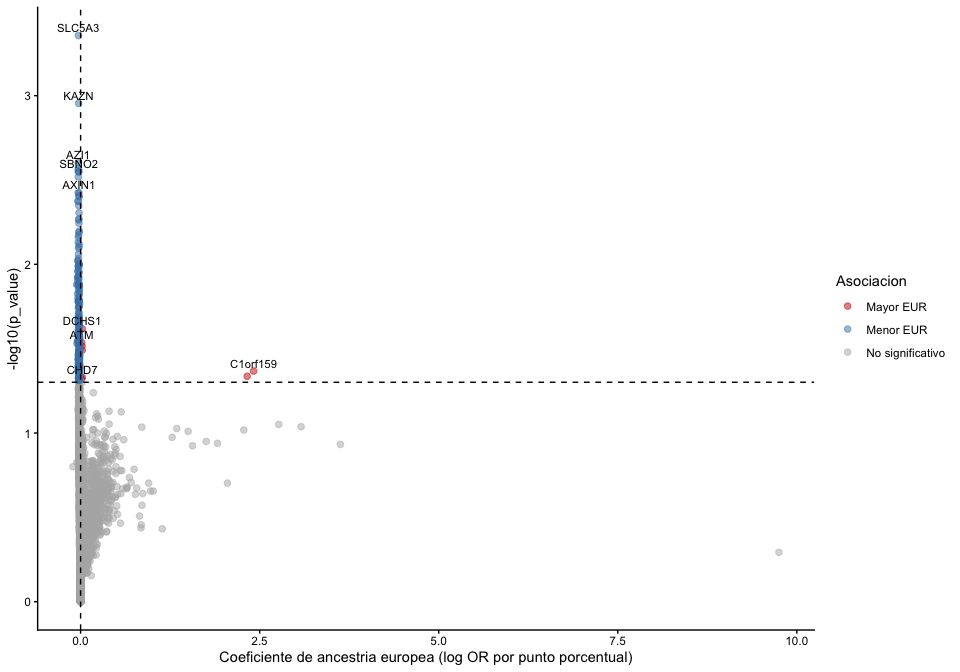<!-- -->


``` r
# Porcentaje de EUR en las mismas muestras usadas para el modelo de ancestria.
datos_estado_eur <- metadata_ancestria %>%
  select(Tumor_Sample_Barcode, EUR) %>%
  mutate(ATM = matriz_binaria["ATM", Tumor_Sample_Barcode],
         SLC5A3 = matriz_binaria["SLC5A3", Tumor_Sample_Barcode]) %>%
  pivot_longer(c(ATM, SLC5A3), names_to = "gen", values_to = "mutado")

ggplot(datos_estado_eur, aes(x = factor(mutado), y = EUR, fill = factor(mutado))) +
  geom_boxplot(outlier.shape = NA) +
  geom_jitter(width = 0.15, alpha = 0.5, size = 1) +
  facet_wrap(~ gen) +
  scale_x_discrete(labels = c("FALSE" = "No mutado", "TRUE" = "Mutado")) +
  scale_fill_manual(values = c("FALSE" = "grey80", "TRUE" = "tomato")) +
  labs(x = "Estado mutacional", y = "Ancestria europea (%)") +
  theme_classic() +
  theme(legend.position = "none")
```

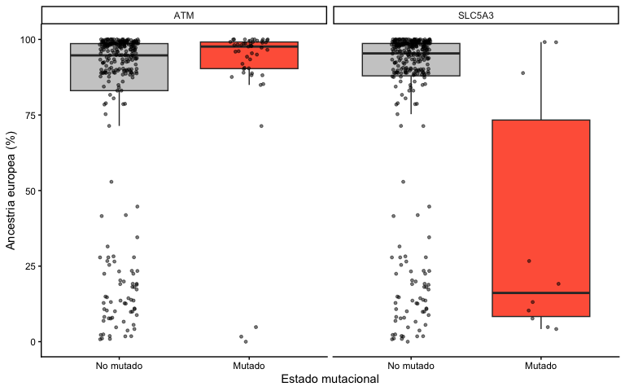<!-- -->


``` r
# BiocManager::install(c("clusterProfiler", "enrichplot"))
# install.packages("msigdbr")
library(clusterProfiler)
```

```
## 
```

```
## clusterProfiler v4.14.6 Learn more at https://yulab-smu.top/contribution-knowledge-mining/
## 
## Please cite:
## 
## T Wu, E Hu, S Xu, M Chen, P Guo, Z Dai, T Feng, L Zhou, W Tang, L Zhan,
## X Fu, S Liu, X Bo, and G Yu. clusterProfiler 4.0: A universal
## enrichment tool for interpreting omics data. The Innovation. 2021,
## 2(3):100141
```

```
## 
## Attaching package: 'clusterProfiler'
```

```
## The following object is masked from 'package:purrr':
## 
##     simplify
```

```
## The following object is masked from 'package:stats':
## 
##     filter
```

``` r
library(msigdbr)
library(enrichplot)
```

```
## enrichplot v1.26.6 Learn more at https://yulab-smu.top/contribution-knowledge-mining/
## 
## Please cite:
## 
## G Yu. Thirteen years of clusterProfiler. The Innovation. 2024,
## 5(6):100722
```

``` r
# reemplaza el FDR para ser más exigente por ejemplo : 0.001 
genes_enriquecimiento_msi <- genes_msi_true %>% filter(FDR < 0.05) %>% pull(gen) 
hallmark <- msigdbr(species = "Homo sapiens", collection = "H") %>%
  dplyr::select(gs_name, gene_symbol) %>% distinct()

enriquecimiento_msi <- enricher(
  gene = genes_enriquecimiento_msi,
  universe = resultados_msi$gen[!is.na(resultados_msi$p_value)],
  TERM2GENE = hallmark, pAdjustMethod = "BH",
  pvalueCutoff = 0.1, qvalueCutoff = 0.2
)

dotplot(enriquecimiento_msi, showCategory = 15)
```

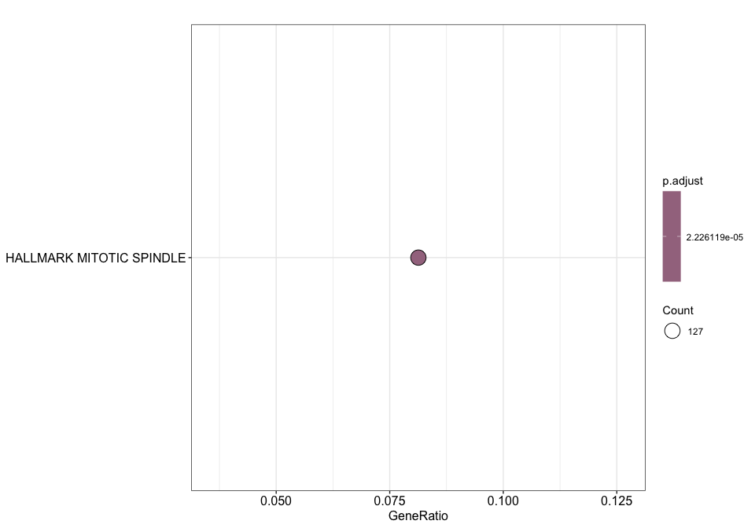<!-- -->
El escaso enriquecimiento Hallmark es compatible con un patrón mutacional amplio asociado a MSI y a defectos de reparación MMR. Algunas asociaciones podrían reflejar la mayor carga mutacional; ajustar por TMB permitiría evaluar asociaciones independientes de esta, sin identificar necesariamente genes causantes de MSI. Además, una lista extensa de genes puede dificultar la identificación de conjuntos específicos. Como exploración adicional, podrían seleccionarse genes mediante criterios predefinidos de FDR, OR y frecuencia mutacional.
